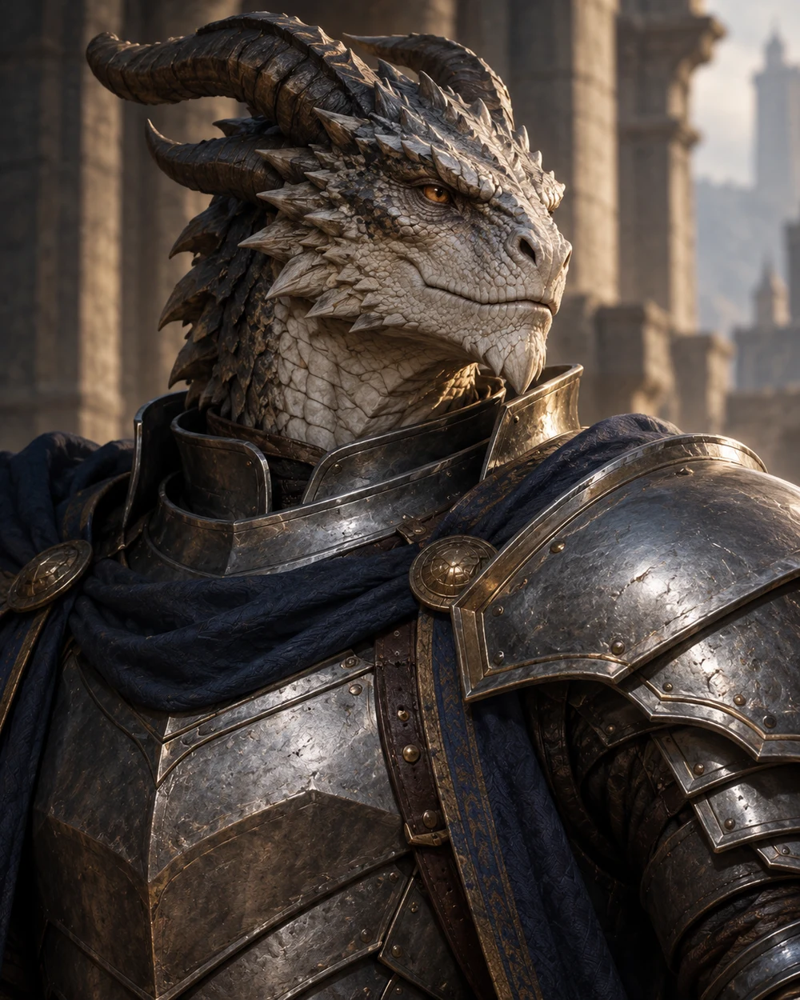

# Aaron Fortisax

<!-- page-summary:start -->

The Dragonborn Paladin commanding New Ostium’s formidable, well-funded City Guard, whose excellent weapons and strength make confrontation an exceptionally dangerous choice.

<!-- page-summary:end -->

<!-- character-profile:start -->

> [!character] Character quick reference
>
> > [!profile] Key information
> >
> > | Detail | Record |
> > | --- | --- |
> > | Species | Dragonborn |
> > | Age | Unknown |
> > | Pronouns | he/him |
> > | Role | Leader of the New Ostium City Guard; Paladin |
> > | Faction / affiliation | [[Factions/New Ostium City Guard\|New Ostium City Guard]] |
> > | Current location | [[Locations/New Ostium\|New Ostium]] |
> > | Status | alive |
> >
> > **In play:** Aaron leads the [[Factions/New Ostium City Guard|New Ostium City Guard]] in [[Locations/New Ostium|New Ostium]]. He is a Paladin and commands a well-funded force with excellent weapons. His authority rests on a formidable organization as well as his position at its head.
>
> > [!portrait] Portrait
> >
> > <!-- campaign-artwork:start -->
> >
> > 
> >
> > *Visual reference: Aaron Fortisax — campaign portrait — OpenAI image generation, directed for the campaign. Proposed appearance only. [[Attachments/Artwork Credits|Credits and interpretation]].*
> >
> > <!-- campaign-artwork:end -->

<!-- character-profile:end -->

## Overview

Aaron leads the [[Factions/New Ostium City Guard|New Ostium City Guard]] in [[Locations/New Ostium|New Ostium]]. He is a Paladin and commands a well-funded force with excellent weapons. His authority rests on a formidable organization as well as his position at its head.

## Appearance & Personality

**Unknown / TBD:** Age, scale coloration, appearance, personal history, and individual temperament have not been established. Paladin does not establish an alignment, deity, or oath.

## Motivations & Goals

His command's immediate responsibility is city order and law enforcement. Personal ambitions and convictions beyond that role remain **Unknown / TBD**.

## Relationships, Resources & Affiliations

- [[Characters/NPCs/Mira Vey|Lieutenant Mira Vey]] coordinates patrols and investigations under his command.
- The Guard has good funding and excellent weapons; no specific magic items or personal loadout have been established.
- [[Factions/New Ostium Government|New Ostium Government]] retains its civic leadership and existing City Marshal. Aaron's precise reporting relationship to those officials is **Unknown / TBD**.

## Current Location

Based in [[Locations/New Ostium|New Ostium]]. No headquarters or exact current posting is established.

## Knowledge & Secrets

Command gives him a reason to receive reports on city security; specific knowledge, secrets, and awareness of PC activities are **Unknown / TBD**. Do not treat him as automatically aware of undiscovered crimes.

## Campaign Role & Possible Interactions

Aaron is an authority the party can approach with credible evidence, requests for lawful assistance, or an explanation of coercion. Meetings and responses are **possible interactions**, not recorded events.

> [!danger] Avoid confrontation
> The PCs should not fight Aaron or the City Guard under any circumstances, especially at low levels. Make their formidable strength clear before a confrontation. Open combat in New Ostium risks an organized Guard response; negotiation, cooperation, and de-escalation are meaningful options.

## Knowledge & Lore Status

- **Canon:** Aaron Fortisax is a Dragonborn Paladin and leader of the New Ostium City Guard.
- **PCs know:** No meeting or revelation recorded yet.
- **Unknown / TBD:** Background, age, oath, deity, level, personal equipment, and combat profile.

## Mechanics — D&D 5e (2024)

Paladin is the GM-established character concept. No class build, subclass, spells, level, Challenge Rating, or official NPC profile is assigned. Verify any future rules profile under [[Rules/System Guide|System Guide]] before use. No Daggerheart conversion is assigned.

## Session References & Changes

No completed appearance recorded; possible interactions remain preparation.

<!-- page-connections:start -->

> [!info]- Connected Pages
> Location mentions are references; Within and Contained locations record geography.
>
> | Connection | Follow links |
> | --- | --- |
> | People | [[Characters/NPCs/Mira Vey\|Mira Vey]] |
> | Referenced locations | [[Locations/New Ostium\|New Ostium]] |
> | Factions | [[Factions/New Ostium City Guard\|New Ostium City Guard]] · [[Factions/New Ostium Government\|New Ostium Government]] |
>
> ### Adventures & Encounters
>
> | Adventure / state | Situation |
> | --- | --- |
> | [[Storylines/Adventures/Heist II\|Heist II]] — prepared | A prepared resource theft targeting concentrated Guild wealth to help Old Ostium, with consequences for law, trade, and faction relationships. |
> | [[Storylines/Adventures/The Heist\|The Heist]] — prepared | A prepared Shattered Axe coercion job to steal an artifact from a New Ostium museum, with room to resist, negotiate, or redirect the threat. |

<!-- page-connections:end -->
