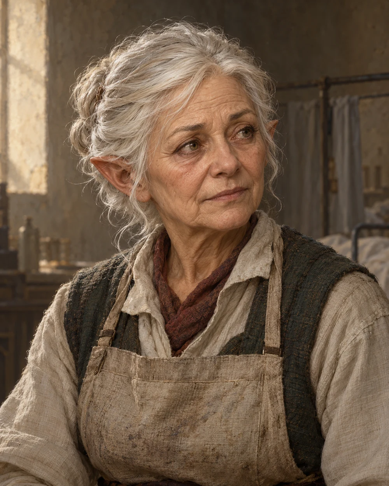

# Arla Gerrin

<!-- page-summary:start -->

An overworked Old Ostium apothecary who can distinguish Frigid Woe from the Rot and refer the party to help, but has no antidote herself.

<!-- page-summary:end -->

<!-- character-profile:start -->

> [!character] Character quick reference
>
> > [!profile] Key information
> >
> > | Detail | Record |
> > | --- | --- |
> > | Species | Gnome |
> > | Age | 72 (estimate) |
> > | Pronouns | Not recorded |
> > | Role | Apothecary |
> > | Faction / affiliation | Not established |
> > | Current location | [[Locations/Old Ostium Hospital District\|Old Ostium Hospital District]] |
> > | Status | alive |
> >
> > **In play:** Works in [[Locations/Old Ostium Hospital District|the Old Hospital Quarter]] of [[Locations/Old Ostium|Old Ostium]].
> >
> > *Age estimate: Proposed estimate for an experienced, overworked apothecary; no dated biography is established.*
>
> > [!portrait] Portrait
> >
> > <!-- campaign-artwork:start -->
> >
> > 
> >
> > *Visual reference: Older Gnome Character Design Commission — [oasiswinds](https://www.deviantart.com/oasiswinds/art/Older-Gnome-Character-Design-Commission-909716251). [[Attachments/Artwork Credits|Credits and interpretation]].*
> >
> > <!-- campaign-artwork:end -->

<!-- character-profile:end -->

<!-- page-connections:start -->

## Connected Pages

Location links are document references; geographic containment is shown in the Within and Contained locations rows.

| Connection | Follow links |
| --- | --- |
| People | [[Characters/NPCs/Mara Voss\|Mara Voss]] · [[Characters/NPCs/Shanda Karth\|Shanda Karth]] |
| Referenced locations | [[Locations/New Ostium\|New Ostium]] · [[Locations/Old Ostium\|Old Ostium]] · [[Locations/Old Ostium Hospital District\|Old Ostium Hospital District]] |
| Campaign & lore | [[Creatures and Afflictions/Frigid Woe\|Frigid Woe]] |

### Adventures & Encounters

| Adventure / state | Situation |
| --- | --- |
| [[Storylines/Adventures/The Road to Ostium\|The Road to Ostium]] — prepared | A prepared caravan journey and city investigation opening several routes to Frigid Woe antidote through danger, medical referrals, and negotiation. |

> [!example]- Session references
> A link records a mention, not proof of an appearance or revelation. Read each report for actual outcomes.
>
> | Record | Table | State |
> | --- | --- | --- |
> | [[Session Logs/Oliver's Table/Session 2\|Session 2 — The Road to Ostium — Preparation]] | Oliver's Table | planned |

<!-- page-connections:end -->

## At a Glance

**Species (D&D 2024):** Gnome

- Works in [[Locations/Old Ostium Hospital District|the Old Hospital Quarter]] of [[Locations/Old Ostium|Old Ostium]].
- Chronically overworked treating Rot patients and injuries from bandit attacks and other hazards.
- Recognizes that the PCs' affliction is distinct from the Rot; knows about [[Creatures and Afflictions/Frigid Woe|Frigid Woe]].
- Has **no antidote**. Refers the party to [[Characters/NPCs/Shanda Karth|Shanda Karth]] in [[Locations/New Ostium|New Ostium]].

## What They Know

- **Freely:** their illness does not match the Rot; Frigid Woe is a known affliction; Shanda obtained antidote.
- **On further questioning:** she cannot supply the cure herself. Exact knowledge of ancient origins or northern stockpiles is not established.
- Describe only symptoms already established at this table; see the disease note before improvising a diagnosis.

## Motives & Portrayal — Tentative

- Competent, exhausted, impatient but compassionate; wants to keep patients alive without wasting scarce supplies.
- Suspicious of a claimed Rot diagnosis that lacks its recognizable signs; scrutinizes symptoms rather than blaming patients.
- Can share information more readily than material aid.

## Dialogue — Tentative Prompts

- “Tell me what changed, and when. Let me look before you call it the Rot.”
- “This is different. Frigid Woe. I have no antidote, but Shanda Karth obtained some.”
- “You can help carry water while I finish here. You don't have to earn an answer.”

## Hidden Alliances & Relationships

- Works in the same district as [[Characters/NPCs/Mara Voss|Mara Voss]]; no new reporting hierarchy is established.

## GM Notes

- Diagnostic information is not payment for a chore or locked behind a successful roll.

## PC Knowledge

_No encounter or revelation recorded yet; this is a continuity note, not a publishing restriction._

## D&D 5e (2024) Mechanics

Narrative NPC first. No D&D stat block, class build, spell list, or Challenge Rating has been assigned. If a meaningful uncertain interaction needs a check, use the approach-based guidance in [[Rules/System Guide|System Guide]]; essential information is not gated by a single check. Choose and verify a separate 2024-compatible profile only if conflict requires it. Any older profile must name its source and edition.

## Daggerheart Mechanics

No numerical profile assigned. See [[Rules/System Guide|System Guide]] for optional roles and approach-based resolution.

## Session Appearances

No completed appearance recorded; planned appearances are preparation, not history.
