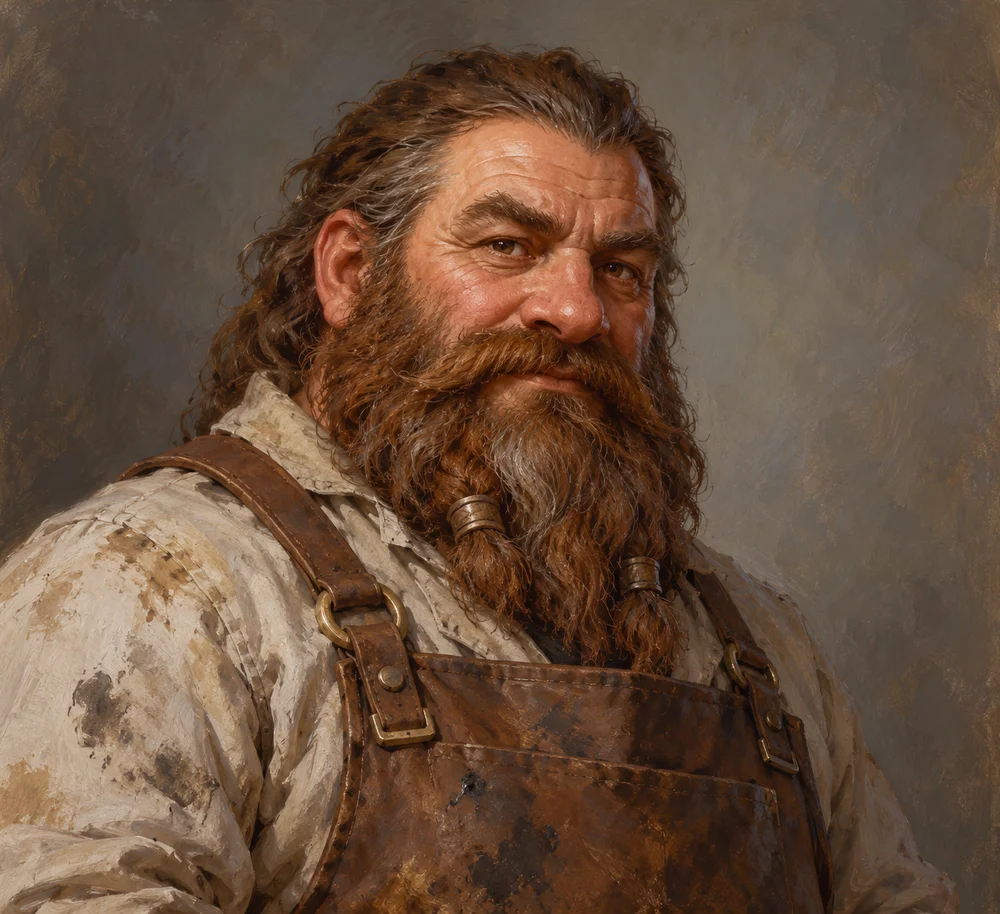

# Brock Drungur

<!-- page-summary:start -->

The senior waterworks engineer keeping Ostium alive with salvage, expertise, and too few hands; he knows a third way to solve the Pump 7 crisis.

<!-- page-summary:end -->

<!-- character-profile:start -->

> [!character] Character quick reference
>
> > [!profile] Key information
> >
> > | Detail | Record |
> > | --- | --- |
> > | Species | Dwarf |
> > | Age | 58 |
> > | Pronouns | he/him |
> > | Role | Senior waterworks engineer |
> > | Faction / affiliation | [[Factions/Old Ostium Engineers\|Old Ostium Engineers]] |
> > | Current location | [[Locations/Old Ostium Waterworks\|Old Ostium Waterworks]] |
> > | Status | alive |
> >
> > **In play:** Technical oracle for the waterworks and the person who reveals Pump 7's third option
> >
> > **Wants now:** Keep everything running one more day and get enough help to prevent a cascading failure.
> >
> > **Portrayal:** Gruff muttering; explains systems with hands, tools, and insults directed at broken machinery.
> >
> > **Attitude:** Irritated by amateurs, instantly attentive to anyone who actually listens to technical constraints.
>
> > [!portrait] Portrait
> >
> > <!-- campaign-artwork:start -->
> >
> > 
> >
> > *Visual reference: Brock Drungur — campaign portrait — OpenAI image generation; directed for the Ostium campaign. AI-generated campaign illustration; [source](https://openai.com/policies/terms-of-use/). Appearance, clothing, props, and effects are illustrative, not new canon. [[Attachments/Artwork Credits|Credits and interpretation]].*
> >
> > <!-- campaign-artwork:end -->

<!-- character-profile:end -->

<!-- page-connections:start -->

## Connected Pages

Location links are document references; geographic containment is shown in the Within and Contained locations rows.

| Connection | Follow links |
| --- | --- |
| People | [[Characters/NPCs/Senn Vale\|Senn Vale]] · [[Characters/NPCs/Taran Lusat\|Taran Lusat]] |
| Referenced locations | [[Locations/Old Ostium Waterworks\|Old Ostium Waterworks]] · [[Locations/Titan Works\|Titan Works]] |
| Factions | [[Factions/Old Ostium Engineers\|Old Ostium Engineers]] |

### Adventures & Encounters

| Adventure / state | Situation |
| --- | --- |
| [[Storylines/Adventures/Negotiations\|Negotiations]] — prepared | A prepared political adventure turning the cities’ unavoidable interdependence into workable cooperation, if their competing needs can be reconciled. |
| [[Storylines/Adventures/Pump 7\|Pump 7]] — prepared | A prepared infrastructure crisis offering alternatives to a choice that merely shifts catastrophe between Old and New Ostium. |
| [[Storylines/Adventures/The Prodigal Son\|The Prodigal Son]] — prepared | A prepared family rescue that becomes a civic dilemma: Egbert wants Taran home, but the Hospital District depends on his engineering. |

<!-- page-connections:end -->

## At a Glance

**Species (D&D 2024):** Dwarf

**Role in campaign:** Technical oracle for the waterworks and the person who reveals Pump 7's third option\
**Usual Location:** [[Locations/Old Ostium Waterworks|Old Ostium Waterworks]]\
**Current agenda:** Keep everything running one more day and get enough help to prevent a cascading failure.\
**Disposition toward party:** Irritated by amateurs, instantly attentive to anyone who actually listens to technical constraints.\
**Voice / portrayal:** Gruff muttering; explains systems with hands, tools, and insults directed at broken machinery.\
**What changes their mind:** Competence, tools, parts, or proof the party can survive a job he cannot leave his post to attempt.\

## Secrets

- When [[Storylines/Adventures/Pump 7|Pump 7]] reaches its apparent binary choice, Brock knows there is a third option: repair the exhaust system rather than accept the obvious tradeoff.
- He is afraid to make the dangerous deeper repair himself, although he frames this as a practical truth: if something happens to him, there may be nobody left who can keep the larger network alive. That claim is likely true.
- Brock has seen structural elements that do not match any known Ostium-era engineering, but he does not yet understand the full truth of [[Locations/Titan Works|Titan Works]].

## Motives

- Keep the city alive through maintenance.
- Avoid heroic gestures that leave essential systems without their only expert.
- Train anyone competent enough to reduce the single point of failure he has become, even if he complains constantly while doing it.

## Hidden Alliances & Relationships

- [[Characters/NPCs/Senn Vale|Senn Vale]] is one of the few people he trusts with major pump operations.
- [[Characters/NPCs/Taran Lusat|Taran Lusat]] has valuable theory and local systems knowledge.
- Both Old and New Ostium depend on work done by the [[Factions/Old Ostium Engineers|Old Ostium Engineers]].

## Backstory

Brock spent most of his life inside the municipal works. The collapse did not change his job so much as remove most of the institution around it. He now performs emergency maintenance with salvage and improvised crews while politicians on both sides often notice the waterworks only when something stops working.

## What They Know

- [[Locations/Old Ostium Waterworks|Old Ostium Waterworks]] almost by memory.
- Pump 4 and Pump 7 service routes.
- Old engineering drawings and where they cease to explain what is physically present.
- Practical evidence of a much older underlying system.

## Current Plans

- Keep Pump 4 stable.
- Find a viable solution to Pump 7.
- Push dangerous fieldwork onto people who can leave the central maintenance network without bringing it down.

## D&D 5e (2024) Mechanics

Narrative NPC first. No D&D stat block, class build, spell list, or Challenge Rating has been assigned. If a meaningful uncertain interaction needs a check, use the approach-based guidance in [[Rules/System Guide|System Guide]]; essential information is not gated by a single check. Choose and verify a separate 2024-compatible profile only if conflict requires it. Any older profile must name its source and edition.

## Daggerheart Mechanics

> Existing campaign homebrew / narrative guidance, retained independently. Check against the adopted SRD before use; no direct D&D conversion.

**Tier:** 1\
**Type:** Support\
**Description:** A veteran engineer whose real power is technical knowledge rather than combat.\
**Motives & Tactics:** Repair, warn, improvise, refuse to abandon essential systems.\
**Difficulty:** 11\
**Thresholds:** Major 8 / Severe 13\
**HP:** 5\
**Stress:** 6\
**Attack Modifier:** +0\
**Standard Attack:** Pipe Wrench — Melee — 1d6+2 physical.

### Experiences

- **Waterworks Master:** +3
- **Improvised Repair:** +3

### Features

- **Seen This Fail Before — Passive:** When Brock can inspect a civic mechanism, the GM should provide a concrete warning about the most likely catastrophic failure before the party commits to a plan.
- **Make Do — Action:** Mark a Stress to turn plausible salvage into a temporary repair, bypass, brace, or tool that lasts for the current scene.

### Fear Features

- None prepared.

## GM Notes

- Keep portrayal grounded in the faction and material pressures around them.

## PC Knowledge

_No encounter or revelation recorded yet; this is a continuity note, not a publishing restriction._

## Session Appearances

No completed appearance recorded; planned appearances are preparation, not history.
