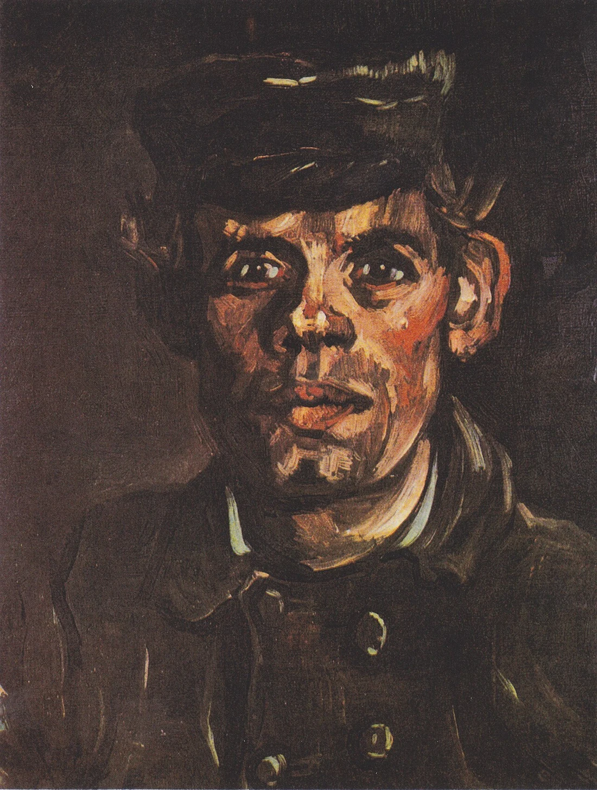

# Carl Marsh

<!-- page-summary:start -->

A cleric drawn into Shattered Axe banditry to feed his wife and obtain medicine for his daughter; desperation explains his choices without erasing their harm.

<!-- page-summary:end -->

<!-- character-profile:start -->

> [!character] Character quick reference
>
> > [!profile] Key information
> >
> > | Detail | Record |
> > | --- | --- |
> > | Species | Human |
> > | Age | 37 (estimate) |
> > | Pronouns | Not recorded |
> > | Role | Cleric; bandit |
> > | Faction / affiliation | [[Factions/The Shattered Axe\|The Shattered Axe]] |
> > | Current location | Road to Ostium |
> > | Status | alive |
> >
> > **In play:** Joined [[Factions/The Shattered Axe|The Shattered Axe]] to obtain money to feed his wife and medicine for his ill daughter in [[Locations/Old Ostium|Old Ostium]].
> >
> > *Age estimate: Proposed estimate for an adult husband and father supporting a dependent daughter; not a fixed family chronology.*
>
> > [!portrait] Portrait
> >
> > <!-- campaign-artwork:start -->
> >
> > 
> >
> > *Visual reference: Head of a Young Peasant in a Peaked Cap — Vincent van Gogh. [Public domain](https://creativecommons.org/publicdomain/mark/1.0/); [source](https://commons.wikimedia.org/wiki/File:Van_Gogh_-_Kopf_eines_jungen_Bauern_mit_M%C3%BCtze.jpeg). Appearance, clothing, props, and effects are illustrative, not new canon. [[Attachments/Artwork Credits|Credits and interpretation]].*
> >
> > <!-- campaign-artwork:end -->

<!-- character-profile:end -->

## At a Glance

- Joined [[Factions/The Shattered Axe|The Shattered Axe]] to obtain money to feed his wife and medicine for his ill daughter in [[Locations/Old Ostium|Old Ostium]].
- Participates in [[Characters/NPCs/Korok Grund|Korok Grund]]'s ambush; alive at session start.
- Desperation rather than cruelty is his primary motive. His daughter's illness, family names, and exact home are **TBD**.

## Secrets & Motives

- Family needs explain his choices without erasing the harm of stealing food and medicine from others.
- No faction-wide redemption or knowledge of Frigid Woe follows from his story.

## Discoverable Clues — Tentative

- [[Attachments/Carl Marsh - Unsent Letter|An unsent letter]] on his person or dropped during retreat; prepare it as an optional handout.
- Reluctance to hurt civilians; conversation after capture or voluntary surrender; an appeal for mercy.
- If he dies or escapes, use the letter or another survivor to retain the human context. No single roll is the sole route.

## Dialogue — Tentative Prompts

- “My daughter needs medicine. I don't have a better answer than that.”
- “Don't hurt the driver. We came for supplies.”
- “You can take my weapon. Please hear me first.”

## Choices & Consequences — Tentative

- Helping his family could open a relationship in Old Ostium; decide their situation when visited.
- Surrender can lead to disarmament, restitution, release, or custody as the PCs choose; local consequences depend on witnesses and jurisdiction.
- Keep poverty, inadequate healthcare, and Old/New inequalities concrete. His profession does not establish healing abilities or a cure for either disease.

## What They Know

- His family's need, his own participation, and the raid's immediate aims. No ancient-disease expertise established.

## GM Notes

- No exact illness, mechanical build, or predetermined redemption arc.

## PC Knowledge

_No encounter or revelation recorded yet; this is a continuity note, not a publishing restriction._

## D&D 5e (2024) Mechanics

**Planned encounter profile:** use the official revised **Bandit** (SRD 5.2.1) for [[Encounters/Roadside Ambush|Roadside Ambush]], prepared for three level-1 PCs. The encounter page embeds the complete profile and links to 5e.tools; use its tactics and morale. This assignment is preparation, not a completed combat or a PC class build. Species does not add mechanical features automatically. For other encounters, reassess party size and resources; essential information remains available without a single gating check.

## Daggerheart Mechanics

No numerical profile assigned. See [[Rules/System Guide|System Guide]] for optional roles and approach-based resolution.

## Session Appearances

No completed appearance recorded; planned appearances are preparation, not history.

<!-- page-connections:start -->

> [!info]- Connected Pages
> Location mentions are references; Within and Contained locations record geography.
>
> | Connection | Follow links |
> | --- | --- |
> | People | [[Characters/NPCs/Korok Grund\|Korok Grund]] |
> | Referenced locations | [[Locations/Old Ostium\|Old Ostium]] |
> | Factions | [[Factions/The Shattered Axe\|The Shattered Axe]] |
>
> ### Adventures & Encounters
>
> | Adventure / state | Situation |
> | --- | --- |
> | [[Encounters/Roadside Ambush\|Roadside Ambush]] — prepared | A prepared caravan robbery by Shattered Axe bandits posing as city guards, with options to detect the deception, negotiate, evade, or fight. |
> | [[Storylines/Adventures/The Road to Ostium\|The Road to Ostium]] — prepared | A prepared caravan journey and city investigation opening several routes to Frigid Woe antidote through danger, medical referrals, and negotiation. |
>
> > [!example]- Session references
> > A link records a mention, not proof of an appearance or revelation. Read each report for actual outcomes.
> >
> > | Record | Table | State |
> > | --- | --- | --- |
> > | [[Session Logs/Oliver's Table/Session 2\|Session 2 — The Road to Ostium — Preparation]] | Oliver's Table | planned |

<!-- page-connections:end -->
