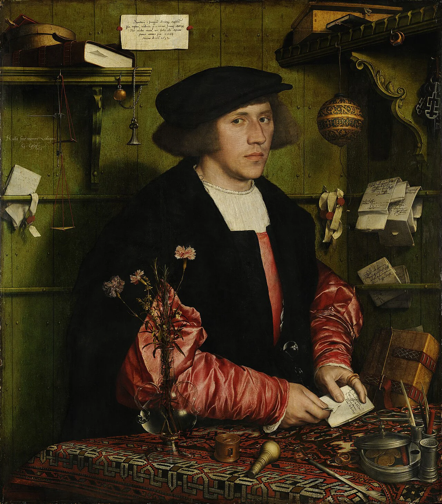

# Darian Auir

<!-- campaign-artwork:start -->

*Visual reference: Portrait of the Merchant Georg Gisze — [Hans Holbein the Younger](https://commons.wikimedia.org/wiki/File:Hans_Holbein_der_J%C3%BCngere_-_Der_Kaufmann_Georg_Gisze_-_Google_Art_Project.jpg). [[Attachments/Artwork Credits|Credits and interpretation]].*

<!-- campaign-artwork:end -->

## At a Glance

**Species (D&D 2024):** Human

- Drives the caravan transporting the PCs toward [[Locations/Ostium|Ostium]].
- **Cargo:** food, medical supplies, and gold intended for use in the city.
- Alive at the start of [[Session Logs/Session Prep — The Road to Ostium|Session Prep — The Road to Ostium]]. Later status depends on play.
- The caravan is targeted by [[Factions/The Shattered Axe|The Shattered Axe]] under [[Characters/NPCs/Korok Grund|Korok Grund]].

## Motives & Portrayal — Tentative

- Practical and watchful; knows the roads are dangerous but relies on the trade route for his livelihood.
- Wants passengers and cargo to arrive safely; may accept losing a portion of cargo to save lives.
- Proposed contacts among Ostium merchants and suppliers are unassigned; do not invent a guaranteed antidote source.

## What They Know

- Established: destination and cargo. No disease expertise or knowledge of antidote supplies is established.
- Tentative: can explain ordinary road risks and seek an introduction to a supplier.

## Dialogue — Tentative Prompts

- “Food, medicine, coin. Everyone needs the first two; everyone notices the third.”
- “Keep an eye on the road ahead. I need the horses calm if something happens.”
- “I want my cargo back. I'd rather not bury anyone to get it.”

## Possible Reactions — Tentative

- Bandits spared: relieved if danger ends; wary of releasing armed attackers immediately.
- Carl's family: sympathetic but angry that stolen medicine would deprive other patients.
- Cargo lost: seeks safe arrival and recovery options; does not compel a revenge quest.

## GM Notes

- His reactions respond to the party's actions, rather than dictating a moral verdict.

## PC Knowledge

_No encounter or revelation recorded yet; this is a continuity note, not a publishing restriction._

## D&D 5e (2024) Mechanics

Narrative NPC first. No D&D stat block, class build, spell list, or Challenge Rating has been assigned. If a meaningful uncertain interaction needs a check, use the approach-based guidance in [[Rules/System Guide|System Guide]]; essential information is not gated by a single check. Choose and verify a separate 2024-compatible profile only if conflict requires it. Any older profile must name its source and edition.

## Daggerheart Mechanics

No numerical profile assigned. See [[Rules/System Guide|System Guide]] for optional roles and approach-based resolution.

## Session Appearances

No completed appearance recorded; planned appearances are preparation, not history.
