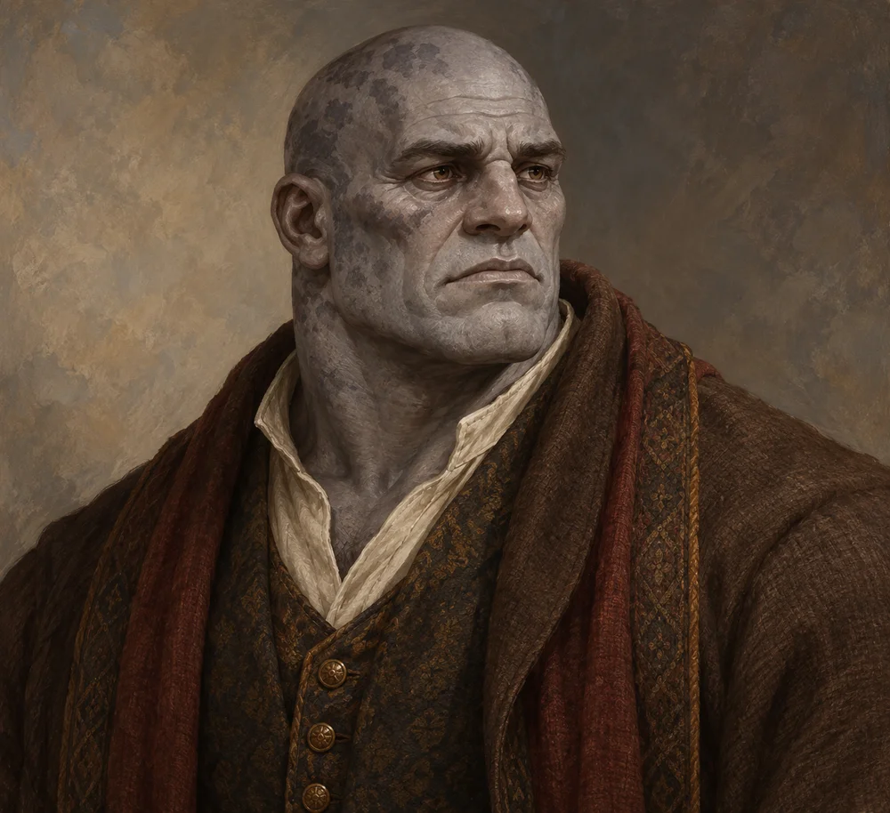

# Egbert Lusat

<!-- page-summary:start -->

A protective father seeking Taran’s return from Old Ostium, and the owner of two reserved Frigid Woe antidote vials that may become part of a negotiated bargain.

<!-- page-summary:end -->

<!-- character-profile:start -->

> [!character] Character quick reference
>
> > [!profile] Key information
> >
> > | Detail | Record |
> > | --- | --- |
> > | Species | Goliath |
> > | Age | 58 |
> > | Pronouns | he/him |
> > | Role | Wealthy merchant and former Old Ostium resident |
> > | Faction / affiliation | Not established |
> > | Current location | [[Locations/New Ostium\|New Ostium]] |
> > | Status | alive |
> >
> > **In play:** Prodigal Son patron and owner of the two reserved Frigid Woe antidote vials
> >
> > **Wants now:** Protect his children, including Sara and both sons, resolve Taran's dangerous situation, and retain or replace the family's access to Frigid Woe treatment.
> >
> > **Portrayal:** Measured merchant's diction; precise until frightened, then abruptly personal.
> >
> > **Attitude:** Reasonable, courteous, accommodating, and sympathetic to their illness; increasingly anxious about Taran, but willing to hear a credible compromise.
>
> > [!portrait] Portrait
> >
> > <!-- campaign-artwork:start -->
> >
> > 
> >
> > *Visual reference: Egbert Lusat — campaign portrait — OpenAI image generation; directed for the Ostium campaign. AI-generated campaign illustration; [source](https://openai.com/policies/terms-of-use/). Appearance, clothing, props, and effects are illustrative, not new canon. [[Attachments/Artwork Credits|Credits and interpretation]].*
> >
> > <!-- campaign-artwork:end -->

<!-- character-profile:end -->

<!-- page-connections:start -->

## Connected Pages

| Connection | Follow links |
| --- | --- |
| People | [[Characters/NPCs/Sara Lusat\|Sara Lusat]] · [[Characters/NPCs/Shanda Karth\|Shanda Karth]] · [[Characters/NPCs/Tara Lusat\|Tara Lusat]] · [[Characters/NPCs/Taran Lusat\|Taran Lusat]] |
| Locations | [[Locations/Mistbreak\|Mistbreak]] · [[Locations/New Ostium\|New Ostium]] |
| Factions | [[Factions/New Ostium Merchants Guild\|New Ostium Merchants Guild]] |
| Campaign & lore | [[Creatures and Afflictions/The Rot\|The Rot]] |

### Adventures & Encounters

| Adventure / state | Situation |
| --- | --- |
| [[Storylines/Adventures/The Prodigal Son\|The Prodigal Son]] — prepared | A prepared family rescue that becomes a civic dilemma: Egbert wants Taran home, but the Hospital District depends on his engineering. |
| [[Storylines/Adventures/The Road to Ostium\|The Road to Ostium]] — prepared | A prepared caravan journey and city investigation opening several routes to Frigid Woe antidote through danger, medical referrals, and negotiation. |

> [!example]- Session references
> A link records a mention, not proof of an appearance or revelation. Read each report for actual outcomes.
>
> | Record | Table | State |
> | --- | --- | --- |
> | [[Session Logs/Oliver's Table/Session 2\|Session 2 — The Road to Ostium — Preparation]] | Oliver's Table | planned |
> | [[Session Logs/Session 0 Prep\|Session 0 Prep]] | Unassigned | Planned |
> | [[Session Logs/Session 1 - The Prodigal Son Prep\|Session 1 - The Prodigal Son Prep]] | Unassigned | Planned |

<!-- page-connections:end -->

## At a Glance

**Species (D&D 2024):** Goliath

**Role in campaign:** Prodigal Son patron and owner of the two reserved Frigid Woe antidote vials\
**Usual Location:** [[Locations/New Ostium|New Ostium]]\
**Current agenda:** Protect his children, including Sara and both sons, resolve Taran's dangerous situation, and retain or replace the family's access to Frigid Woe treatment.\
**Disposition toward party:** Reasonable, courteous, accommodating, and sympathetic to their illness; increasingly anxious about Taran, but willing to hear a credible compromise.\
**Voice / portrayal:** Measured merchant's diction; precise until frightened, then abruptly personal.\
**What changes their mind:** Evidence that Taran can be kept safe without simply abandoning the Hospital District.\

## Secrets

- His wife, [[Characters/NPCs/Tara Lusat|Tara Lusat]], died from [[Creatures and Afflictions/The Rot|the Rot of Old Ostium]]. Her death made him exceptionally protective of his children; he sympathizes with the PCs' fear through his own experience of family loss.
- Taran's existing Rot affliction echoes the danger that took Tara. Frigid Woe remains a separate illness, and its antidote is not established as a treatment for the Rot.
- He may know more about Taran's recent symptoms than he initially admits, but he does not know the deep cause of the Rot.

## Motives

- Protect his children: [[Characters/NPCs/Sara Lusat|Sara Lusat]], [[Characters/NPCs/Taran Lusat|Taran Lusat]], and his unnamed second son.
- Preserve what remains of his family.
- Use wealth to solve a problem that wealth may not actually be able to solve.

## Hidden Alliances & Relationships

- [[Characters/NPCs/Taran Lusat|Taran Lusat]] is one of his **two sons**. The other son's name, age, location, and circumstances are **TBD**; no new quest or missing-son story is established.
- [[Characters/NPCs/Sara Lusat|Sara Lusat]] is his daughter and Taran's sister; her further details remain TBD.
- His wife, [[Characters/NPCs/Tara Lusat|Tara Lusat]], died from the Rot of Old Ostium; her date of death remains TBD.
- [[Characters/NPCs/Shanda Karth|Shanda Karth]] holds his two commissioned antidote vials, one reserved for each son.
- His connections to the [[Factions/New Ostium Merchants Guild|New Ostium Merchants Guild]] give him access to money and introductions, but not unlimited political power.

## Backstory

Egbert built wealth through trade during Ostium's prosperous years. When the city deteriorated he had the capital and contacts to relocate, a privilege most residents did not have. Tara's death from the Rot of Old Ostium turned that privilege into a source of guilt as much as comfort. He is determined to protect Sara and both sons. On hearing reports of Frigid Woe in the north, he commissioned Shanda to acquire two vials, one per son. The extraordinary cost seemed a necessary precaution; neither son is established as infected with Frigid Woe.

## What They Know

- Trade routes and merchant politics in New Ostium.
- The social divide between people who could relocate and those who could not.
- Enough about the Rot to fear early mental symptoms, but not its true origin.
- The personal cost of the Rot through Tara's death. His Frigid Woe precautions arise from northern reports and fear for his family, not from Tara having that illness. He knows the ownership/reservation of his two vials; no ancient-disease expertise is implied.
- Replacement from [[Locations/Mistbreak|Mistbreak]] can be discussed with Shanda; actual stock access, prices, travel time, and dose requirements remain unresolved.

## Current Plans

- Offer the existing [[Storylines/Adventures/The Prodigal Son|Prodigal Son quest]], potentially with the antidote as negotiated compensation; this is an opportunity, not a prerequisite for treatment.
- Press for a concrete plan to remove or treat Taran.
- If the party sides with Taran, Egbert may fund a compromise if convinced it genuinely improves his son's survival odds.
- Consider sale, other paid work, collateral, immediate transfer with credible assurances, or a Mistbreak replacement plan rather than insisting on one exchange.

## Antidote Negotiation — GM Quick Reference

**Canonical position:** compassionate grieving father, not a villain or miser. The vials belong to him, not Shanda. Giving them up risks his sons' protection as well as a considerable financial loss. He is more flexible than Shanda, who cannot dispose of a client's property independently.

**Priorities, in order:**

1. Protect his children, including Sara and both sons.
2. Resolve the circumstances of [[Storylines/Adventures/The Prodigal Son|The Prodigal Son]].
3. Retain or replace family access to Frigid Woe treatment.
4. Recover the considerable cost of the antidote.
5. Help others where he reasonably can.

| Offer | Negotiable response / boundary |
|---|---|
| Complete Prodigal Son | May agree to transfer the two vials on success under explicit negotiated terms. The objective remains resolving Taran's safety/duty conflict, not inventing another rescue or requiring forced extraction. |
| Buy one or both | May accept substantial payment that justifies replacement expense and risk. Exact price TBD; no universal refusal to sell. |
| Earn money elsewhere | PCs can undertake other work in Ostium and return to purchase medicine; no commitment to his quest required. |
| Replace supply from Mistbreak | Consider a credible retrieval/courier arrangement; agree who bears cost and delivery risk. Replacement stock and delivery are not guaranteed. |
| Immediate aid against assurances | May transfer one or both now if trust, collateral, or concrete assistance adequately addresses his sons' safety. Do not require the whole quest to finish first. |
| Different reasonable proposal | Listen and negotiate what each side gives, when, and how commitments can be honored. Compassion matters alongside family responsibility. |

**Run the conversation:** ask what the PCs need and what they can offer; acknowledge their danger; state the remaining family risk plainly. Evaluate offers, actions, and demonstrated trustworthiness. No single Persuasion roll is a gate to meeting him or learning the alternatives. If an optional D&D check is useful, use the existing [[Rules/System Guide|System Guide]] for an uncertain social approach; it can clarify concerns or improve a plausible concession, not compel agreement. Daggerheart interpretation remains separate below.

**Resource limits:** Sara's addition does not establish another vial or change the existing reservation for the two sons; her own antidote arrangements are TBD. Only **two vials**, held by Shanda, not a second cache at his home. Record any authorized transfer and whether Shanda has been informed. Number of doses needed per patient is still TBD; two vials are not automatically a cure for the whole party. No new deadline, Frigid Woe infection in either son, or Rot cure is established.

**Always available as alternatives:** courier, direct Mistbreak travel, other paid work, and investigation of other possible treatments without guaranteeing they exist. Theft remains a possible PC choice with consequences for trust, ownership, and family protection.

## D&D 5e (2024) Mechanics

Narrative NPC first. No D&D stat block, class build, spell list, or Challenge Rating has been assigned. If a meaningful uncertain interaction needs a check, use the approach-based guidance in [[Rules/System Guide|System Guide]]; essential information is not gated by a single check. Choose and verify a separate 2024-compatible profile only if conflict requires it. Any older profile must name its source and edition.

## Daggerheart Mechanics

> Existing campaign homebrew / narrative guidance, retained independently. Check against the adopted SRD before use; no direct D&D conversion.

**Mechanical use:** Narrative Social NPC. If a contested social scene needs mechanics, improvise a Social adversary at the party's current tier rather than treating Egbert as a combatant.

## GM Notes

- Keep portrayal grounded in the faction and material pressures around them.

## PC Knowledge

_No encounter or revelation recorded yet; this is a continuity note, not a publishing restriction._

## Session Appearances

No completed appearance recorded; planned appearances are preparation, not history.
