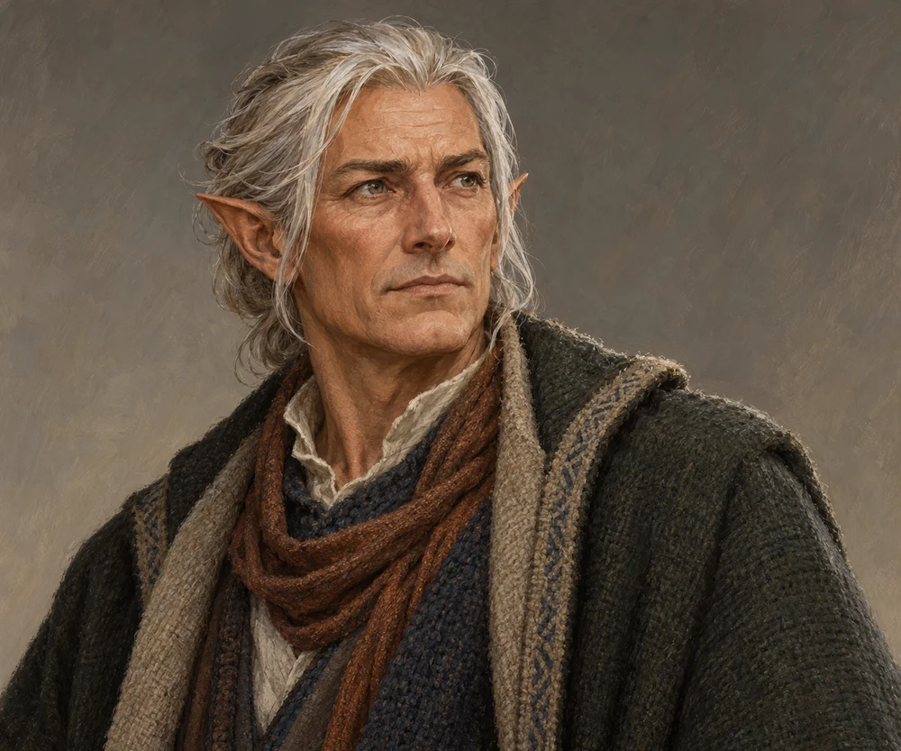

# Elro Aditower

<!-- character-profile:start -->

> [!character] Character quick reference
>
> > [!profile] Key information
> >
> > | Detail | Record |
> > | --- | --- |
> > | Species | Elf |
> > | Age | 112 (estimate) |
> > | Pronouns | Not recorded |
> > | Role | Mayor |
> > | Faction / affiliation | Not established |
> > | Current location | [[Locations/Mistbreak\|Mistbreak]] |
> > | Status | alive |
> >
> > **In play:** **Role:** Mayor of [[Locations/Mistbreak|Mistbreak]].
> >
> > *Age estimate: Proposed estimate for an established elven civic leader; no length of tenure is implied.*
>
> > [!portrait] Portrait
> >
> > <!-- campaign-artwork:start -->
> >
> > 
> >
> > *Visual reference: Elro Aditower — campaign portrait — OpenAI image generation; directed for the Ostium campaign. AI-generated campaign illustration; [source](https://openai.com/policies/terms-of-use/). Appearance, clothing, props, and effects are illustrative, not new canon. [[Attachments/Artwork Credits|Credits and interpretation]].*
> >
> > <!-- campaign-artwork:end -->

<!-- character-profile:end -->

## At a Glance

**Species (D&D 2024):** Elf

- **Role:** Mayor of [[Locations/Mistbreak|Mistbreak]].
- **Status:** Alive.

## What They Know

- Open question: exact knowledge of [[Creatures and Afflictions/Frigid Woe|Frigid Woe]] and authority over the stockpile. Do not assume control of the antidote.

## Motives & Portrayal — Tentative

- A pragmatic civic leader balancing residents' needs against outside interest in the antidote.
- Ask visitors how their plans protect the village as well as themselves.

## Hidden Alliances & Relationships

- Other village relationships: TBD.

## GM Notes

- No adversary block needed for the current session.

## PC Knowledge

_No encounter or revelation recorded yet; this is a continuity note, not a publishing restriction._

## D&D 5e (2024) Mechanics

Narrative NPC first. No D&D stat block, class build, spell list, or Challenge Rating has been assigned. If a meaningful uncertain interaction needs a check, use the approach-based guidance in [[Rules/System Guide|System Guide]]; essential information is not gated by a single check. Choose and verify a separate 2024-compatible profile only if conflict requires it. Any older profile must name its source and edition.

## Daggerheart Mechanics

No numerical profile assigned. See [[Rules/System Guide|System Guide]] for optional roles and approach-based resolution.

## Session Appearances

No completed appearance recorded; planned appearances are preparation, not history.
