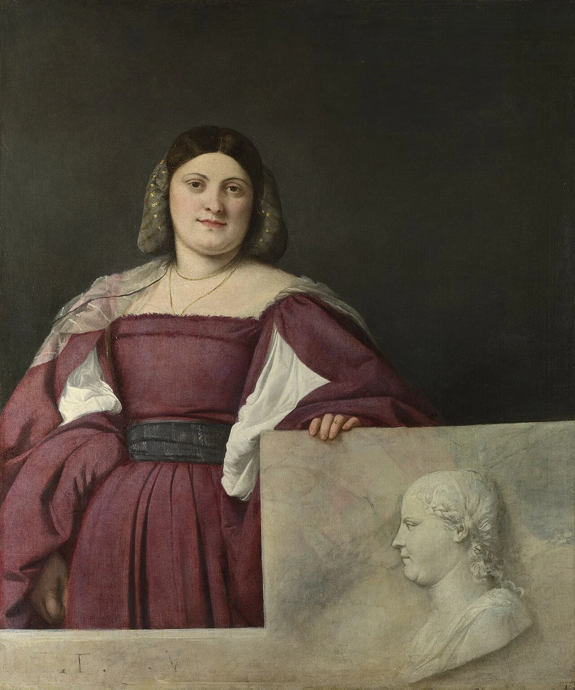

# Helena Orst

<!-- page-summary:start -->

New Ostium’s First Councillor, balancing housing, water, and public order against demands to take responsibility for the old city’s crisis.

<!-- page-summary:end -->

<!-- character-profile:start -->

> [!character] Character quick reference
>
> > [!profile] Key information
> >
> > | Detail | Record |
> > | --- | --- |
> > | Species | Human |
> > | Age | 46 |
> > | Pronouns | she/her |
> > | Role | First Councillor; civil administrator |
> > | Faction / affiliation | [[Factions/New Ostium Government\|New Ostium Government]] |
> > | Current location | [[Locations/New Ostium Town Hall\|New Ostium Town Hall]] |
> > | Status | alive |
> >
> > **In play:** Political face of New Ostium's defensible exclusion and scarcity
> >
> > **Wants now:** Maintain housing, water, public order, and legitimacy without allowing Old Ostium's crisis to overwhelm New Ostium.
> >
> > **Portrayal:** Formal civic language; always distinguishes compassion from capacity.
> >
> > **Attitude:** Polite to adventurers who solve concrete problems; suspicious of demands framed as limitless moral obligations.
>
> > [!portrait] Portrait
> >
> > <!-- campaign-artwork:start -->
> >
> > 
> >
> > *Visual reference: Portrait of a Lady (La Schiavona) — [Titian](https://commons.wikimedia.org/wiki/File:Titian_-_Portrait_of_a_Lady_(%27La_Schiavona%27)_-_Google_Art_Project.jpg). [[Attachments/Artwork Credits|Credits and interpretation]].*
> >
> > <!-- campaign-artwork:end -->

<!-- character-profile:end -->

## At a Glance

**Role in campaign:** Political face of New Ostium's defensible exclusion and scarcity\
**Usual Location:** [[Locations/New Ostium Town Hall|New Ostium Town Hall]]\
**Current agenda:** Maintain housing, water, public order, and legitimacy without allowing Old Ostium's crisis to overwhelm New Ostium.\
**Disposition toward party:** Polite to adventurers who solve concrete problems; suspicious of demands framed as limitless moral obligations.\
**Voice / portrayal:** Formal civic language; always distinguishes compassion from capacity.\
**What changes their mind:** Evidence that cooperation reduces New Ostium's risk rather than simply transferring costs to it.\

## Secrets

- Helena feels genuine responsibility toward Old Ostium residents but considers the old city outside New Ostium's administrative responsibility.
- She believes unrestricted refugee intake would create housing and supply failures that hurt current residents and newcomers alike.

## Motives

- Protect New Ostium.
- Avoid recreating Old Ostium's infrastructural collapse.
- Find bounded forms of cooperation that the city can actually sustain.

## Hidden Alliances & Relationships

- [[Characters/NPCs/Dalia Quent|Dalia Quent]] and the Merchants Guild control resources government often needs.
- The [[Factions/Old Ostium Engineers|Old Ostium Engineers]] create an uncomfortable interdependence because New Ostium still relies on infrastructure they help maintain.

## Backstory

Helena represents the generation of officials who turned emergency relocation structures into a permanent successor government. The wall became both a practical boundary and a moral wound.

## What They Know

- City housing and supply constraints.
- Water dependence.
- Government security posture.
- Political resistance to deeper obligations toward Old Ostium.

## Current Plans

- Keep the wall policy politically sustainable.
- Resolve Pump 7 without admitting uncontrolled dependence on Old Ostium.
- Consider negotiations if the party can create a credible framework.

## D&D 5e (2024) Mechanics

Narrative NPC first. No D&D stat block, class build, spell list, or Challenge Rating has been assigned. If a meaningful uncertain interaction needs a check, use the approach-based guidance in [[Rules/System Guide|System Guide]]; essential information is not gated by a single check. Choose and verify a separate 2024-compatible profile only if conflict requires it. Any older profile must name its source and edition.

## Daggerheart Mechanics

> Existing campaign homebrew / narrative guidance, retained independently. Check against the adopted SRD before use; no direct D&D conversion.

**Mechanical use:** Narrative Social NPC; use a Tier 2 Social profile for high-stakes negotiation.

## GM Notes

- Keep portrayal grounded in the faction and material pressures around them.

## PC Knowledge

_No encounter or revelation recorded yet; this is a continuity note, not a publishing restriction._

## Session Appearances

No completed appearance recorded; planned appearances are preparation, not history.

<!-- page-connections:start -->

> [!info]- Connected Pages
> Location mentions are references; Within and Contained locations record geography.
>
> | Connection | Follow links |
> | --- | --- |
> | People | [[Characters/NPCs/Dalia Quent\|Dalia Quent]] |
> | Referenced locations | [[Locations/New Ostium Town Hall\|New Ostium Town Hall]] |
> | Factions | [[Factions/New Ostium Government\|New Ostium Government]] · [[Factions/Old Ostium Engineers\|Old Ostium Engineers]] |
>
> ### Adventures & Encounters
>
> | Adventure / state | Situation |
> | --- | --- |
> | [[Storylines/Adventures/Negotiations\|Negotiations]] — prepared | A prepared political adventure turning the cities’ unavoidable interdependence into workable cooperation, if their competing needs can be reconciled. |
> | [[Storylines/Adventures/Pump 7\|Pump 7]] — prepared | A prepared infrastructure crisis offering alternatives to a choice that merely shifts catastrophe between Old and New Ostium. |
>
> > [!example]- Session references
> > A link records a mention, not proof of an appearance or revelation. Read each report for actual outcomes.
> >
> > | Record | Table | State |
> > | --- | --- | --- |
> > | [[Session Logs/Session 0 Prep\|Session 0 Prep]] | Unassigned | Planned |

<!-- page-connections:end -->
