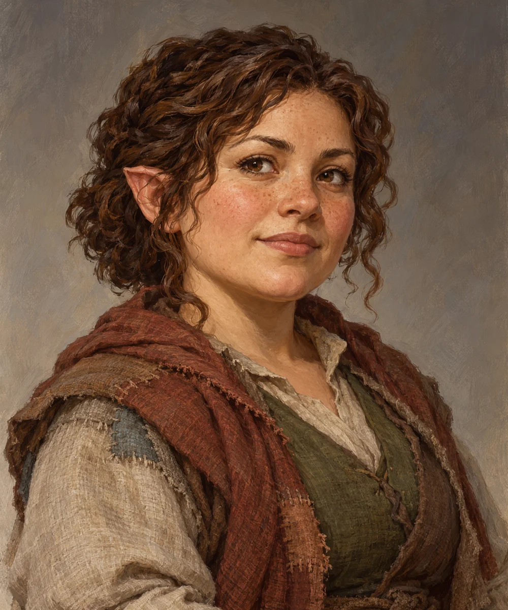

# Mara Voss

<!-- character-profile:start -->

> [!character] Character quick reference
>
> > [!profile] Key information
> >
> > | Detail | Record |
> > | --- | --- |
> > | Species | Halfling |
> > | Age | 31 |
> > | Pronouns | she/her |
> > | Role | Hospital District speaker and relief administrator |
> > | Faction / affiliation | [[Factions/Old Ostium Hospital District Community\|Old Ostium Hospital District Community]] |
> > | Current location | [[Locations/Old Ostium Hospital District\|Old Ostium Hospital District]] |
> > | Status | alive |
> >
> > **In play:** Hospital District civic leader and counterweight to simplistic 'rescue Taran' logic
> >
> > **Wants now:** Protect residents, keep rations stable, keep Protectorate payments from destroying the settlement, and retain essential technical help.
> >
> > **Portrayal:** Quiet administrative competence; remembers names and exact shortages.
> >
> > **Attitude:** Cooperative with outsiders who contribute; cold toward anyone treating residents as obstacles or collateral.
>
> > [!portrait] Portrait
> >
> > <!-- campaign-artwork:start -->
> >
> > 
> >
> > *Visual reference: Mara Voss — campaign portrait — OpenAI image generation; directed for the Ostium campaign. AI-generated campaign illustration; [source](https://openai.com/policies/terms-of-use/). Appearance, clothing, props, and effects are illustrative, not new canon. [[Attachments/Artwork Credits|Credits and interpretation]].*
> >
> > <!-- campaign-artwork:end -->

<!-- character-profile:end -->

## At a Glance

**Species (D&D 2024):** Halfling

**Role in campaign:** Hospital District civic leader and counterweight to simplistic 'rescue Taran' logic\
**Usual Location:** [[Locations/Old Ostium Hospital District|Old Ostium Hospital District]]\
**Current agenda:** Protect residents, keep rations stable, keep Protectorate payments from destroying the settlement, and retain essential technical help.\
**Disposition toward party:** Cooperative with outsiders who contribute; cold toward anyone treating residents as obstacles or collateral.\
**Voice / portrayal:** Quiet administrative competence; remembers names and exact shortages.\
**What changes their mind:** Concrete supplies, sustainable protection, or replacement technical capacity.\

## Secrets

- Mara knows Taran is showing concerning symptoms but has not confronted him publicly.
- She understands that asking him to stay may be asking him to risk his life.

## Motives

- Protect people who were left behind.
- Refuse charity that turns into control.
- Keep the settlement politically autonomous enough to make its own decisions.

## Hidden Alliances & Relationships

- [[Characters/NPCs/Taran Lusat|Taran Lusat]] is both benefactor and essential infrastructure worker.
- [[Characters/NPCs/Indra Karaf|Indra Karaf]] is a hard but necessary bargaining partner.

## Backstory

Mara's authority emerged from doing the work rather than claiming a title. People kept asking her to coordinate one more emergency until the emergency became a settlement.

## What They Know

- Ration levels.
- Patient and refugee pressures.
- Which streets and routes remain usable.
- Internal debate over paying the Protectorate.

## Current Plans

- Find a way to keep Taran alive without losing water expertise.
- Reduce the settlement's dependence on any one outside faction.

## D&D 5e (2024) Mechanics

Narrative NPC first. No D&D stat block, class build, spell list, or Challenge Rating has been assigned. If a meaningful uncertain interaction needs a check, use the approach-based guidance in [[Rules/System Guide|System Guide]]; essential information is not gated by a single check. Choose and verify a separate 2024-compatible profile only if conflict requires it. Any older profile must name its source and edition.

## Daggerheart Mechanics

> Existing campaign homebrew / narrative guidance, retained independently. Check against the adopted SRD before use; no direct D&D conversion.

**Mechanical use:** Narrative Social NPC. If mechanically contested, use a Tier 1 Social profile focused on community legitimacy rather than combat.

## GM Notes

- Keep portrayal grounded in the faction and material pressures around them.

## PC Knowledge

_No encounter or revelation recorded yet; this is a continuity note, not a publishing restriction._

## Session Appearances

No completed appearance recorded; planned appearances are preparation, not history.
