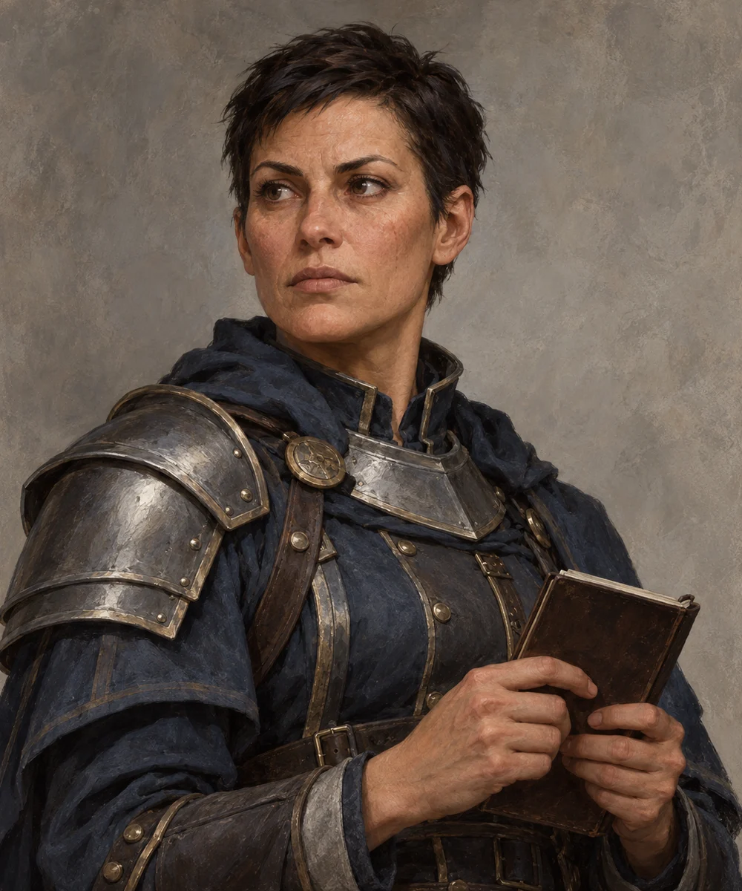

# Mira Vey

<!-- page-summary:start -->

Aaron Fortisax’s practical, exacting lieutenant, who coordinates New Ostium’s patrols and investigations and prefers an orderly surrender to a crowded street fight.

<!-- page-summary:end -->

<!-- character-profile:start -->

> [!character] Character quick reference
>
> > [!profile] Key information
> >
> > | Detail | Record |
> > | --- | --- |
> > | Species | Human |
> > | Age | 38 |
> > | Pronouns | she/her |
> > | Role | City Guard lieutenant; patrol and investigation coordinator |
> > | Faction / affiliation | [[Factions/New Ostium City Guard\|New Ostium City Guard]] |
> > | Current location | [[Locations/New Ostium\|New Ostium]] |
> > | Status | alive |
> >
> > **In play:** Mira Vey is the lieutenant of the [[Factions/New Ostium City Guard|New Ostium City Guard]], serving under [[Characters/NPCs/Aaron Fortisax|Aaron Fortisax]]. She turns command decisions into patrol assignments, incident reports, and coordinated investigations in [[Locations/New Ostium|New Ostium]].
>
> > [!portrait] Portrait
> >
> > <!-- campaign-artwork:start -->
> >
> > 
> >
> > *Campaign portrait generated with the built-in imagegen tool; visual interpretation only. [[Attachments/Artwork Credits|Credits and interpretation]] · [Exact prompt and provenance](../../Attachments/Artwork/sources/mira-vey-portrait-generation.json).*
> >
> > <!-- campaign-artwork:end -->

<!-- character-profile:end -->

<!-- page-connections:start -->

## Connected Pages

Location links are document references; geographic containment is shown in the Within and Contained locations rows.

| Connection | Follow links |
| --- | --- |
| People | [[Characters/NPCs/Aaron Fortisax\|Aaron Fortisax]] |
| Referenced locations | [[Locations/New Ostium\|New Ostium]] |
| Factions | [[Factions/New Ostium City Guard\|New Ostium City Guard]] |

<!-- page-connections:end -->

## Overview

**Species (D&D 2024):** Human

Mira Vey is the lieutenant of the [[Factions/New Ostium City Guard|New Ostium City Guard]], serving under [[Characters/NPCs/Aaron Fortisax|Aaron Fortisax]]. She turns command decisions into patrol assignments, incident reports, and coordinated investigations in [[Locations/New Ostium|New Ostium]].

## Appearance & Personality

Mira is 38, with close-cropped dark hair, a weathered face, and a meticulous uniform. She keeps a small notebook at hand and writes down names before asking for explanations. Her voice is low and precise; under pressure, she becomes quieter rather than louder.

She is disciplined, observant, and difficult to rush. Courtesy earns a hearing, but titles and expensive clothes do not excuse an inconsistent account. She dislikes unnecessary force because it endangers bystanders and makes an already difficult job harder.

## Background

Mira worked her way up through ordinary patrol duty and remains attentive to the practical details that officers behind desks can miss. She regards careful reports and reliable colleagues as essential tools of command. No role in earlier campaign events is established.

## Motivations & Goals

- Keep civilians and her patrol officers alive.
- Stop small disturbances from becoming street battles.
- Establish what happened before accepting the loudest or wealthiest person's story.
- Maintain the Guard's discipline when political or commercial interests demand a quick result.

## Relationships, Resources & Affiliations

- [[Characters/NPCs/Aaron Fortisax|Aaron Fortisax]] is her commander; she gives him concise reports and raises practical objections privately.
- Her authority comes from the City Guard, with its strong funding, excellent weapons, and formidable collective force.
- She can coordinate patrols and investigations. Particular informants, political patrons, and connections to other named NPCs are **Unknown / TBD**.

## Current Location

Based in [[Locations/New Ostium|New Ostium]], moving between patrol work and investigations. A specific office or residence is not established.

## Knowledge & Secrets

Mira knows the patrol assignments and cases she is currently handling. No specific investigation has been activated, and she does not automatically know about the party or its plans. She worries that pressure for reassuring arrests can outrun the evidence; this concern does not establish a past scandal or secret conspiracy.

## Campaign Role & Possible Interactions

- **Cooperation:** She listens to concrete reports and can arrange appropriate follow-up without promising resources before assessing the situation.
- **Investigation:** If trouble occurs, she separates witnesses, compares accounts, and follows evidence. These are possible responses, not completed events.
- **De-escalation:** She gives clear instructions and seeks an orderly surrender when circumstances allow. Cooperation opens a hearing; it does not erase an offense.
- **Changing her mind:** Corroborated evidence, a credible explanation of coercion, and a plan that protects civilians matter more than flattery.

**Portrayal:** “Start with what you saw. We will come to what you think it means.”

> [!danger] An officer of a formidable force
> Mira is not a level-appropriate combat obstacle. The PCs should avoid fighting her or the City Guard under any circumstances, especially at low levels. Show the Guard's coordination and excellent equipment before violence becomes a choice.

## Knowledge & Lore Status

- **Canon:** Newly created under the GM's authorization to generate the lieutenant: name, Human species, age, appearance, personality, patrol background, and command role above.
- **PCs know:** No meeting, warning, or revelation recorded yet.
- **Unknown / TBD:** Specific active cases, residence, personal connections beyond Aaron, and combat statistics.

## Mechanics — D&D 5e (2024)

Narrative NPC; no class, level, feat, spell list, Challenge Rating, or official combat profile is assigned. Verify any future profile under [[Rules/System Guide|System Guide]]. No Daggerheart conversion is assigned.

## Session References & Changes

No completed appearance recorded; possible interactions remain preparation.
