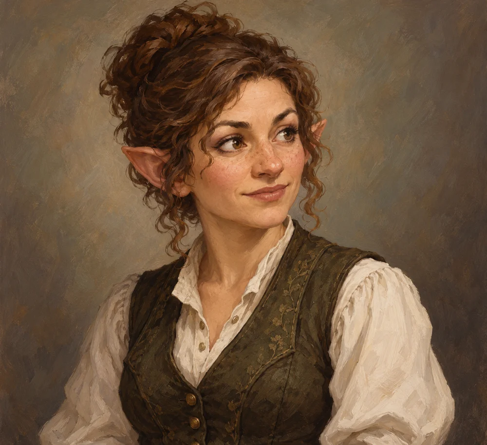

# Orla Meren

<!-- page-summary:start -->

A missing scholar at Old Ostium University whose possible rescue can reveal the Rot’s effects on cognition and clues to the deeper city.

<!-- page-summary:end -->

<!-- character-profile:start -->

> [!character] Character quick reference
>
> > [!profile] Key information
> >
> > | Detail | Record |
> > | --- | --- |
> > | Species | Gnome |
> > | Age | 29 |
> > | Pronouns | she/her |
> > | Role | Public servant and clerk |
> > | Faction / affiliation | Not established |
> > | Current location | [[Locations/New Ostium\|New Ostium]] |
> > | Status | alive |
> >
> > **In play:** Missing scholar for the University rescue; conduit for clues about the Heart's cognitive influence
> >
> > **Wants now:** Survive long enough to understand what the University inhabitants have become and preserve useful observations.
> >
> > **Portrayal:** Rapid academic excitement alternating with unnerving fixation after prolonged exposure.
> >
> > **Attitude:** If rescued, grateful but frustrated if forced away before she understands anything.
>
> > [!portrait] Portrait
> >
> > <!-- campaign-artwork:start -->
> >
> > 
> >
> > *Visual reference: Orla Meren — campaign portrait — OpenAI image generation; directed for the Ostium campaign. AI-generated campaign illustration; [source](https://openai.com/policies/terms-of-use/). Appearance, clothing, props, and effects are illustrative, not new canon. [[Attachments/Artwork Credits|Credits and interpretation]].*
> >
> > <!-- campaign-artwork:end -->

<!-- character-profile:end -->

<!-- page-connections:start -->

## Connected Pages

| Connection | Follow links |
| --- | --- |
| Locations | [[Locations/Old Ostium University\|Old Ostium University]] |
| Factions | [[Factions/New Ostium Government\|New Ostium Government]] |

### Adventures & Encounters

| Adventure / state | Situation |
| --- | --- |
| [[Storylines/Adventures/Rescue Mission\|Rescue Mission]] — prepared | A prepared search for Orla Meren at Old Ostium University, combining rescue with unsettling evidence about the Rot and the Heart. |

<!-- page-connections:end -->

## At a Glance

**Species (D&D 2024):** Gnome

**Role in campaign:** Missing scholar for the University rescue; conduit for clues about the Heart's cognitive influence\
**Usual Location:** [[Locations/Old Ostium University|Old Ostium University]]\
**Current agenda:** Survive long enough to understand what the University inhabitants have become and preserve useful observations.\
**Disposition toward party:** If rescued, grateful but frustrated if forced away before she understands anything.\
**Voice / portrayal:** Rapid academic excitement alternating with unnerving fixation after prolonged exposure.\
**What changes their mind:** Concrete proof her research can continue safely elsewhere.\

## Secrets

- Orla went into the University deliberately despite warnings.
- Exposure may have begun synchronizing her attention with the strange collective phenomena there.
- She can return with clues that the Rot's mental effects are not random decay but interact with something that amplifies cognition/connection.

## Motives

- Curiosity.
- Professional obsession.
- Belief that understanding the phenomenon may help people suffering from it.

## Hidden Alliances & Relationships

- No formal faction allegiance, but her disappearance can pressure [[Factions/New Ostium Government|New Ostium Government]] and create academic interest in Old Ostium.

## Backstory

Orla specialized in the parts of civic history most scholars avoided: institutional decline, anomalous testimony, and the relationship between infrastructure and collective behaviour.

## What They Know

- University archives.
- Early reports of synchronized speech and attention among Rot-afflicted groups.
- Pieces of evidence that point downward toward older systems without revealing the whole truth.

## Current Plans

- Observe, document, and survive.
- If partially affected, hide how compelling the shared mental state feels.

## D&D 5e (2024) Mechanics

Narrative NPC first. No D&D stat block, class build, spell list, or Challenge Rating has been assigned. If a meaningful uncertain interaction needs a check, use the approach-based guidance in [[Rules/System Guide|System Guide]]; essential information is not gated by a single check. Choose and verify a separate 2024-compatible profile only if conflict requires it. Any older profile must name its source and edition.

## Daggerheart Mechanics

> Existing campaign homebrew / narrative guidance, retained independently. Check against the adopted SRD before use; no direct D&D conversion.

**Mechanical use:** Narrative NPC; if the University changes her into active opposition, build a current-tier Social/Support adversary at that time rather than fixing it now.

## GM Notes

- Keep portrayal grounded in the faction and material pressures around them.

## PC Knowledge

_No encounter or revelation recorded yet; this is a continuity note, not a publishing restriction._

## Session Appearances

No completed appearance recorded; planned appearances are preparation, not history.
