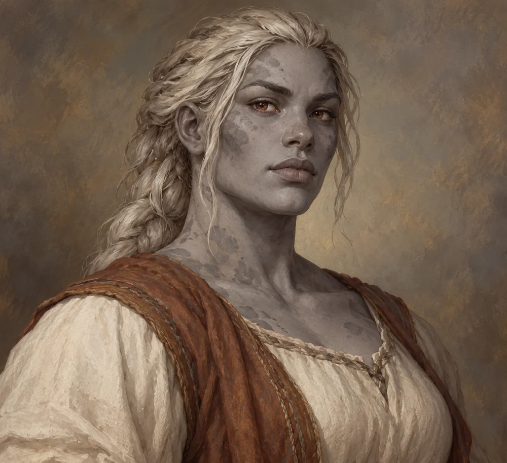

# Sara Lusat

<!-- page-summary:start -->

Egbert and Tara Lusat’s daughter and Taran’s sister; her wider role, goals, and circumstances remain to be established.

<!-- page-summary:end -->

<!-- character-profile:start -->

> [!character] Character quick reference
>
> > [!profile] Key information
> >
> > | Detail | Record |
> > | --- | --- |
> > | Species | Goliath |
> > | Age | 24 (estimate) |
> > | Pronouns | Not recorded |
> > | Role | Not recorded |
> > | Faction / affiliation | Not established |
> > | Current location | Unknown |
> > | Status | unknown |
> >
> > **In play:** Sister of [[Characters/NPCs/Taran Lusat|Taran Lusat]] and daughter of [[Characters/NPCs/Egbert Lusat|Egbert Lusat]]. Her mother is [[Characters/NPCs/Tara Lusat|Tara Lusat]], deceased from the Rot of Old Ostium.
> >
> > *Age estimate: Proposed adult-sibling appearance estimate; the relative ages of the Lusat siblings are not established.*
>
> > [!portrait] Portrait
> >
> > <!-- campaign-artwork:start -->
> >
> > 
> >
> > *Visual reference: Sara Lusat — campaign portrait — OpenAI image generation; directed for the Ostium campaign. AI-generated campaign illustration; [source](https://openai.com/policies/terms-of-use/). Appearance, clothing, props, and effects are illustrative, not new canon. [[Attachments/Artwork Credits|Credits and interpretation]].*
> >
> > <!-- campaign-artwork:end -->

<!-- character-profile:end -->

## Overview

Sister of [[Characters/NPCs/Taran Lusat|Taran Lusat]] and daughter of [[Characters/NPCs/Egbert Lusat|Egbert Lusat]]. Her mother is [[Characters/NPCs/Tara Lusat|Tara Lusat]], deceased from the Rot of Old Ostium.

## Appearance & Personality

TBD.

## Motivations & Goals

TBD.

## Relationships, Resources & Affiliations

- **Father:** [[Characters/NPCs/Egbert Lusat|Egbert Lusat]].
- **Mother:** [[Characters/NPCs/Tara Lusat|Tara Lusat]], deceased.
- **Brother:** [[Characters/NPCs/Taran Lusat|Taran Lusat]].
- Egbert also has a second, as-yet-unnamed son. Sara is an additional family member; the existing brother has not been replaced.
- Her exact age, current status/location, personality, and other relationships remain TBD.

## Current Location

TBD.

## Knowledge & Secrets

TBD.

## Campaign Role & Possible Interactions

TBD — include negotiation, help, conflict, and changing priorities where appropriate.

## Knowledge & Lore Status

- **Canon:** Family relationships above. Other character details remain undeveloped.
- **PCs know:** TBD — record what was actually learned and when.
- **Proposed / Rumor / Unknown:** TBD — label each claim; do not promote suggestions automatically.

## Mechanics (Optional)

### D&D 5e (2024)

TBD — choose verified rules only if mechanically useful; record edition/source. Do not invent official statistics.

### Daggerheart

TBD — independent traits/Difficulty, roles, environments, and consequences as useful; no numeric conversion. Label campaign homebrew.

## Session References & Changes

TBD.

## Background

TBD.

<!-- page-connections:start -->

> [!info]- Connected Pages
> Location mentions are references; Within and Contained locations record geography.
>
> | Connection | Follow links |
> | --- | --- |
> | People | [[Characters/NPCs/Egbert Lusat\|Egbert Lusat]] · [[Characters/NPCs/Tara Lusat\|Tara Lusat]] · [[Characters/NPCs/Taran Lusat\|Taran Lusat]] |
>
> ### Adventures & Encounters
>
> | Adventure / state | Situation |
> | --- | --- |
> | [[Storylines/Adventures/The Prodigal Son\|The Prodigal Son]] — prepared | A prepared family rescue that becomes a civic dilemma: Egbert wants Taran home, but the Hospital District depends on his engineering. |

<!-- page-connections:end -->
