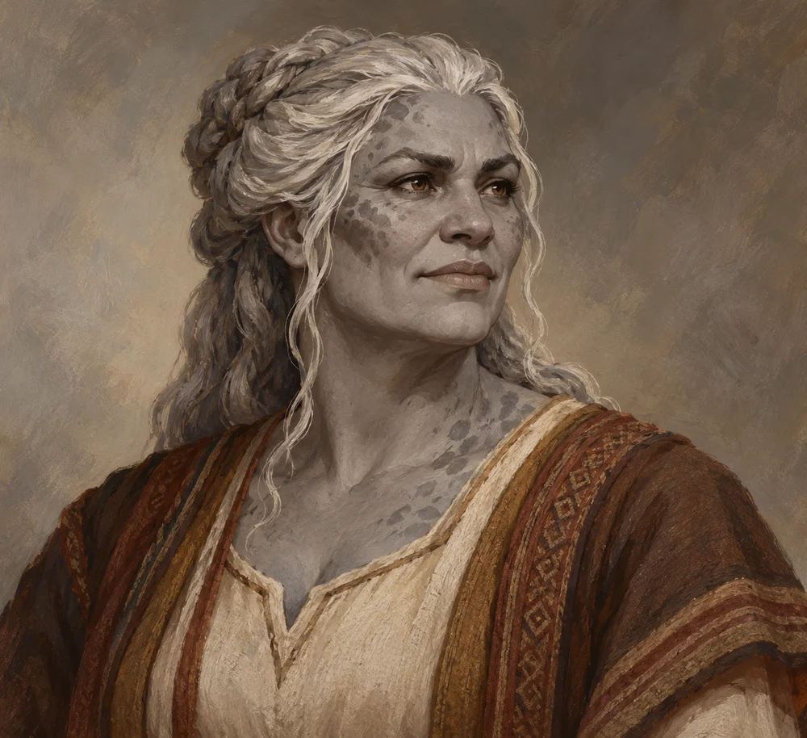

# Tara Lusat

<!-- character-profile:start -->

> [!character] Character quick reference
>
> > [!profile] Key information
> >
> > | Detail | Record |
> > | --- | --- |
> > | Species | Goliath |
> > | Age | 56 (estimate) at death |
> > | Pronouns | Not recorded |
> > | Role | Not recorded |
> > | Faction / affiliation | Not established |
> > | Last known location | Unknown |
> > | Status | deceased |
> > | Cause of death | Rot of Old Ostium |
> >
> > **In play:** Deceased wife of [[Characters/NPCs/Egbert Lusat|Egbert Lusat]] and mother of [[Characters/NPCs/Taran Lusat|Taran Lusat]] and [[Characters/NPCs/Sara Lusat|Sara Lusat]]. She died from [[Creatures and Afflictions/The Rot|the Rot of Old Ostium]].
> >
> > *Age estimate: Proposed mature-parent appearance estimate at death; the date of death and family chronology remain unestablished.*
>
> > [!portrait] Portrait
> >
> > <!-- campaign-artwork:start -->
> >
> > 
> >
> > *Visual reference: Tara Lusat — campaign portrait — OpenAI image generation; directed for the Ostium campaign. AI-generated campaign illustration; [source](https://openai.com/policies/terms-of-use/). Appearance, clothing, props, and effects are illustrative, not new canon. [[Attachments/Artwork Credits|Credits and interpretation]].*
> >
> > <!-- campaign-artwork:end -->

<!-- character-profile:end -->

## Overview

**Species (D&D 2024):** Goliath

Deceased wife of [[Characters/NPCs/Egbert Lusat|Egbert Lusat]] and mother of [[Characters/NPCs/Taran Lusat|Taran Lusat]] and [[Characters/NPCs/Sara Lusat|Sara Lusat]]. She died from [[Creatures and Afflictions/The Rot|the Rot of Old Ostium]].

## Appearance & Personality

TBD.

## Background

TBD.

## Motivations & Goals

TBD.

## Relationships, Resources & Affiliations

- **Husband:** [[Characters/NPCs/Egbert Lusat|Egbert Lusat]].
- **Children:** [[Characters/NPCs/Taran Lusat|Taran Lusat]], [[Characters/NPCs/Sara Lusat|Sara Lusat]], and Egbert's previously established unnamed second son.
- Her exact age, occupation, and date of death remain TBD.

## Current Location

TBD.

## Knowledge & Secrets

Her death from the Rot is established GM canon. What the PCs know of her is not yet recorded. This replaces the earlier attribution of her death to Frigid Woe; the two afflictions remain distinct.

## Campaign Role & Possible Interactions

TBD — include negotiation, help, conflict, and changing priorities where appropriate.

## Knowledge & Lore Status

- **Canon:** Family relationships above. Tara died from the Rot of Old Ostium.
- **PCs know:** TBD — record what was actually learned and when.
- **Proposed / Rumor / Unknown:** TBD — label each claim; do not promote suggestions automatically.

## Mechanics (Optional)

### D&D 5e (2024)

TBD — choose verified rules only if mechanically useful; record edition/source. Do not invent official statistics.

### Daggerheart

TBD — independent traits/Difficulty, roles, environments, and consequences as useful; no numeric conversion. Label campaign homebrew.

## Session References & Changes

TBD.
