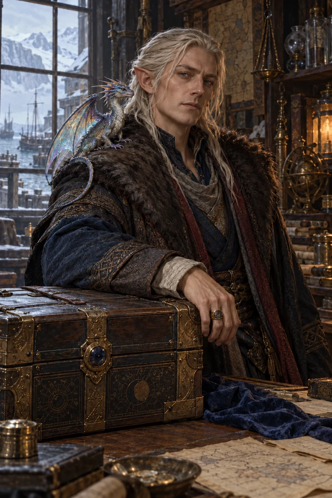

# The Buyer

<!-- page-summary:start -->

The Torney Isles’ principal magical-item fence: an independent elf with a violent trading history, a pet faerie dragon, and a teleporting chest.

<!-- page-summary:end -->

<!-- character-profile:start -->

> [!character] Character quick reference
>
> > [!profile] Key information
> >
> > | Detail | Record |
> > | --- | --- |
> > | Species | Elf |
> > | Age | Unknown |
> > | Pronouns | he/him |
> > | Role | Independent merchant and magical-item fence |
> > | Faction / affiliation | Not established |
> > | Current location | [[Locations/Torney Isles\|Torney Isles]] |
> > | Status | alive |
> >
> > **In play:** Known only as **The Buyer**, he is an independent elf merchant and the key fence for magical items found in the [[Locations/Torney Isles|Torney Isles]]. He operates in a moral grey area, including shady business; he is not established as a guild subordinate.
>
> > [!portrait] Portrait
> >
> > <!-- campaign-artwork:start -->
> >
> > 
> >
> > *Visual reference: The Buyer — campaign portrait — OpenAI image generation. AI-generated campaign illustration; [source](https://openai.com/policies/terms-of-use/). Appearance, clothing, and incidental details are illustrative, not new canon. [[Attachments/Artwork Credits|Credits and interpretation]].*
> >
> > <!-- campaign-artwork:end -->

<!-- character-profile:end -->

## Overview

Known only as **The Buyer**, he is an independent elf merchant and the key fence for magical items found in the [[Locations/Torney Isles|Torney Isles]]. He operates in a moral grey area, including shady business; he is not established as a guild subordinate.

## Appearance & Personality

An elf accompanied by a pet faerie dragon. **Suggested portrayal:** composed, pragmatic, and firm about terms. Exact age and other physical details are unrecorded; the portrait is a visual reference.

## Background

He used violence to secure his position as the Torney Isles’ main mercantile waypoint. His real identity, former rivals, and the details of that violence remain **Unknown/TBD**.

## Motivations & Goals

**Suggested:** preserve his independence and central position in the islands’ trade; negotiate profitable, reliable exchanges.

## Relationships, Resources & Affiliations

- **Canon:** pet faerie dragon; a magical chest that teleports items to key locations, notably [[Locations/Mistbreak|Mistbreak]]. Its rules and limits are unrecorded.
- **Tentative:** an Ostium destination for the chest and contacts among wealthy merchants, museum curators, or shady operators.
- **Tentative:** business ties to the [[Factions/New Ostium Merchants Guild|New Ostium Merchants Guild]], while remaining independent. No membership or named guild contact is established.

## Current Location

Lives and trades in the Torney Isles; exact premises **TBD**.

## Knowledge & Secrets

**Planned:** he will know about the antidote recovered in [[Session Logs/Steven's Table/Session 5|Session 5]]. How he learns and how much the party knows about his violent past are unrecorded.

## Campaign Role & Possible Interactions

In [[Session Logs/Steven's Table/Session 6|Session 6 preparation]], offer a library retrieval commission for delivery to Ostium. The specific book and recipient remain tentative. He may separately negotiate transport or introductions for [[Creatures and Afflictions/Frigid Woe|Frigid Woe]] antidote. Let the party bargain, decline, or seek another route; prices and commitments are not yet agreed.

## Knowledge & Lore Status

- **Canon:** identity used, species, independent trade role, violent history, companion, and chest’s Mistbreak connection.
- **PCs know:** Steven identifies him as the elf with the faerie dragon and transporting chest; the exact encounter and extent of knowledge are unrecorded.
- **Unknown / Tentative:** true identity, age, chest limits, Ostium endpoint, contacts, and commission details. No mechanical profile assigned.

## Session References & Changes

[[Session Logs/Steven's Table/Session 5|Session 5 follow-up]] supplies context; [[Session Logs/Steven's Table/Session 6|Session 6]] prepares his commission. Neither link establishes a completed Session 6 appearance.

<!-- page-connections:start -->

> [!info]- Connected Pages
> Location mentions are references; Within and Contained locations record geography.
>
> | Connection | Follow links |
> | --- | --- |
> | Referenced locations | [[Locations/Mistbreak\|Mistbreak]] · [[Locations/Torney Isles\|Torney Isles]] |
> | Factions | [[Factions/New Ostium Merchants Guild\|New Ostium Merchants Guild]] |
> | Campaign & lore | [[Creatures and Afflictions/Frigid Woe\|Frigid Woe]] |
>
> > [!example]- Session references
> > A link records a mention, not proof of an appearance or revelation. Read each report for actual outcomes.
> >
> > | Record | Table | State |
> > | --- | --- | --- |
> > | [[Session Logs/Steven's Table/Session 5\|Session 5 — The Antidote Retrieved]] | Steven's Table | completed |
> > | [[Session Logs/Steven's Table/Session 6\|Session 6 — The Library Commission — Preparation]] | Steven's Table | planned |

<!-- page-connections:end -->
