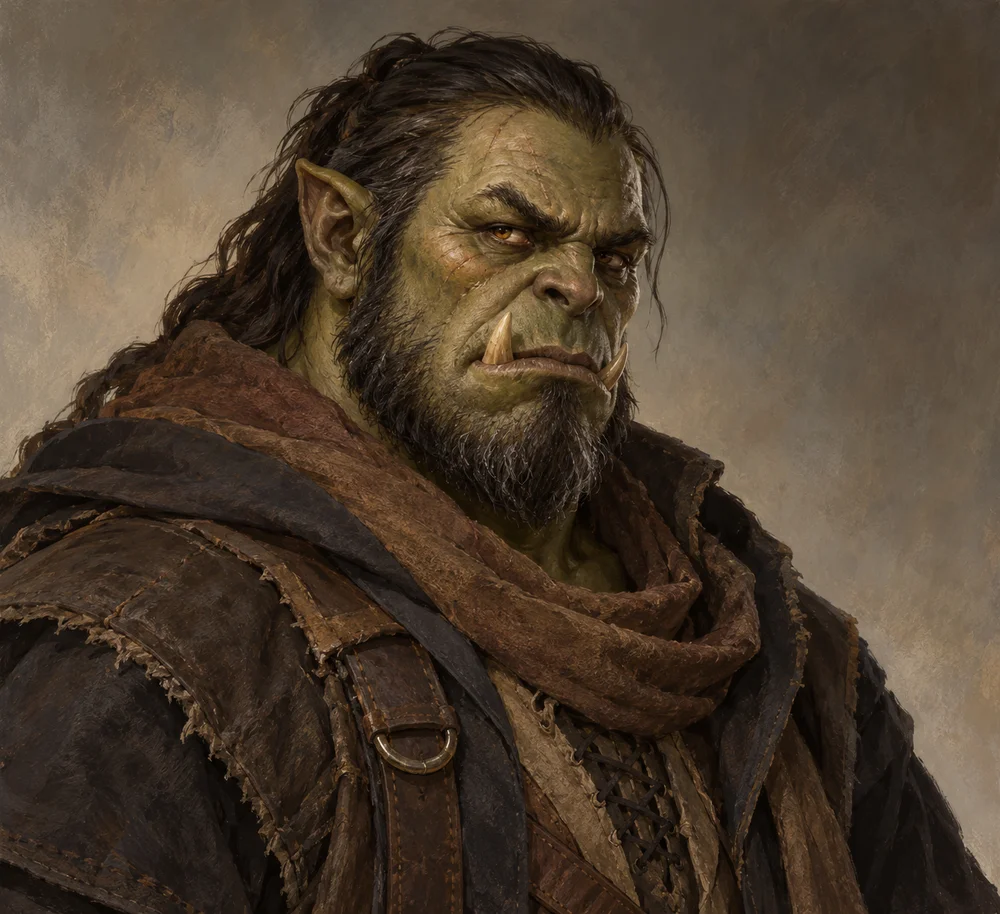

# Ulroc Grimscar

<!-- character-profile:start -->

> [!character] Character quick reference
>
> > [!profile] Key information
> >
> > | Detail | Record |
> > | --- | --- |
> > | Species | Orc |
> > | Age | 47 |
> > | Pronouns | he/him |
> > | Role | Raider chief and crime lord |
> > | Faction / affiliation | [[Factions/The Shattered Axe\|The Shattered Axe]] |
> > | Current location | [[Locations/Old Ostium Slums\|Old Ostium Slums]] |
> > | Status | alive |
> >
> > **In play:** Primary mortal antagonist and embodiment of predatory power in Old Ostium
> >
> > **Wants now:** Exploit instability, raid surviving settlements, increase smuggling into New Ostium, and keep subordinates loyal through profitable violence.
> >
> > **Portrayal:** Quiet threat rather than shouting; makes ownership claims as if they are obvious facts.
> >
> > **Attitude:** Respectful only toward competence and credible strength; sees mercy without leverage as weakness.
>
> > [!portrait] Portrait
> >
> > <!-- campaign-artwork:start -->
> >
> > 
> >
> > *Visual reference: Ulroc Grimscar — campaign portrait — OpenAI image generation; directed for the Ostium campaign. AI-generated campaign illustration; [source](https://openai.com/policies/terms-of-use/). Appearance, clothing, props, and effects are illustrative, not new canon. [[Attachments/Artwork Credits|Credits and interpretation]].*
> >
> > <!-- campaign-artwork:end -->

<!-- character-profile:end -->

## At a Glance

**Species (D&D 2024):** Orc

**Role in campaign:** Primary mortal antagonist and embodiment of predatory power in Old Ostium\
**Usual Location:** [[Locations/Old Ostium Slums|Old Ostium Slums]]\
**Current agenda:** Exploit instability, raid surviving settlements, increase smuggling into New Ostium, and keep subordinates loyal through profitable violence.\
**Disposition toward party:** Respectful only toward competence and credible strength; sees mercy without leverage as weakness.\
**Voice / portrayal:** Quiet threat rather than shouting; makes ownership claims as if they are obvious facts.\
**What changes their mind:** Demonstrated leverage, a threat to his organization he cannot simply kill, or a deal that makes him richer and stronger.\

## Secrets

- Ulroc took over the Shattered Axe through assassinations, intimidation, and calculated betrayals during Old Ostium's collapse.
- He has blackmailed informants on both sides of the divide.
- He may use the party as deniable assets for [[Storylines/Adventures/The Heist|The Heist]].

## Motives

- Might makes right.
- The strong deserve what they can take and keep.
- The Shattered Axe is his property, not a community or cause.
- Success justifies the brutality that produced it.

## Hidden Alliances & Relationships

- [[Characters/NPCs/Vesha Noll|Vesha Noll]] manages much of his intelligence and blackmail network.
- Berrik Thane commands major raiding parties.
- His organization competes directly with [[Factions/The Protectorate|The Protectorate]] and preys on the [[Factions/Old Ostium Hospital District Community|Old Ostium Hospital District community]].

## Backstory

Ulroc never had a stable family and learned early to treat institutions as things owned by whoever could seize them. He was an ambitious organized-crime upstart before the city's deterioration. The vacuum removed many constraints and he used murder, intimidation, and the distribution of spoils to make himself indispensable to the people who survived by following him.

## What They Know

- Smuggling routes between Old and New Ostium.
- Blackmail material on traders, guards, and residents.
- Shattered Axe safe routes and caches.
- Rumours about deeper waterworks, but no reliable understanding of the Heart.

## Current Plans

- Build enough wealth and clandestine reach that New Ostium cannot simply ignore him.
- Use raids to keep Old Ostium settlements dependent and weak.
- Test whether the party can be coerced, bought, or broken.

## D&D 5e (2024) Mechanics

Narrative NPC first. No D&D stat block, class build, spell list, or Challenge Rating has been assigned. If a meaningful uncertain interaction needs a check, use the approach-based guidance in [[Rules/System Guide|System Guide]]; essential information is not gated by a single check. Choose and verify a separate 2024-compatible profile only if conflict requires it. Any older profile must name its source and edition.

## Daggerheart Mechanics

> Existing campaign homebrew / narrative guidance, retained independently. Check against the adopted SRD before use; no direct D&D conversion.

**Tier:** 2\
**Type:** Leader\
**Description:** A ruthless crime lord who controls the pace of a fight through threats, positioning, and subordinates.\
**Motives & Tactics:** Dominate, isolate the weak, make an example, withdraw before losing control.\
**Difficulty:** 14\
**Thresholds:** Major 10 / Severe 20\
**HP:** 8\
**Stress:** 5\
**Attack Modifier:** +2\
**Standard Attack:** Jagged Sabre — Melee — 2d8+3 physical.

### Experiences

- **Crime Lord:** +3
- **Intimidation:** +3

### Features

- **Make an Example — Reaction:** When Ulroc deals Major or worse damage, another Shattered Axe adversary within Close range may immediately reposition to a more advantageous point.
- **Cutthroat Command — Action:** Mark a Stress to spotlight a nearby Shattered Axe subordinate without spending additional Fear for that spotlight.
- **Never Fight Fair — Passive:** Ulroc seeks cover, hostages, terrain, or allies; if isolated in an open fair fight, he tries to change the situation rather than trade blows.

### Fear Features

- **Everybody Has a Price:** Spend a Fear to reveal a prepared piece of leverage, bribery, or blackmail that changes the immediate social or tactical situation. The leverage must be plausible and previously supportable by the fiction.

## GM Notes

- Tier 2 fits the idea that killing Ulroc is more appropriate as an Act II/III side quest than as an opening fight.

## PC Knowledge

_No encounter or revelation recorded yet; this is a continuity note, not a publishing restriction._

## Session Appearances

No completed appearance recorded; planned appearances are preparation, not history.
