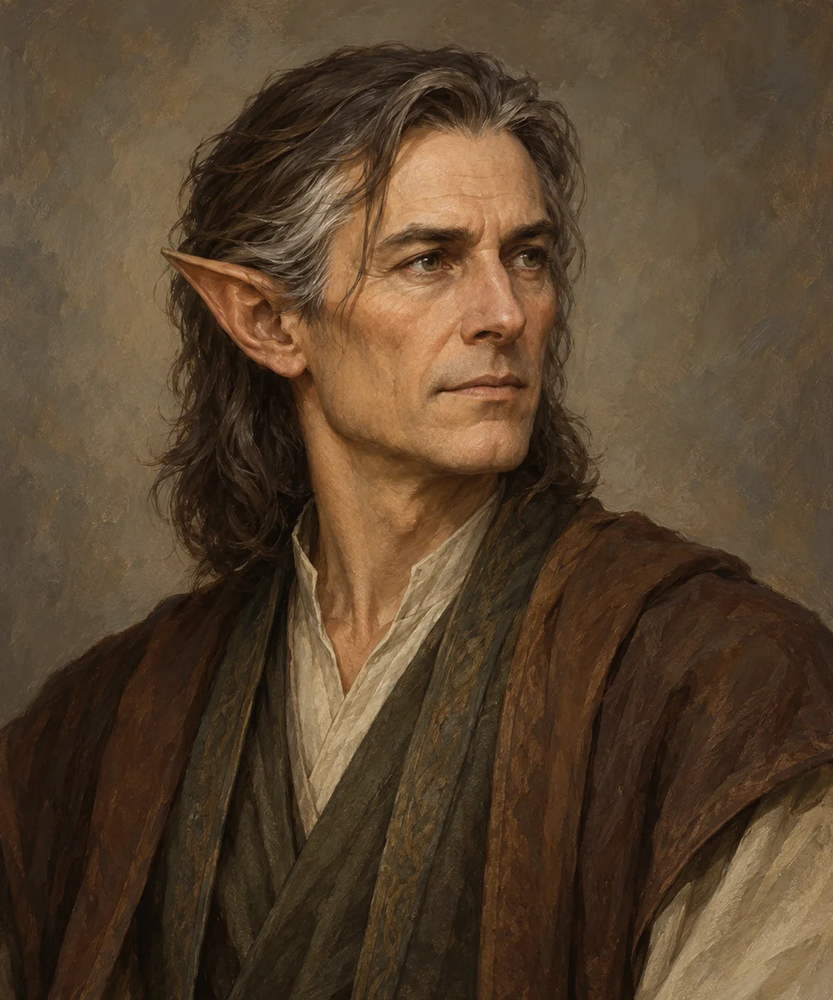

# Veritas

<!-- page-summary:start -->

An elven wizard who died of Frigid Woe in Mistbreak several months ago; Steven’s party began investigating his death.

<!-- page-summary:end -->

<!-- character-profile:start -->

> [!character] Character quick reference
>
> > [!profile] Key information
> >
> > | Detail | Record |
> > | --- | --- |
> > | Species | Elf |
> > | Age | 138 (estimate) at death |
> > | Pronouns | Not recorded |
> > | Role | Wizard |
> > | Faction / affiliation | Not established |
> > | Last known location | [[Locations/Mistbreak\|Mistbreak]] |
> > | Status | deceased |
> >
> > **In play:** A wizard associated with [[Locations/Mistbreak|Mistbreak]], deceased several months before current campaign events.
> >
> > *Age estimate: Proposed age-at-death estimate for an established elven wizard; his research and career dates remain unknown.*
>
> > [!portrait] Portrait
> >
> > <!-- campaign-artwork:start -->
> >
> > 
> >
> > *Visual reference: Veritas — campaign portrait — OpenAI image generation; directed for the Ostium campaign. AI-generated campaign illustration; [source](https://openai.com/policies/terms-of-use/). Appearance, clothing, props, and effects are illustrative, not new canon. [[Attachments/Artwork Credits|Credits and interpretation]].*
> >
> > <!-- campaign-artwork:end -->

<!-- character-profile:end -->

<!-- page-connections:start -->

## Connected Pages

| Connection | Follow links |
| --- | --- |
| Locations | [[Locations/Mistbreak\|Mistbreak]] · [[Locations/Torney Isles\|Torney Isles]] |
| Campaign & lore | [[Creatures and Afflictions/Frigid Woe\|Frigid Woe]] · [[World Lore/Auren Culture\|Auren Culture]] |

> [!example]- Session references
> A link records a mention, not proof of an appearance or revelation. Read each report for actual outcomes.
>
> | Record | Table | State |
> | --- | --- | --- |
> | [[Session Logs/Steven's Table/Session 2\|Session 2 — A New Party in Mistbreak]] | Steven's Table | completed |

<!-- page-connections:end -->

## At a Glance

**Species (D&D 2024):** Elf

- A wizard associated with [[Locations/Mistbreak|Mistbreak]], deceased several months before current campaign events.
- **Cause of death:** [[Creatures and Afflictions/Frigid Woe|Frigid Woe]].

## What They Know

- Records or surviving witnesses may establish the circumstances of his illness; their existence and contents are TBD.

## Hooks — Tentative

- His notes or personal effects could hold information on [[Locations/Torney Isles|Torney Isles]], [[World Lore/Auren Culture|Auren Culture]], or the affliction.
- **Not established:** that he researched or visited the islands, or that his belongings survive.

## GM Notes

- Do not invent a cause of exposure or precise death date.

## PC Knowledge

_No encounter or revelation recorded yet; this is a continuity note, not a publishing restriction._

## D&D 5e (2024) Mechanics

Narrative NPC first. No D&D stat block, class build, spell list, or Challenge Rating has been assigned. If a meaningful uncertain interaction needs a check, use the approach-based guidance in [[Rules/System Guide|System Guide]]; essential information is not gated by a single check. Choose and verify a separate 2024-compatible profile only if conflict requires it. Any older profile must name its source and edition.

## Daggerheart Mechanics

No numerical profile assigned. See [[Rules/System Guide|System Guide]] for optional roles and approach-based resolution.

## Session Appearances

No completed appearance recorded; planned appearances are preparation, not history.
