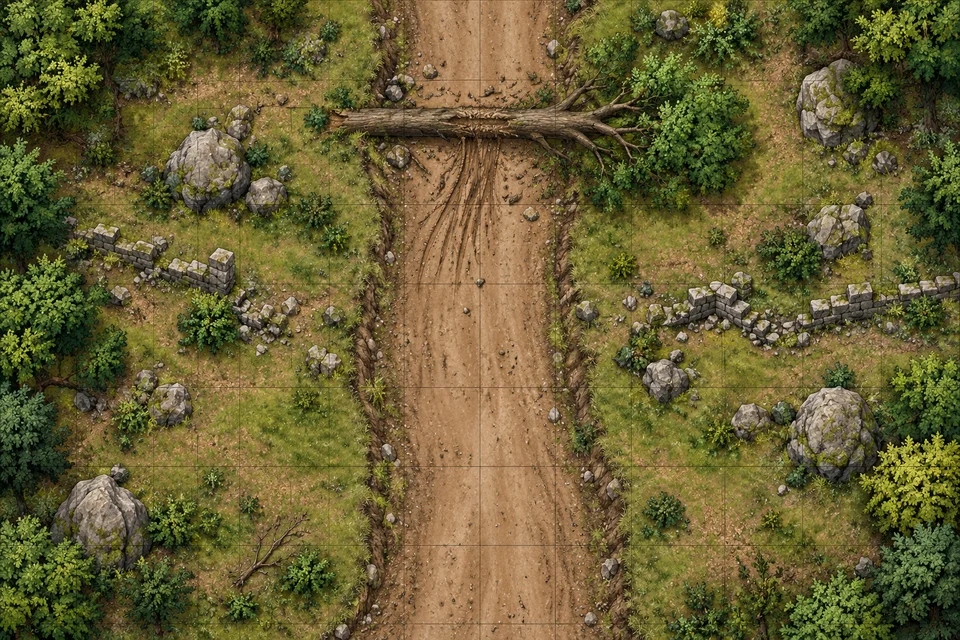

# Roadside Ambush

<!-- page-summary:start -->

A prepared caravan robbery by Shattered Axe bandits posing as city guards, with options to detect the deception, negotiate, evade, or fight.

<!-- page-summary:end -->

> [!battlefield] Map & enemies · 3 level-1 PCs · Planned / unplayed
>
> > [!map] Roadblock
> >
> > 
> >
> > **60 × 40 ft. · 5-ft. squares · road 15 ft. wide · north ↑**
>
> > [!roster] 5 enemies
> >
> > | Enemy | # | AC | HP |
> > | --- | --- | --- | --- |
> > | [[Characters/NPCs/Korok Grund\|Korok]] | 1 | 12 | **32** |
> > | [[Characters/NPCs/Carl Marsh\|Carl]] + bandit | 2 | 12 | **11 each** |
> > | Recruits | 2 | 12 | **1 each** |
> >
> > [[Characters/NPCs/Darian Auir|Darian]] handles passengers and wagon; no allied combatant assumed. PCs choose positions.

**D&D 5e (2024).** Protect Darian’s cargo from [[Factions/The Shattered Axe|Shattered Axe]] bandits. Deception, negotiation, evasion, and aftermath: [[Storylines/Adventures/The Road to Ostium#1. Caravan Journey and Ambush|The Road to Ostium]].

> [!info]- Placement, cover & movement
>
> Terrain-only map; place combatants as follows. Roster, terrain, and tactics are planned preparation.
>
> - **Wagon:** approaching from the south, front 20 ft. short of the tree. PCs choose positions.
> - **Korok:** road, just south of the tree; 20 ft. ahead of the wagon.
> - **Bandits:** one on each roadside, about 15 ft. from Korok and 20–30 ft. from the wagon.
> - **Recruits:** roadside ahead, about 30 ft. from the wagon; no cargo or hostages held.
> - **Cover:** substantial rocks, masonry, wagon sides, and the trunk grant half cover (+2 AC/Dexterity saves) when blocking a shot. Scrub alone grants none.
> - **Movement:** shallow ditch and stepping over the trunk cost difficult-terrain movement. The dragged tree blocks the wagon; bypass on foot. Keep the route south open; no damaging falls.

## Statblocks

> [!statcards] Enemy cards · click to expand
>
> > [!statblock]- Korok ×1 · AC 12 · HP 32
> >
> > *Tough · Medium or Small Humanoid, Neutral · CR ½ · XP 100 · PB +2*
> >
> > **AC** 12 · **HP** 32 (5d8 + 10) · **Speed** 30 ft. · **Initiative** +1 (11)
> >
> > **STR** 15 (+2) · **DEX** 12 (+1) · **CON** 14 (+2) · **INT** 10 (+0) · **WIS** 10 (+0) · **CHA** 11 (+0). Saves equal ability modifiers.
> >
> > **Gear** Heavy Crossbow, Leather Armor, Mace · **Passive Perception** 10 · **Languages** Common
> >
> > **Pack Tactics.** Advantage on attacks against a creature while an ally is within 5 ft. of it and isn’t Incapacitated.
> >
> > **Mace.** +4, reach 5 ft.; **5 (1d6 + 2) Bludgeoning**.
> > **Heavy Crossbow.** +3, range 100/400 ft.; **6 (1d10 + 1) Piercing**.
> >
> > [5e.tools: Tough](https://5e.tools/bestiary.html#tough_xmm) · [SRD p. 332](https://media.dndbeyond.com/compendium-images/srd/5.2/SRD_CC_v5.2.1.pdf#page=332)
>
> > [!statblock]- Carl + bandit ×2 · AC 12 · HP 11 each
> >
> > *Bandit · Medium or Small Humanoid, Neutral · CR ⅛ · XP 25 · PB +2*
> >
> > **AC** 12 · **HP** 11 (2d8 + 2) · **Speed** 30 ft. · **Initiative** +1 (11)
> >
> > **STR** 11 (+0) · **DEX** 12 (+1) · **CON** 12 (+1) · **INT** 10 (+0) · **WIS** 10 (+0) · **CHA** 10 (+0). Saves equal ability modifiers.
> >
> > **Gear** Leather Armor, Light Crossbow, Scimitar · **Passive Perception** 10 · **Languages** Common, Thieves’ Cant
> >
> > **Scimitar.** +3, reach 5 ft.; **4 (1d6 + 1) Slashing**.
> > **Light Crossbow.** +3, range 80/320 ft.; **5 (1d8 + 1) Piercing**.
> >
> > [5e.tools: Bandit](https://5e.tools/bestiary.html#bandit_xmm) · [SRD p. 261](https://media.dndbeyond.com/compendium-images/srd/5.2/SRD_CC_v5.2.1.pdf#page=261)
>
> > [!statblock]- Recruits ×2 · AC 12 · HP 1 each
> >
> > *Bandit minions · campaign homebrew*
> >
> > Bandit profile above, except **HP 1** and **weapon damage 1**, including critical hits. Any damage drops them; saving throws and areas work normally.
> >
> > **Cargo first:** move to supplies and use an action to unlash/lift a bundle; then carry it away, Dodge, or Disengage. Attack only when blocked; **at most one recruit attacks per round**. No offensive Help; their presence can enable Pack Tactics.
> >
> > **Morale:** if either falls or yields, the other flees/yields next turn. Both give up if Korok falls or withdraws. Describe their obvious inexperience.

## Combat

1. **Start:** everyone steps into view during the false inspection. Allow choices before initiative; no automatic surprise or free volley.
2. **Round 1:** Korok closes with a defender. Bandits threaten cargo and separate defenders; recruits start stealing. No coordinated opening volley against one PC.
3. **Later:** Korok makes one mace attack; call out allies crowding his target for Pack Tactics. Bandits fight nearby threats or guard cargo. Use printed average damage; resolve official-profile critical hits normally. No reinforcements.
4. **Morale:** Carl yields at **≤5 HP**, or to a credible peaceful offer of family help. The other bandit withdraws when Carl yields or Korok orders retreat. Korok seeks truce/withdraws at **≤16 HP**, or when both bandits stop fighting. Movement and opportunity attacks apply normally.
5. **PC down:** Korok offers to halt for a limited cargo share; acceptance needs no check. Never attack downed PCs or pin down fleeing PCs. Death saves and stabilization still apply.

**Depleted party:** both recruits flee when weapons are drawn. Otherwise reassess for attendance/resources. **Budget:** 150 XP from official profiles; 200 XP with conservative minion allowance, between Low and Moderate for three level-1 PCs. Minions have no official CR/XP.

**After combat:** use the adventure for cargo losses, Carl’s letter, rewards, and onward travel. Record actual outcomes in the session report before updating [[Planning/Plot Threads and Mysteries|plot threads]] or the timeline; no encounter knowledge is recorded yet.

> [!info]- Profile notes & attribution
>
> Revised **SRD 5.2.1** profiles; minion overrides are campaign homebrew. Korok remains Orc; Carl remains Human. Generic profile alignment grants no campaign moral identity or species features.
>
> **Attribution:** This work includes material from the System Reference Document 5.2.1 (“SRD 5.2.1”) by Wizards of the Coast LLC, available at [the official SRD page](https://www.dndbeyond.com/srd). The SRD 5.2.1 is licensed under the Creative Commons Attribution 4.0 International License, available at [the CC BY 4.0 legal code](https://creativecommons.org/licenses/by/4.0/legalcode). Formatting and wording condensed; mechanics retained except labelled minion homebrew. Fiction, tactics, and morale are campaign additions.

<!-- page-connections:start -->

## Connected Pages

| Connection | Follow links |
| --- | --- |
| People | [[Characters/NPCs/Carl Marsh\|Carl Marsh]] · [[Characters/NPCs/Darian Auir\|Darian Auir]] · [[Characters/NPCs/Korok Grund\|Korok Grund]] |
| Factions | [[Factions/The Shattered Axe\|The Shattered Axe]] |

### Adventures & Encounters

| Adventure / state | Situation |
| --- | --- |
| [[Storylines/Adventures/The Road to Ostium\|The Road to Ostium]] — prepared | A prepared caravan journey and city investigation opening several routes to Frigid Woe antidote through danger, medical referrals, and negotiation. |

<!-- page-connections:end -->
