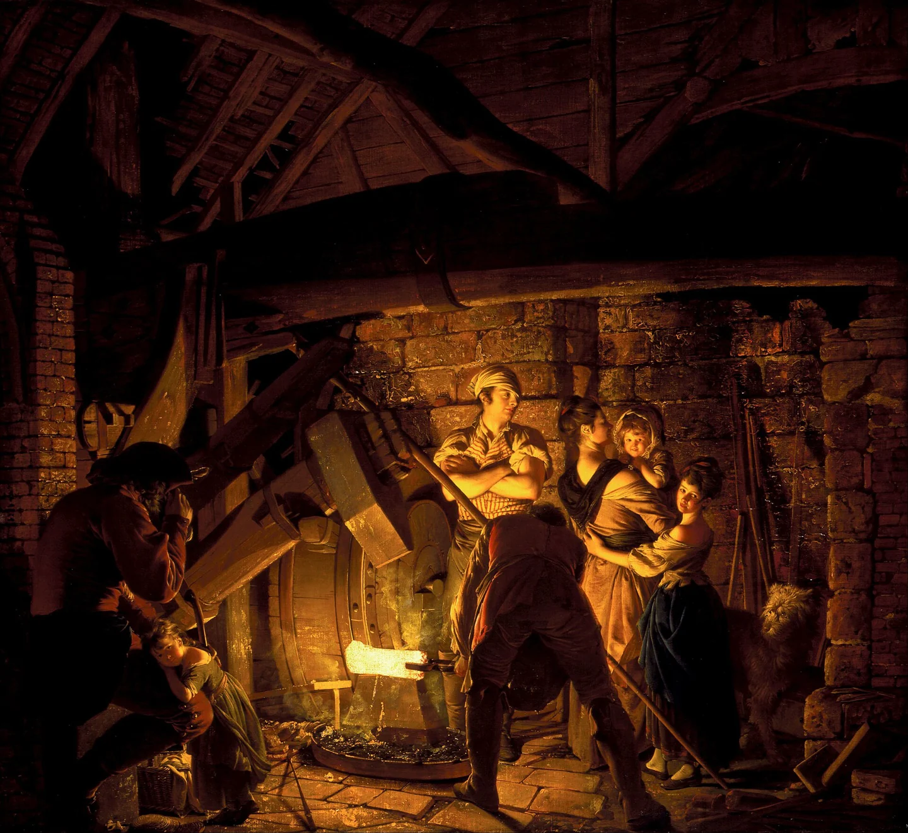

# Old Ostium Engineers

<!-- campaign-artwork:start -->

*Visual reference: An Iron Forge — Joseph Wright of Derby. [Public domain](https://creativecommons.org/publicdomain/mark/1.0/); [source](https://commons.wikimedia.org/wiki/File:Joseph_Wright_-_An_Iron_Forge_-_Google_Art_Project.jpg). [[Attachments/Artwork Credits|Credits and interpretation]].*

<!-- campaign-artwork:end -->

## At a Glance

**True objective:** Keep the coupled Old/New infrastructure alive long enough to avoid catastrophic failure.\
**Immediate pressure:** Too few experts, too little material, and multiple systems reaching end-of-life at once.\
**What they need:** Parts, apprentices, safe access, and political recognition that maintenance cannot be treated as neutral background work.\
**What they fear:** A cascading failure that kills people on both sides and proves the surviving network cannot be saved.\
**How they might use the party:** Escort repairs, recover parts, negotiate access, inspect dangerous lower systems, or carry out fieldwork Brock cannot leave to do.\

## Leadership Hierarchy

1. [[Characters/NPCs/Brock Drungur|Brock Drungur]] — Senior Works Engineer; de facto technical authority.
2. [[Characters/NPCs/Senn Vale|Senn Vale]] — Pump Captain; operational lead at Pump 4 and reliable second layer.
3. **Ilya Dren** — Salvage Master; allocates scarce parts and recovery crews.
4. **Kessa Marr** — Records Keeper; maintains surviving plans, work orders, and legacy maps.

## Relevant Roles to Populate Later

- Structural Surveyor — maps subsidence and unsafe buildings.
- Apprentice Coordinator — recruits and trains replacement technical workers.
- Sewer Crew Lead — manages contaminated drainage routes.
- Crossing Liaison — negotiates maintenance access with New Ostium authorities.

## Actual Agenda

- Stabilize [[Locations/Old Ostium Pump 7|Old Ostium Pump 7]].
- Reduce reliance on Brock as a single point of failure.
- Quietly map structures below the documented waterworks.

## Secrets

- Some senior engineers know there are pre-Ostium 'legacy works' but not what they truly are.
- Engineer neutrality is partly strategic: if they become identified with one armed faction, the others may block access that keeps everyone alive.

## Resources

- Specialized knowledge is their greatest resource.
- Limited parts stores and salvage teams.
- Access to service tunnels ignored by most factions.

## Internal Tensions

- Brock prioritizes systemic survival; younger engineers may want more explicit political commitments.
- Some workers resent New Ostium benefiting from labour performed in Old Ostium without accepting broader responsibility.

## Relationships & Leverage

- Every major faction needs them.
- This gives them influence but also makes them targets for coercion.
- [[Characters/NPCs/Taran Lusat|Taran Lusat]] is valuable because he bridges theory, money, and field maintenance.

## Current Moves

- Push for a viable Pump 7 intervention.
- Quietly seek replacements and training.
- Record increasingly inexplicable features in lower infrastructure.

## If the Party Helps

- The party gains trusted access, maps, technical warnings, and the clearest route into deeper layers.

## If the Party Opposes

- Sabotage or reckless choices can turn routine failures into city-scale crises.

## PC Knowledge

_No encounter or revelation recorded yet; this is a continuity note, not a publishing restriction._
