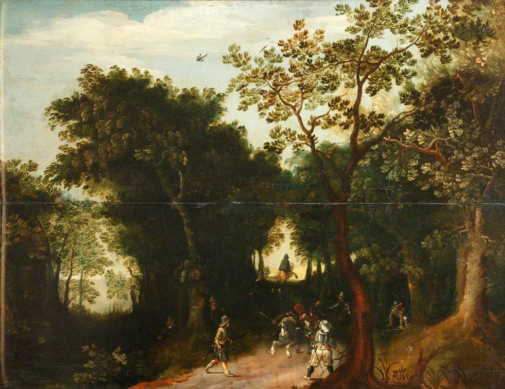

# The Shattered Axe

<!-- campaign-artwork:start -->

*Visual reference: A Pass with Travellers Attacked by Bandits — Salvator Rosa. [Public domain](https://creativecommons.org/publicdomain/mark/1.0/); [source](https://commons.wikimedia.org/wiki/File:Salvator_Rosa_(1615-1673)_-_A_Pass_with_Travellers_Attacked_by_Bandits_-_129818_-_National_Trust.jpg). [[Attachments/Artwork Credits|Credits and interpretation]].*

<!-- campaign-artwork:end -->

## At a Glance

**True objective:** Turn the collapse into durable personal and organizational power under Ulroc.\
**Immediate pressure:** The Protectorate limits expansion and New Ostium contains the richest targets behind a difficult boundary.\
**What they need:** Profitable raids, compromised insiders, weapons, and routes that bypass controls.\
**What they fear:** Loss of fear and profitability: Ulroc's men follow him because his brutality produces spoils.\
**How they might use the party:** Blackmail them into theft, buy deniable work, trade information, or use them to hurt the Protectorate.\

## Leadership Hierarchy

1. [[Characters/NPCs/Ulroc Grimscar|Ulroc Grimscar]] — Boss; treats the organization as personal property.
2. [[Characters/NPCs/Vesha Noll|Vesha Noll]] — Intelligence and smuggling chief; blackmail network.
3. **Berrik Thane** — Raiding Captain; leads larger attacks and rewards violent loyalty.
4. **Nalo Grin** — Fence and stores keeper; turns loot into usable money and supplies.

## Relevant Roles to Populate Later

- New Ostium Inside Contact — compromised official or guard.
- Museum Scout — maps valuable collections and security.
- Blackmail Courier — carries threats, proof, and instructions.
- Recruiter — targets desperate Old Ostium residents.

## Actual Agenda

- Expand raids and smuggling.
- Test the party as deniable assets.
- Undermine Protectorate credibility.

## Secrets

- Many spies work for the gang because of blackmail rather than loyalty.
- Vesha's loyalty to Ulroc is conditional.
- Ulroc's authority is stronger than his institution; killing him could fragment rather than automatically dissolve the gang.

## Resources

- Armed raiders.
- Hidden routes.
- Stolen supplies.
- Information and kompromat.

## Internal Tensions

- Profitable veterans respect Ulroc's success; newer desperate recruits may not share his ideology.
- Vesha values survival and information more than Ulroc's doctrine of strength.

## Relationships & Leverage

- Can coerce the party into [[Storylines/Adventures/The Heist|The Heist]].
- Raids on the Hospital District make [[Storylines/Adventures/The Best Defense|The Best Defense]] relevant.
- Ulroc becomes the target of [[Storylines/Adventures/Assassination|Assassination]].

## Current Moves

- Increase pressure on a surviving settlement.
- Identify a New Ostium artifact target.
- Seek leverage over anyone who can cross the wall safely.

## If the Party Helps

- The party can access criminal routes and information but risks becoming complicit or compromised.

## If the Party Opposes

- The Shattered Axe retaliates through theft, blackmail, hostages, and targeted raids before committing to a fair fight.

## Road Banditry

- Orders the upcoming raid on [[Characters/NPCs/Darian Auir|Darian Auir]]'s caravan carrying food, medical supplies, and gold into Ostium.
- [[Characters/NPCs/Korok Grund|Korok Grund]] leads this ambush; [[Characters/NPCs/Carl Marsh|Carl Marsh]] is among the attackers.
- Korok is a field leader, not a replacement for Ulroc or Berrik Thane. The specific ordering intermediary is TBD.
- Carl's family desperation exemplifies existing internal tensions; it does not erase predatory leadership or the harm done by raids.

## PC Knowledge

_No encounter or revelation recorded yet; this is a continuity note, not a publishing restriction._
