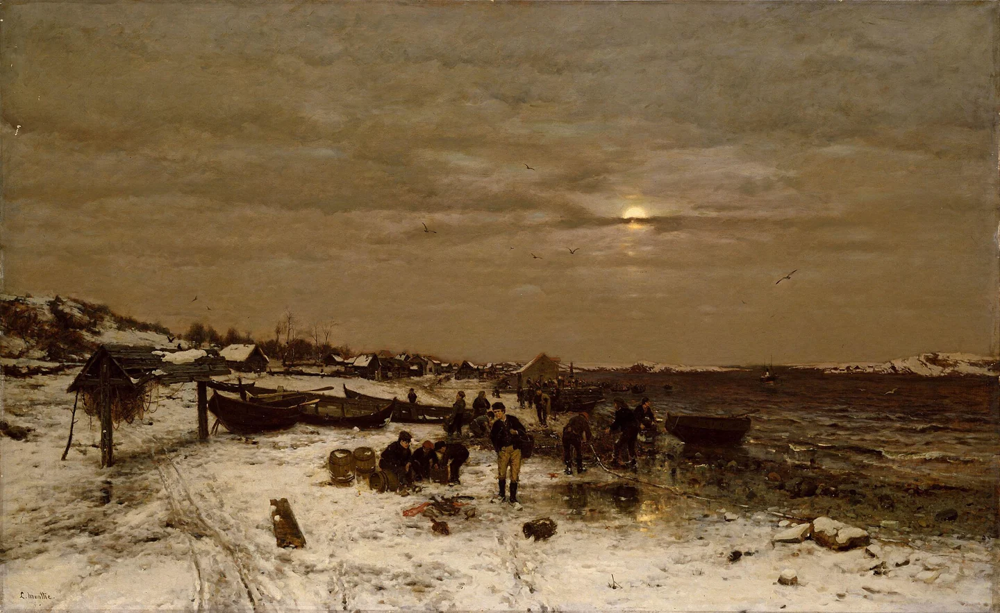
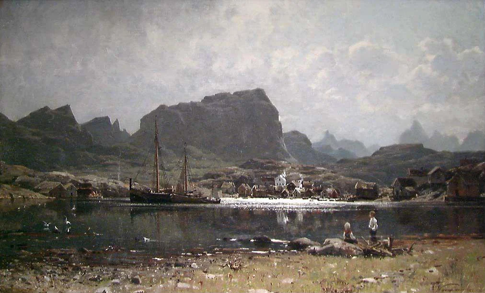

# Mistbreak

<!-- page-summary:start -->

An independent fishing town far north of Ostium, near the Torney Isles, where the party can seek a stockpiled Frigid Woe antidote.

<!-- page-summary:end -->

<!-- page-connections:start -->

## Connected Pages

Location links are document references; geographic containment is shown in the Within and Contained locations rows.

| Connection | Follow links |
| --- | --- |
| People | [[Characters/NPCs/Egbert Lusat\|Egbert Lusat]] · [[Characters/NPCs/Elro Aditower\|Elro Aditower]] · [[Characters/NPCs/Shanda Karth\|Shanda Karth]] · [[Characters/NPCs/Veritas\|Veritas]] |
| Referenced locations | [[Locations/Torney Isles\|Torney Isles]] |
| Campaign & lore | [[Creatures and Afflictions/Frigid Woe\|Frigid Woe]] |

### Adventures & Encounters

| Adventure / state | Situation |
| --- | --- |
| [[Storylines/Adventures/The Prodigal Son\|The Prodigal Son]] — prepared | A prepared family rescue that becomes a civic dilemma: Egbert wants Taran home, but the Hospital District depends on his engineering. |
| [[Storylines/Adventures/The Road to Ostium\|The Road to Ostium]] — prepared | A prepared caravan journey and city investigation opening several routes to Frigid Woe antidote through danger, medical referrals, and negotiation. |

> [!example]- Session references
> A link records a mention, not proof of an appearance or revelation. Read each report for actual outcomes.
>
> | Record | Table | State |
> | --- | --- | --- |
> | [[Session Logs/Session 1 - The Prodigal Son Prep\|Session 1 - The Prodigal Son Prep]] | Unassigned | Planned |
> | [[Session Logs/Steven's Table/Session 1\|Session 1 — The Wizard’s Tower Basement]] | Steven's Table | completed |
> | [[Session Logs/Steven's Table/Session 2\|Session 2 — A New Party in Mistbreak]] | Steven's Table | completed |

<!-- page-connections:end -->

<!-- location-residents:start -->

## NPCs Currently Based Here

| NPC | Role | Faction / affiliation | Recorded current location | Status |
| --- | --- | --- | --- | --- |
| [[Characters/NPCs/Elro Aditower\|Elro Aditower]] | Mayor | Not established | [[Locations/Mistbreak\|Mistbreak]] | alive |

*From NPC current-location records, including contained districts and work sites. A work location is not a confirmed home. Deceased characters, unknown locations, and planned visitors are excluded; table-specific movements must be recorded before changing this list.*

<!-- location-residents:end -->

<!-- campaign-artwork:start -->

> [!gallery]- Visual inspiration
> These images combine classical atmosphere with fantasy texture and scale. They are inspiration, not a map or new campaign facts.
>
> > [!artwork] Classical reference
> >
> > 
> >
> > *Fishing Village on the Norwegian Coast — Ludvig Munthe. [Source](https://commons.wikimedia.org/wiki/File:Ludvig_Munthe_-_Fishing_Village_on_the_Norwegian_Coast_-_NG.M.00296_-_National_Museum_of_Art,_Architecture_and_Design.jpg) · [Public domain](https://creativecommons.org/publicdomain/mark/1.0/).*
>
> > [!artwork] Classical reference
> >
> > 
> >
> > *A Fishing Village in the North of Norway — Adelsteen Normann. [Source](https://commons.wikimedia.org/wiki/File:Adelsteen_Normann_-_A_fishing_Village_in_the_North_of_Norway_-_NG.M.04360_-_National_Museum_of_Art,_Architecture_and_Design.jpg) · [Public domain](https://creativecommons.org/publicdomain/mark/1.0/).*
>
> > [!artwork] Fantasy reference
> >
> > 
> >
> > *Boat City — David Revoy. [Source](https://www.davidrevoy.com/article144/boat-city) · [CC-BY-4.0](https://creativecommons.org/licenses/by/4.0/).*

<!-- campaign-artwork:end -->

## Geography & Government

- **Canon:** Mistbreak is a completely separate fishing town far north of Ostium, near [[Locations/Torney Isles|Torney Isles]]. It is outside Old and New Ostium and their shared infrastructure.
- It has its own government and faction landscape, independent of Ostium’s authorities and factions. Mayor Elro Aditower is established; other local offices and factions remain **TBD**.
- Travel or a courier journey is required to reach its antidote supply from Ostium; the route, distance, and journey time remain **TBD**.
- Recently important because of nearby [[Creatures and Afflictions/Frigid Woe|Frigid Woe]] cases and a newly discovered antidote.
- A supply of antidote found in the far north has recently been stockpiled here.
- [[Characters/NPCs/Elro Aditower|Elro Aditower]] is the elven mayor. [[Characters/NPCs/Veritas|Veritas]], an elf wizard, died of the affliction several months ago.

## Clues & Revelations

- [[Characters/NPCs/Shanda Karth|Shanda Karth]] can direct the party here or potentially organize a courier.
- The two vials she holds in New Ostium belong to [[Characters/NPCs/Egbert Lusat|Egbert Lusat]] for his two sons. A Mistbreak replacement plan may support negotiation with him, but the PCs can come here directly without meeting him or accepting [[Storylines/Adventures/The Prodigal Son|The Prodigal Son]].
- Stock quantity, custodian, price, access terms, journey time, and whether enough can be obtained for everyone: **Needs decision**.

## Suggested Village Details — Tentative

- Working harbor with fishing vessels and occasional merchant ships.
- Modest apothecary or medical storehouse holding the antidote.
- Locals uneasy about the illness; visiting scholars, merchants, and opportunists.
- Rumors of old Auren ruins on the islands. Ruins are a proposal, not confirmed discoveries.

## D&D 5e (2024) Mechanics

Use the environmental fiction above. For uncertain investigation, travel, negotiation, or repair, see [[Rules/System Guide|System Guide]]; choose checks and consequences for the actual approach. Existing Daggerheart Difficulty, damage, and tiers below are not D&D DCs or encounter ratings. Saving throws, conditions, and spell interactions require a separately defined effect, not an automatic disease rule.

## Daggerheart Environment

> Existing campaign homebrew / narrative guidance, retained independently. Check against the adopted SRD before use; no direct D&D conversion.

- Social / Exploration scenes as needed; no mechanical values or disease clock established.

## Future Changes

- Record what the PCs learn during play in the continuity tracker; the entire entry belongs to the DM wiki.

## PC Knowledge

_No encounter or revelation recorded yet; this is a continuity note, not a publishing restriction._
