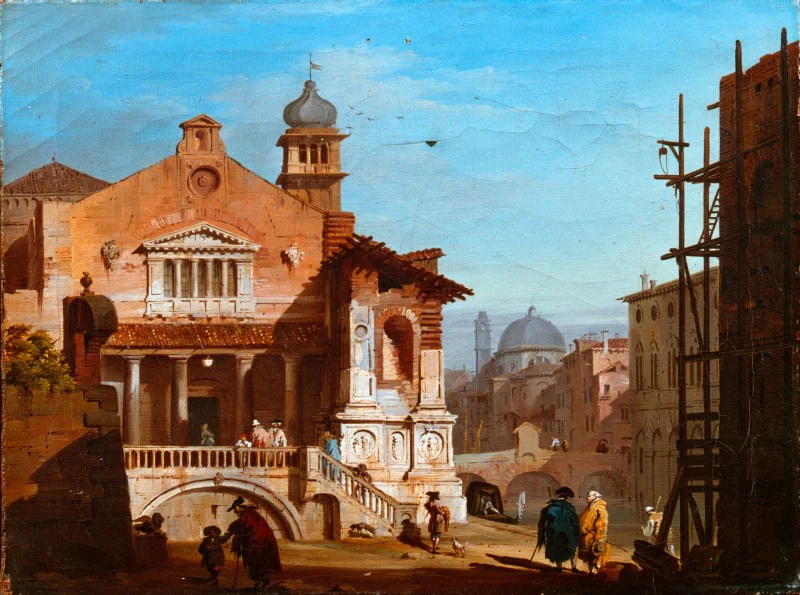
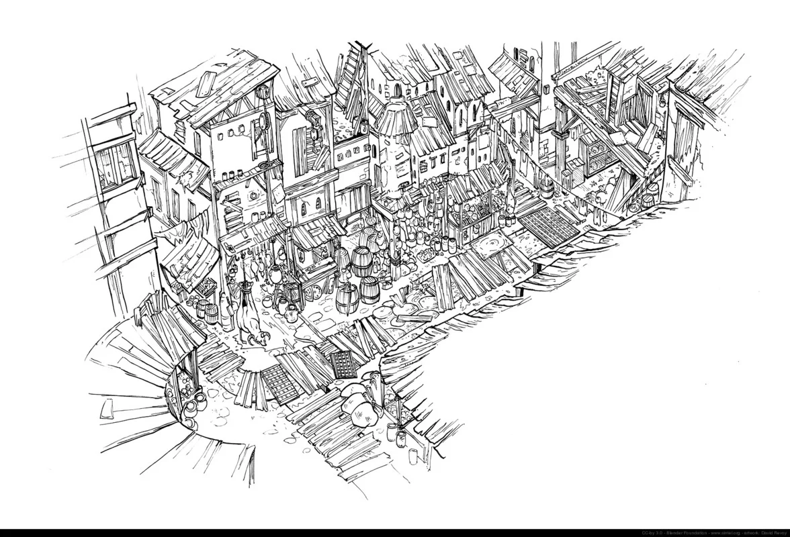

# New Ostium Market District

<!-- page-summary:start -->

New Ostium’s centre of trade and Guild influence, where lawful commerce, artifact speculation, and theft carry political consequences.

<!-- page-summary:end -->

## Operational Summary

**Why the party comes here:** Civilized adventure space for social jobs, trade, investigation, and high-consequence crime\
**What is changing:** Guild consolidation is increasing resentment while also stabilizing supply.\
**Current controlling pressure:** Money, law, reputation, and access.\
**Hidden danger:** Old Ostium artifacts are becoming a speculative market, creating incentives for dangerous expeditions and theft.\
**Useful NPCs:** [[Characters/NPCs/Trine Baradur|Trine Baradur]], [[Characters/NPCs/Dalia Quent|Dalia Quent]]\

<!-- page-connections:start -->

## Connected Pages

| Connection | Follow links |
| --- | --- |
| Within | [[Locations/New Ostium\|New Ostium]] |
| People | [[Characters/NPCs/Dalia Quent\|Dalia Quent]] · [[Characters/NPCs/Trine Baradur\|Trine Baradur]] |
| Factions | [[Factions/New Ostium Merchants Guild\|New Ostium Merchants Guild]] |

### Adventures & Encounters

| Adventure / state | Situation |
| --- | --- |
| [[Storylines/Adventures/Heist II\|Heist II]] — prepared | A prepared resource theft targeting concentrated Guild wealth to help Old Ostium, with consequences for law, trade, and faction relationships. |

> [!example]- Session references
> A link records a mention, not proof of an appearance or revelation. Read each report for actual outcomes.
>
> | Record | Table | State |
> | --- | --- | --- |
> | [[Session Logs/Session 0 Prep\|Session 0 Prep]] | Unassigned | Planned |

<!-- page-connections:end -->

<!-- location-residents:start -->

## NPCs Currently Based Here

| NPC | Role | Faction / affiliation | Recorded current location | Status |
| --- | --- | --- | --- | --- |
| [[Characters/NPCs/Dalia Quent\|Dalia Quent]] | Guildmaster; broker and fixer | [[Factions/New Ostium Merchants Guild\|New Ostium Merchants Guild]] | [[Locations/New Ostium Market District\|New Ostium Market District]] | alive |
| [[Characters/NPCs/Trine Baradur\|Trine Baradur]] | Guild acquisition factor; merchant and broker | [[Factions/New Ostium Merchants Guild\|New Ostium Merchants Guild]] | [[Locations/New Ostium Market District\|New Ostium Market District]] | alive |

*From NPC current-location records, including contained districts and work sites. A work location is not a confirmed home. Deceased characters, unknown locations, and planned visitors are excluded; table-specific movements must be recorded before changing this list.*

<!-- location-residents:end -->

<!-- campaign-artwork:start -->

> [!gallery]- Visual inspiration
> These images combine classical atmosphere with fantasy texture and scale. They are inspiration, not a map or new campaign facts.
>
> > [!artwork] Classical reference
> >
> > 
> >
> > *Veduta di una piazzetta a Venezia — Giovanni Migliara. [Source](https://commons.wikimedia.org/wiki/File:Artgate_Fondazione_Cariplo_-_Migliara_Giovanni,_Veduta_di_una_piazzetta_a_Venezia.jpg) · [CC BY-SA 3.0](https://creativecommons.org/licenses/by-sa/3.0).*
>
> > [!artwork] Fantasy reference
> >
> > 
> >
> > *Ishtar — market — David Revoy / Blender Foundation (Sintel). [Source](https://www.davidrevoy.com/article45/sintel-art-direction) · [CC-BY-4.0](https://creativecommons.org/licenses/by/4.0/).*

<!-- campaign-artwork:end -->

## Secrets & Hidden History

- The Merchants Guild used the relocation chaos to remove or absorb competitors.
- Trine can pull the party into artifact retrieval without needing violence.

## Faction Pressures

- Government needs merchants but fears appearing captured by them.
- Shattered Axe smugglers seek buyers and compromised contacts.

## Hidden Areas / Access

- Secure warehouse districts can support [[Storylines/Adventures/Heist II|Heist II]].

## Clues & Revelations

- Ledger patterns can show investment in Old Ostium salvage.

## D&D 5e (2024) Mechanics

Use the environmental fiction above. For uncertain investigation, travel, negotiation, or repair, see [[Rules/System Guide|System Guide]]; choose checks and consequences for the actual approach. Existing Daggerheart Difficulty, damage, and tiers below are not D&D DCs or encounter ratings. Saving throws, conditions, and spell interactions require a separately defined effect, not an automatic disease rule.

## Daggerheart Environment

> Existing campaign homebrew / narrative guidance, retained independently. Check against the adopted SRD before use; no direct D&D conversion.

**Tier:** 1-2\
**Type:** Social\
**Description:** A wealthy commercial district where almost everything has a price and crime has consequences.\
**Impulses:** Tempt, appraise, regulate, compete\
**Difficulty:** 11 early\
**Potential Adversaries:** Guild negotiators, guards, thieves, social rivals\

### Features

- **Everything Has a Buyer — Passive:** An unusual object, rumour, or service can usually find a buyer, but the buyer's interest creates a relationship or complication.
- **Law Is Nearby — Reaction:** On Fear during a crime or public disturbance, introduce witnesses, guards, records, or reputational consequences rather than defaulting immediately to combat.

### Feature Questions

- Who profits if the party succeeds?
- What evidence does a civilized city leave behind after a crime?

## Encounter / Scene Ideas

- Shopping that becomes patron recruitment.
- Negotiation with Trine or Dalia.
- Planning or aftermath for Heist II.

## Future Changes

- Market politics can become part of Old/New negotiations.

## PC Knowledge

_No encounter or revelation recorded yet; this is a continuity note, not a publishing restriction._
