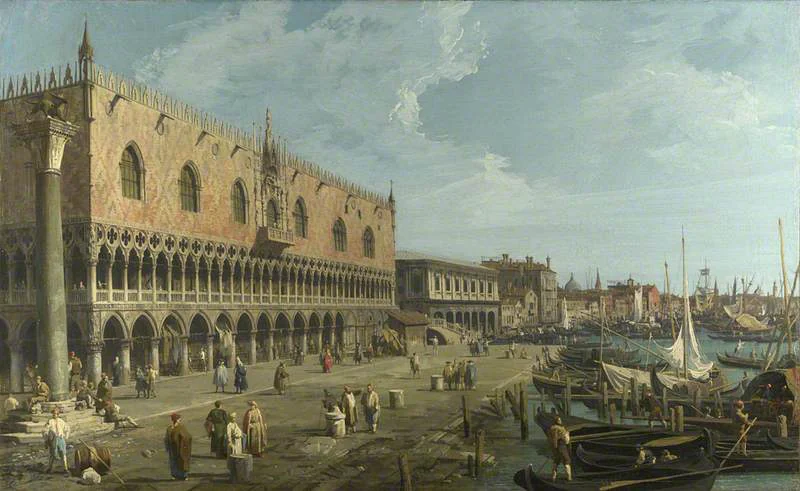

# New Ostium

<!-- location-residents:start -->

## NPCs Currently Based Here

| NPC | Role | Faction / affiliation | Recorded current location | Status |
| --- | --- | --- | --- | --- |
| [[Characters/NPCs/Dalia Quent\|Dalia Quent]] | Guildmaster; broker and fixer | [[Factions/New Ostium Merchants Guild\|New Ostium Merchants Guild]] | [[Locations/New Ostium Market District\|New Ostium Market District]] | alive |
| [[Characters/NPCs/Egbert Lusat\|Egbert Lusat]] | Wealthy merchant and former Old Ostium resident | Not established | [[Locations/New Ostium\|New Ostium]] | alive |
| [[Characters/NPCs/Helena Orst\|Helena Orst]] | First Councillor; civil administrator | [[Factions/New Ostium Government\|New Ostium Government]] | [[Locations/New Ostium Town Hall\|New Ostium Town Hall]] | alive |
| [[Characters/NPCs/Orla Meren\|Orla Meren]] | Public servant and clerk | Not established | [[Locations/New Ostium\|New Ostium]] | alive |
| [[Characters/NPCs/Shanda Karth\|Shanda Karth]] | Apothecary | Not established | [[Locations/New Ostium\|New Ostium]] | alive |
| [[Characters/NPCs/Trine Baradur\|Trine Baradur]] | Guild acquisition factor; merchant and broker | [[Factions/New Ostium Merchants Guild\|New Ostium Merchants Guild]] | [[Locations/New Ostium Market District\|New Ostium Market District]] | alive |

*From NPC current-location records, including contained districts and work sites. A work location is not a confirmed home. Deceased characters, unknown locations, and planned visitors are excluded; table-specific movements must be recorded before changing this list.*

<!-- location-residents:end -->

<!-- campaign-artwork:start -->

> [!gallery] Visual inspiration
> These images combine classical atmosphere with fantasy texture and scale. They are inspiration, not a map or new campaign facts.
>
> > [!artwork] Classical reference
> >
> > 
> >
> > *Dido Building Carthage — J. M. W. Turner. [Source](https://commons.wikimedia.org/wiki/File:Dido_building_Carthage_-_JMW_Turner.jpg) · [Public domain](https://creativecommons.org/publicdomain/mark/1.0/).*
>
> > [!artwork] Classical reference
> >
> > 
> >
> > *Venice, The Doge’s Palace and the Riva degli Schiavoni — Canaletto (Giovanni Antonio Canal). [Source](https://commons.wikimedia.org/wiki/File:Canaletto_(1697-1768)_-_Venice,_The_Doge%27s_Palace_and_the_Riva_degli_Schiavoni_-_NG940_-_National_Gallery.jpg) · [Public domain](https://creativecommons.org/publicdomain/mark/1.0/).*
>
> > [!artwork] Fantasy reference
> >
> > 
> >
> > *Ishtar — city panorama — David Revoy / Blender Foundation (Sintel). [Source](https://www.davidrevoy.com/article45/sintel-art-direction) · [CC-BY-4.0](https://creativecommons.org/licenses/by/4.0/).*

<!-- campaign-artwork:end -->

## Operational Summary

**Why the party comes here:** Safe hub, political arena, and contrast to Old Ostium\
**What is changing:** The city is learning that a wall cannot sever infrastructure dependency.\
**Current controlling pressure:** Government capacity, merchant power, public fear of Old Ostium.\
**Hidden danger:** New Ostium's prosperity still depends partly on systems and people it has politically abandoned.\
**Useful NPCs:** [[Characters/NPCs/Egbert Lusat|Egbert Lusat]], [[Characters/NPCs/Trine Baradur|Trine Baradur]], [[Characters/NPCs/Dalia Quent|Dalia Quent]], [[Characters/NPCs/Helena Orst|Helena Orst]]\

## Secrets & Hidden History

- New Ostium is not 'fake' safety; it genuinely works better. The moral complication is that its stability depends partly on exclusion and on systems still maintained in Old Ostium.

## Faction Pressures

- Government and Merchants Guild cooperate but compete over who sets priorities.
- Old Ostium crises can become New Ostium political crises when water, trade, or security is affected.

## Hidden Areas / Access

- Restricted maintenance access and administrative archives can contain records relevant to Old water infrastructure.

## Clues & Revelations

- Officials acknowledge shared infrastructure only reluctantly when it threatens narratives of separation.

## Frigid Woe / Prodigal Son Connection

- [[Characters/NPCs/Shanda Karth|Shanda Karth]] holds **two** antidote vials belonging to [[Characters/NPCs/Egbert Lusat|Egbert Lusat]], reserved for his two sons after the loss of his wife, [[Characters/NPCs/Tara Lusat|Tara Lusat]], to [[Creatures and Afflictions/The Rot|the Rot of Old Ostium]]. Neither son is established as infected with Frigid Woe.
- Shanda cannot independently sell the stock, but can introduce the PCs. Egbert may negotiate medicine for [[Storylines/Adventures/The Prodigal Son|help with Taran]], substantial gold, assurances/collateral, or replacement supply; he is sympathetic, not an automatic obstacle.
- [[Locations/Mistbreak|Mistbreak]] remains a direct-travel or courier alternative. Other paid work, research, and theft remain possible without accepting Egbert's quest.

## D&D 5e (2024) Mechanics

Use the environmental fiction above. For uncertain investigation, travel, negotiation, or repair, see [[Rules/System Guide|System Guide]]; choose checks and consequences for the actual approach. Existing Daggerheart Difficulty, damage, and tiers below are not D&D DCs or encounter ratings. Saving throws, conditions, and spell interactions require a separately defined effect, not an automatic disease rule.

## Daggerheart Environment

> Existing campaign homebrew / narrative guidance, retained independently. Check against the adopted SRD before use; no direct D&D conversion.

**Tier:** 1\
**Type:** Social\
**Description:** A functioning successor city trying to preserve order while denying how entangled it remains with the city beyond the wall.\
**Impulses:** Regulate, allocate, exclude, bargain\
**Difficulty:** 11 for early social scenes\
**Potential Adversaries:** Officials, Guild security, smugglers, social opposition\

### Features

- **Capacity Has a Number — Passive:** When the party asks the city to take responsibility for Old Ostium, give the request a concrete resource, housing, or political cost instead of a purely ideological refusal.
- **The Wall Is Political — Reaction:** On Fear during a public dispute, the issue becomes about who belongs to New Ostium and who gets to decide.

### Feature Questions

- Who benefits from the current boundary?
- What resource is genuinely scarce?
- What would cooperation cost the people already inside the wall?

## Encounter / Scene Ideas

- Patron meeting with Egbert.
- Merchant negotiation.
- Government hearing after an Old Ostium incident.
- A safe street disrupted by consequences from Pump 7.

## Future Changes

- Negotiations can shift the city from denial toward structured cooperation.

## PC Knowledge — Recorded Overview

New Ostium is the functioning successor city that grew out of the newer districts of Ostium. It is the safer and more orderly side of the divided capital.

It depends on the survival of the wider city, even as it remains politically and practically separate from [[Locations/Old Ostium|Old Ostium]].
