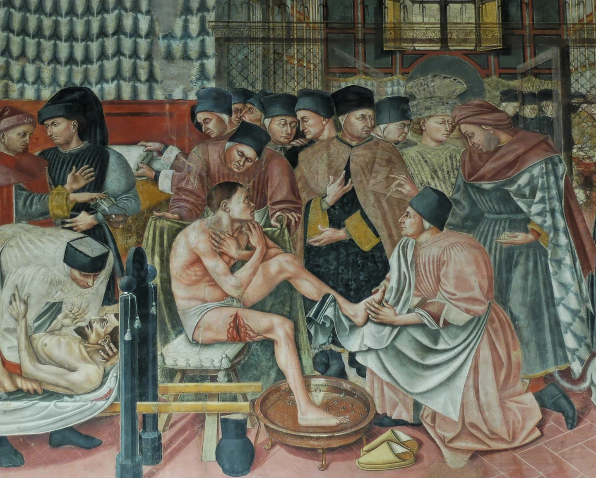

# Old Ostium Hospital District

<!-- campaign-artwork:start -->

> [!gallery] Visual inspiration
> These images combine classical atmosphere with fantasy texture and scale. They are inspiration, not a map or new campaign facts.
>
> > [!artwork] Classical reference
> >
> > 
> >
> > *Caring for the Sick, Pellegrinaio fresco detail — Domenico di Bartolo. [Source](https://commons.wikimedia.org/wiki/File:Pellegrinaio_Santa_Maria_della_Scala_n5.jpg) · [Public domain](https://creativecommons.org/publicdomain/mark/1.0/).*
>
> > [!artwork] Fantasy reference
> >
> > 
> >
> > *Ishtar — layered streets — David Revoy / Blender Foundation (Sintel). [Source](https://www.davidrevoy.com/article45/sintel-art-direction) · [CC-BY-4.0](https://creativecommons.org/licenses/by/4.0/).*

<!-- campaign-artwork:end -->

## Operational Summary

**Why the party comes here:** Moral centre of the opening arc and proof that Old Ostium is inhabited, organized, and worth caring about\
**What is changing:** Its water situation is fragile and Taran's condition is worsening.\
**Current controlling pressure:** Protection costs, supply scarcity, water reliability, Rot patients.\
**Hidden danger:** The settlement's dependence on Taran makes Egbert's apparently simple rescue request ethically complicated.\
**Useful NPCs:** [[Characters/NPCs/Taran Lusat|Taran Lusat]], [[Characters/NPCs/Mara Voss|Mara Voss]], [[Characters/NPCs/Arla Gerrin|Arla Gerrin]]\

## Secrets & Hidden History

- Taran's early Rot symptoms are known or suspected by a few people.
- The district cannot easily replace his infrastructure expertise.
- Residents' willingness to pay the Protectorate reflects genuine fear of what happens without patrols.

## Faction Pressures

- Mara must bargain with Indra over protection levies.
- Engineers and volunteers overlap in practical work.
- The Shattered Axe sees the district as both prey and a source of blackmailable desperation.

## Hidden Areas / Access

- Maintenance access from the district can connect into waterworks routes used in the opening adventure.

## Clues & Revelations

- Specific residents can explain what stops working if Taran leaves.
- A sudden water-quality or pressure problem can demonstrate the stakes rather than explain them.

## D&D 5e (2024) Mechanics

Use the environmental fiction above. For uncertain investigation, travel, negotiation, or repair, see [[Rules/System Guide|System Guide]]; choose checks and consequences for the actual approach. Existing Daggerheart Difficulty, damage, and tiers below are not D&D DCs or encounter ratings. Saving throws, conditions, and spell interactions require a separately defined effect, not an automatic disease rule.

## Daggerheart Environment

> Existing campaign homebrew / narrative guidance, retained independently. Check against the adopted SRD before use; no direct D&D conversion.

**Tier:** 1\
**Type:** Social\
**Description:** A crowded survivor settlement where care, scarcity, and protection politics are inseparable.\
**Impulses:** Shelter, ration, ask for help, endure\
**Difficulty:** 11\
**Potential Adversaries:** Scarcity, social conflict, raiders at the perimeter, Rot emergencies\

### Features

- **Everyone Has a Job — Passive:** Show residents contributing in concrete ways so the settlement is never framed as helpless scenery.
- **There Is Not Enough — Reaction:** On Fear in a resource negotiation, reveal a real shortage that makes every available choice costly.
- **Alarm at the Barricade — Action:** Introduce a threat outside the settlement when a scene needs pressure or optional combat, without making violence mandatory.

### Feature Questions

- Who would be harmed if Taran leaves today?
- Who thinks he should leave anyway?
- What does the settlement pay for protection that it cannot replace?

## Encounter / Scene Ideas

- The party meets Taran doing useful work rather than waiting to be rescued.
- Mara explains a concrete shortage.
- Optional raider/Rot threat creates a combat path without forcing one.

## Future Changes

- Success in Act I can improve water stability or create new political ties for the settlement.

## Upcoming Illness Investigation

- [[Characters/NPCs/Arla Gerrin|Arla Gerrin]] treats Rot patients and injuries here. She can recognize that the PCs' affliction is different and refer them to [[Characters/NPCs/Shanda Karth|Shanda Karth]].
- Arla has no antidote. Her apothecary role supplements existing community leadership rather than replacing it.
- “Old Hospital Quarter” is an alternate name for this district, not a second location.

## PC Knowledge

_No encounter or revelation recorded yet; this is a continuity note, not a publishing restriction._
