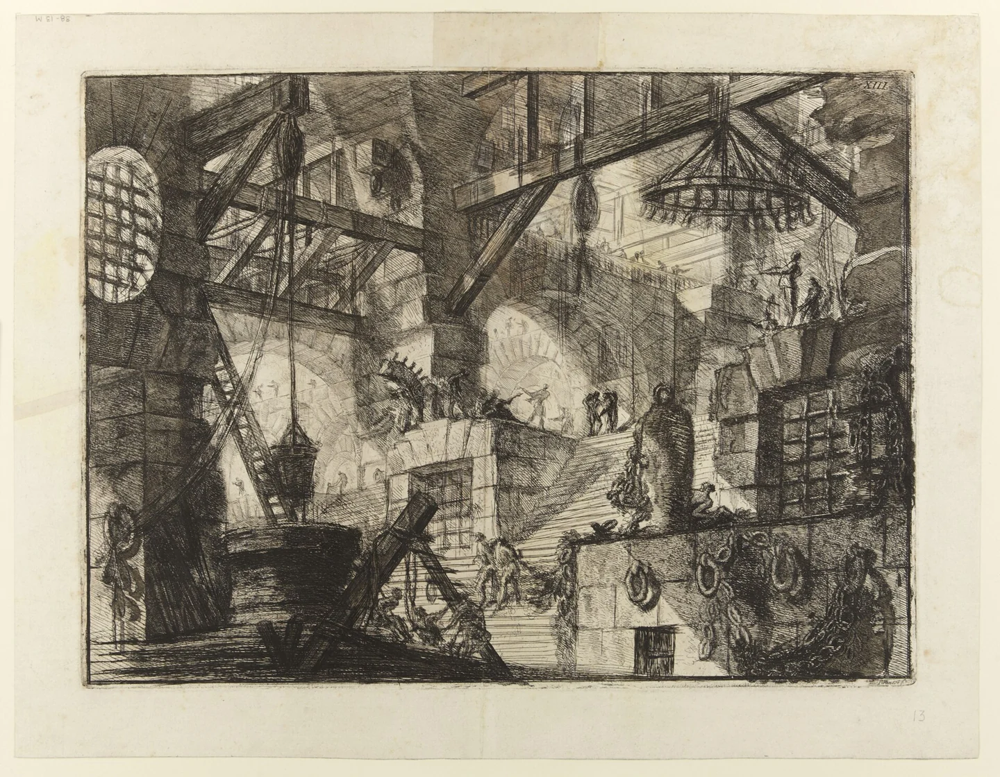

# Old Ostium Pump 4

<!-- page-summary:start -->

A comparatively stable waterworks station run by Senn Vale, showing what maintenance can preserve and what continued shortages could destroy.

<!-- page-summary:end -->

## Operational Summary

**Why the party comes here:** Stable comparison point for understanding why Pump 7 is alarming\
**What is changing:** Wear is accumulating faster than crews can reverse it.\
**Current controlling pressure:** Shortages of parts and experienced labour.\
**Hidden danger:** Some underlying interfaces do not match the station's documented construction history.\
**Useful NPCs:** [[Characters/NPCs/Senn Vale|Senn Vale]], [[Characters/NPCs/Brock Drungur|Brock Drungur]]\

<!-- page-connections:start -->

## Connected Pages

Location links are document references; geographic containment is shown in the Within and Contained locations rows.

| Connection | Follow links |
| --- | --- |
| Within | [[Locations/Old Ostium\|Old Ostium]] |
| People | [[Characters/NPCs/Brock Drungur\|Brock Drungur]] · [[Characters/NPCs/Senn Vale\|Senn Vale]] |
| Factions | [[Factions/Old Ostium Engineers\|Old Ostium Engineers]] |

<!-- page-connections:end -->

<!-- location-residents:start -->

## NPCs Currently Based Here

| NPC | Role | Faction / affiliation | Recorded current location | Status |
| --- | --- | --- | --- | --- |
| [[Characters/NPCs/Senn Vale\|Senn Vale]] | Pump captain; waterworks maintenance worker | [[Factions/Old Ostium Engineers\|Old Ostium Engineers]] | [[Locations/Old Ostium Pump 4\|Old Ostium Pump 4]] | alive |

*From NPC current-location records, including contained districts and work sites. A work location is not a confirmed home. Deceased characters, unknown locations, and planned visitors are excluded; table-specific movements must be recorded before changing this list.*

<!-- location-residents:end -->

<!-- campaign-artwork:start -->

> [!gallery]- Visual inspiration
> These images combine classical atmosphere with fantasy texture and scale. They are inspiration, not a map or new campaign facts.
>
> > [!artwork] Classical reference
> >
> > 
> >
> > *Le Carceri d’Invenzione: The Well, second edition — Giovanni Battista Piranesi. [Source](https://commons.wikimedia.org/wiki/File:Giovanni_Battista_Piranesi_-_Le_Carceri_d%27Invenzione_-_Second_Edition_-_1761_-_13_-_The_Well.jpg) · [Public domain](https://creativecommons.org/publicdomain/mark/1.0/).*
>
> > [!artwork] Fantasy reference
> >
> > 
> >
> > *Ishtar — alley — David Revoy / Blender Foundation (Sintel). [Source](https://www.davidrevoy.com/article45/sintel-art-direction) · [CC-BY-4.0](https://creativecommons.org/licenses/by/4.0/).*

<!-- campaign-artwork:end -->

## Secrets & Hidden History

- Pump 4 can provide baseline evidence that normal municipal machinery is layered over much older works.

## Faction Pressures

- Engineers want the party to avoid destabilizing Pump 4 while chasing a Pump 7 solution.

## Hidden Areas / Access

- A sealed service route can hint toward the older network without requiring early entry.

## Clues & Revelations

- Certain pressure rhythms continue even when local machinery is stopped.

## D&D 5e (2024) Mechanics

Use the environmental fiction above. For uncertain investigation, travel, negotiation, or repair, see [[Rules/System Guide|System Guide]]; choose checks and consequences for the actual approach. Existing Daggerheart Difficulty, damage, and tiers below are not D&D DCs or encounter ratings. Saving throws, conditions, and spell interactions require a separately defined effect, not an automatic disease rule.

## Daggerheart Environment

> Existing campaign homebrew / narrative guidance, retained independently. Check against the adopted SRD before use; no direct D&D conversion.

**Tier:** 1\
**Type:** Exploration\
**Description:** A functioning pump station held together by expertise, salvage, and constant attention.\
**Impulses:** Leak, overload, warn, demand maintenance\
**Difficulty:** 11\
**Potential Adversaries:** Mechanical hazards, intruders, Rot phenomena in lower access\

### Features

- **Redundant Until It Isn't — Passive:** Early failures have workarounds, but each workaround removes a future safety margin.
- **Pressure Spike — Reaction:** On Fear during a repair or sabotage attempt, a connected subsystem becomes the immediate problem rather than simply inflicting damage.

### Feature Questions

- What has been repaired too many times?
- What older component should not be here?

## Encounter / Scene Ideas

- Engineer tutorial scene.
- Evidence comparison before Pump 7.
- Emergency stabilization while Brock is elsewhere.

## Future Changes

- Can become a symbol of what is saved or lost by Pump 7 choices.

## PC Knowledge

_No encounter or revelation recorded yet; this is a continuity note, not a publishing restriction._
