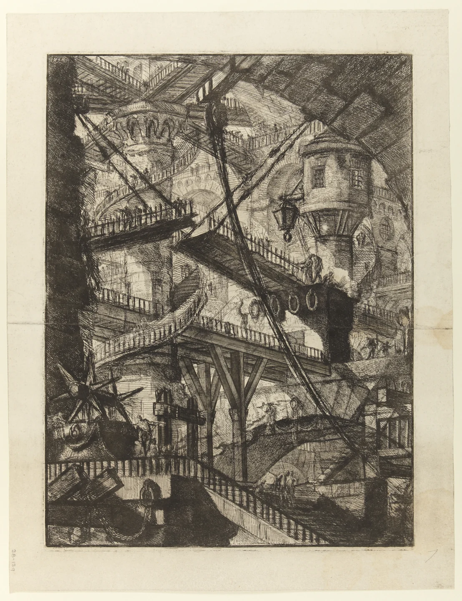
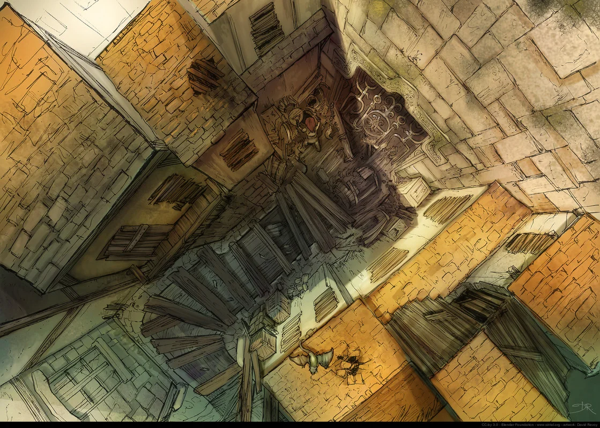

# Old Ostium Pump 7

<!-- page-summary:start -->

A failing pump station whose threatened collapse forces both cities to confront their dependence on shared infrastructure.

<!-- page-summary:end -->

## Operational Summary

**Why the party comes here:** Act I climax that forces the party to confront the cities' shared infrastructure\
**What is changing:** The station is approaching a failure state that makes an apparent binary solution politically explosive.\
**Current controlling pressure:** Time, Rot exposure, water pressure, competing Old/New priorities.\
**Hidden danger:** The visible Pump 7 system interfaces with a deeper structure the city did not build.\
**Useful NPCs:** [[Characters/NPCs/Brock Drungur|Brock Drungur]], [[Characters/NPCs/Taran Lusat|Taran Lusat]]\

<!-- location-residents:start -->

## NPCs Currently Based Here

| NPC | Role | Faction / affiliation | Recorded current location | Status |
| --- | --- | --- | --- | --- |
| None recorded | — | — | — | — |

*From NPC current-location records, including contained districts and work sites. A work location is not a confirmed home. Deceased characters, unknown locations, and planned visitors are excluded; table-specific movements must be recorded before changing this list.*

<!-- location-residents:end -->

## Secrets & Hidden History

- Pump 7 should initially look like a civic engineering crisis, not a divine revelation.
- [[Characters/NPCs/Brock Drungur|Brock Drungur]] knows a third option involving repair of the exhaust system. The exact engineering route remains intentionally flexible until the final Pump 7 scenario is detailed.
- Successful repair can expose access or evidence pointing toward [[Locations/Titan Works|Titan Works]], launching Act II.

## Faction Pressures

- New Ostium wants clean water and controlled waste/overflow.
- Old Ostium residents cannot accept solutions that simply dump the cost onto them.
- Engineers need a technically viable solution regardless of politics.

## Hidden Areas / Access

- Exhaust access descends beyond documented municipal construction.
- A lower maintenance route can be the first clear transition from 'old city engineering' to 'something older.'

## Clues & Revelations

- Materials and geometry below the civic station do not match known construction.
- Flow behaves less like a sewer network and more like pressure in a living system, though this should be implication rather than explanation.

## D&D 5e (2024) Mechanics

Use the environmental fiction above. For uncertain investigation, travel, negotiation, or repair, see [[Rules/System Guide|System Guide]]; choose checks and consequences for the actual approach. Existing Daggerheart Difficulty, damage, and tiers below are not D&D DCs or encounter ratings. Saving throws, conditions, and spell interactions require a separately defined effect, not an automatic disease rule.

## Daggerheart Environment

> Existing campaign homebrew / narrative guidance, retained independently. Check against the adopted SRD before use; no direct D&D conversion.

**Tier:** 1 climax\
**Type:** Event / Exploration\
**Description:** A failing pump complex where engineering, Rot exposure, and political stakes converge.\
**Impulses:** Force tradeoffs, flood, expose dependency, open the way down\
**Difficulty:** 11; raise specific tasks when fiction demands\
**Potential Adversaries:** Rot-afflicted threats, Shattered Axe opportunists if appropriate, infrastructure itself\

### Features

- **Rising Pressure — Passive:** Every major delay should visibly worsen one concrete condition: water level, contamination, structural strain, or political time pressure.
- **Bad Binary — Action:** Present a technically workable solution that protects one population by imposing serious cost on the other.
- **Third Option — Revelation:** Once the party understands the bad binary and has access to Brock, reveal the dangerous exhaust repair as a third route. It should require action, not merely a successful conversation.
- **What Is This Made Of? — Reaction:** On a successful investigation with Fear in the deeper section, give the clue they need but also make clear that some underlying structure predates the municipal works.

### Feature Questions

- Who pays for the easy solution?
- What does the third option require the party to risk?
- What is the first undeniable sign that the deeper system is not ordinary civic engineering?

## Encounter / Scene Ideas

- Competing briefings from stakeholders.
- Traversal through a flooded maintenance route.
- Emergency repair under pressure.
- Choice between expedient factional solutions and Brock's dangerous third option.

## Future Changes

- Resolution ends Act I and opens the deeper campaign beneath the waterworks.

## PC Knowledge

_No encounter or revelation recorded yet; this is a continuity note, not a publishing restriction._

<!-- campaign-artwork:start -->

> [!gallery]- Visual inspiration
> These images combine classical atmosphere with fantasy texture and scale. They are inspiration, not a map or new campaign facts.
>
> > [!artwork] Classical reference
> >
> > 
> >
> > *Le Carceri d’Invenzione: The Drawbridge, second edition — Giovanni Battista Piranesi. [Source](https://commons.wikimedia.org/wiki/File:Giovanni_Battista_Piranesi_-_Le_Carceri_d%27Invenzione_-_Second_Edition_-_1761_-_07_-_The_Drawbridge.jpg) · [Public domain](https://creativecommons.org/publicdomain/mark/1.0/).*
>
> > [!artwork] Fantasy reference
> >
> > 
> >
> > *Ishtar — alley — David Revoy / Blender Foundation (Sintel). [Source](https://www.davidrevoy.com/article45/sintel-art-direction) · [CC-BY-4.0](https://creativecommons.org/licenses/by/4.0/).*

<!-- campaign-artwork:end -->

<!-- page-connections:start -->

> [!info]- Connected Pages
> Location mentions are references; Within and Contained locations record geography.
>
> | Connection | Follow links |
> | --- | --- |
> | Within | [[Locations/Old Ostium\|Old Ostium]] |
> | People | [[Characters/NPCs/Brock Drungur\|Brock Drungur]] · [[Characters/NPCs/Taran Lusat\|Taran Lusat]] |
> | Referenced locations | [[Locations/Titan Works\|Titan Works]] |
> | Factions | [[Factions/New Ostium Government\|New Ostium Government]] · [[Factions/Old Ostium Engineers\|Old Ostium Engineers]] |
>
> ### Adventures & Encounters
>
> | Adventure / state | Situation |
> | --- | --- |
> | [[Storylines/Adventures/Pump 7\|Pump 7]] — prepared | A prepared infrastructure crisis offering alternatives to a choice that merely shifts catastrophe between Old and New Ostium. |

<!-- page-connections:end -->
