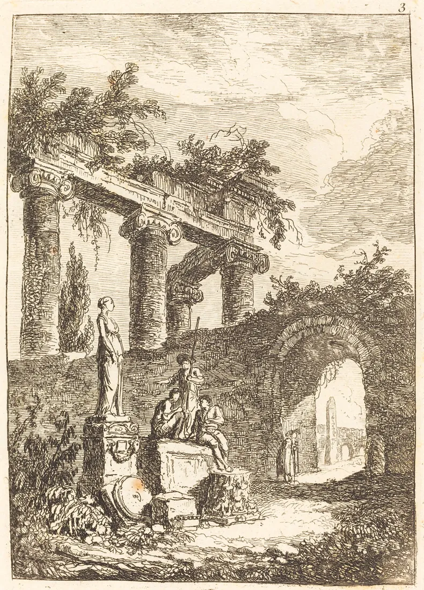

# Old Ostium Town Hall

<!-- page-summary:start -->

The Protectorate’s civic and military hub, where supply shortages, levies, and the legitimacy of armed protection meet.

<!-- page-summary:end -->

<!-- campaign-artwork:start -->

> [!gallery]- Visual inspiration
> These images combine classical atmosphere with fantasy texture and scale. They are inspiration, not a map or new campaign facts.
>
> > [!artwork] Classical reference
> >
> > 
> >
> > *The Statue before the Ruins — Hubert Robert. [Source](https://commons.wikimedia.org/wiki/File:Hubert_Robert,_The_Statue_before_the_Ruins,_NGA_52436.jpg) · [CC0](http://creativecommons.org/publicdomain/zero/1.0/deed.en).*
>
> > [!artwork] Fantasy reference
> >
> > 
> >
> > *Ishtar — abandoned temple — David Revoy / Blender Foundation (Sintel). [Source](https://www.davidrevoy.com/article45/sintel-art-direction) · [CC-BY-4.0](https://creativecommons.org/licenses/by/4.0/).*

<!-- campaign-artwork:end -->

## Operational Summary

**Why the party comes here:** Faction hub for Protectorate negotiations, jobs, and internal politics\
**What is changing:** Supply pressure may force Indra into harder levy decisions.\
**Current controlling pressure:** Logistics and legitimacy.\
**Hidden danger:** Internal abuses can exist without making the entire faction fraudulent.\
**Useful NPCs:** [[Characters/NPCs/Indra Karaf|Indra Karaf]], [[Characters/NPCs/Calev Marr|Calev Marr]]\

<!-- page-connections:start -->

## Connected Pages

Location links are document references; geographic containment is shown in the Within and Contained locations rows.

| Connection | Follow links |
| --- | --- |
| Within | [[Locations/Old Ostium\|Old Ostium]] |
| People | [[Characters/NPCs/Calev Marr\|Calev Marr]] · [[Characters/NPCs/Indra Karaf\|Indra Karaf]] |
| Factions | [[Factions/The Protectorate\|The Protectorate]] |

<!-- page-connections:end -->

<!-- location-residents:start -->

## NPCs Currently Based Here

| NPC | Role | Faction / affiliation | Recorded current location | Status |
| --- | --- | --- | --- | --- |
| [[Characters/NPCs/Calev Marr\|Calev Marr]] | Protectorate quartermaster | [[Factions/The Protectorate\|The Protectorate]] | [[Locations/Old Ostium Town Hall\|Old Ostium Town Hall]] | alive |
| [[Characters/NPCs/Indra Karaf\|Indra Karaf]] | Commander of the Protectorate | [[Factions/The Protectorate\|The Protectorate]] | [[Locations/Old Ostium Town Hall\|Old Ostium Town Hall]] | alive |

*From NPC current-location records, including contained districts and work sites. A work location is not a confirmed home. Deceased characters, unknown locations, and planned visitors are excluded; table-specific movements must be recorded before changing this list.*

<!-- location-residents:end -->

## Secrets & Hidden History

- Calev's records can prove how expensive the force is and also expose officers who exploit the system.
- The building can become a target if the Shattered Axe decides to break Protectorate legitimacy.

## Faction Pressures

- Protected settlements resent fees but fear losing patrols.
- New Ostium may treat the Protectorate as an unofficial armed group rather than a legitimate authority.

## Hidden Areas / Access

- Old record rooms can still contain municipal maps relevant to early waterworks research.

## Clues & Revelations

- Old police and civic documents show how rapidly official withdrawal happened.

## D&D 5e (2024) Mechanics

Use the environmental fiction above. For uncertain investigation, travel, negotiation, or repair, see [[Rules/System Guide|System Guide]]; choose checks and consequences for the actual approach. Existing Daggerheart Difficulty, damage, and tiers below are not D&D DCs or encounter ratings. Saving throws, conditions, and spell interactions require a separately defined effect, not an automatic disease rule.

## Daggerheart Environment

> Existing campaign homebrew / narrative guidance, retained independently. Check against the adopted SRD before use; no direct D&D conversion.

**Tier:** 1-2\
**Type:** Social\
**Description:** A former civic building turned into the operational heart of Old Ostium's strongest defensive faction.\
**Impulses:** Demand proof, allocate force, count costs, judge\
**Difficulty:** 11 early; 14 for later high-stakes negotiations\
**Potential Adversaries:** Protectorate officers, political pressure, potential infiltrators\

### Features

- **Show the Ledger — Passive:** If the party challenges the cost of protection, Calev or another officer can produce concrete shortages and expenditures instead of ending the scene with assertion.
- **Authority Without a State — Reaction:** On Fear, a dispute turns into a question of who gave the Protectorate the right to decide.

### Feature Questions

- What happens if the Protectorate cannot afford the next patrol?
- Which old civic function are they now performing without legal authority?

## Encounter / Scene Ideas

- Meet Indra.
- Negotiate protection or supplies.
- Discover internal corruption without collapsing the faction into villainy.

## Future Changes

- Could become a key site in negotiations or Shattered Axe escalation.

## PC Knowledge

_No encounter or revelation recorded yet; this is a continuity note, not a publishing restriction._
