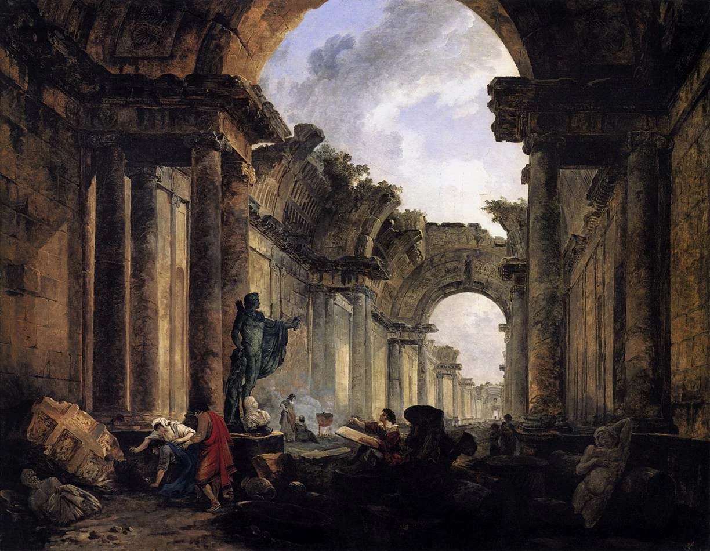
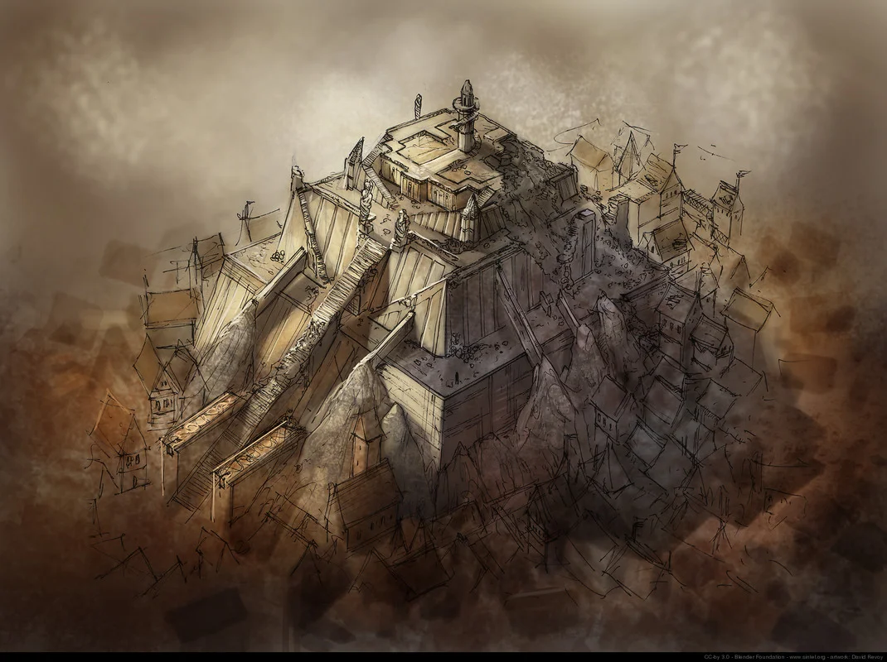

# Old Ostium University

<!-- page-summary:start -->

A dangerous exploration site where the Rot’s cognitive effects and the inhabitants’ shared attention offer distorted clues to the Heart.

<!-- page-summary:end -->

## Operational Summary

**Why the party comes here:** Horror/exploration site that demonstrates the Rot's cognitive and networked qualities\
**What is changing:** The inhabitants' shared mental effects are intensifying.\
**Current controlling pressure:** Collective attention, Rot exposure, and the site's proximity/attunement to deeper influence.\
**Hidden danger:** Some 'psychosis' is also distorted contact with the Heart's amplified cognitive field; neither pure madness nor reliable revelation.\
**Useful NPCs:** [[Characters/NPCs/Orla Meren|Orla Meren]]\

<!-- location-residents:start -->

## NPCs Currently Based Here

| NPC | Role | Faction / affiliation | Recorded current location | Status |
| --- | --- | --- | --- | --- |
| None recorded | — | — | — | — |

*From NPC current-location records, including contained districts and work sites. A work location is not a confirmed home. Deceased characters, unknown locations, and planned visitors are excluded; table-specific movements must be recorded before changing this list.*

<!-- location-residents:end -->

## Secrets & Hidden History

- The university's Rot-afflicted minds are unusually entangled with the Heart's influence.
- Their hive-mind-like behaviour should feel frightening and unstable rather than like a clean telepathic superpower.
- They may notice patterns in the deeper system that healthy investigators cannot, but their interpretations are fragmented and unreliable.

## Faction Pressures

- New Ostium scholars want knowledge but do not want responsibility for the people inside.
- The Shattered Axe may avoid the site unless an artifact or hostage makes the risk worthwhile.

## Hidden Areas / Access

- Archives can contain old descriptions of Ostium's impossible bursts of innovation.
- Lower utility tunnels can hint at the waterworks and deeper routes.

## Clues & Revelations

- Different inhabitants independently draw the same 'heart' or branching channels.
- Multiple people finish Orla's sentences.
- A collective episode contains one accurate infrastructural clue wrapped in delusional content.

## D&D 5e (2024) Mechanics

Use the environmental fiction above. For uncertain investigation, travel, negotiation, or repair, see [[Rules/System Guide|System Guide]]; choose checks and consequences for the actual approach. Existing Daggerheart Difficulty, damage, and tiers below are not D&D DCs or encounter ratings. Saving throws, conditions, and spell interactions require a separately defined effect, not an automatic disease rule.

## Daggerheart Environment

> Existing campaign homebrew / narrative guidance, retained independently. Check against the adopted SRD before use; no direct D&D conversion.

**Tier:** 2 by default; scale if used earlier\
**Type:** Exploration\
**Description:** A ruined university where Rot-afflicted minds slip between psychosis, synchronization, and fragments of impossible insight.\
**Impulses:** Synchronize, echo, fixate, reveal truth through distortion\
**Difficulty:** 14 at Tier 2\
**Potential Adversaries:** Rot-addled scholars/inhabitants, collective social opposition, environmental manifestations\

### Features

- **Finish the Thought — Reaction:** When a PC speaks a fear, theory, or unfinished thought aloud, an unrelated inhabitant elsewhere answers or completes it.
- **Shared Attention — Action:** A group of inhabitants abruptly focuses on the same PC, doorway, object, or sound, turning an ordinary detail into immediate pressure.
- **Useful Delusion — Passive:** At least one bizarre claim in a major scene should contain a true clue, but never label which part is true without investigation.

### Feature Questions

- What do all of them notice at once?
- Which impossible statement is actually structurally accurate?
- How much of Orla is still separate from the collective?

## Encounter / Scene Ideas

- Search for Orla through contradictory testimony.
- Social scene where violence worsens collective behaviour.
- Archive discovery that points toward deeper systems.

## Future Changes

- Can seed Act II revelations without forcing the University to become the main path.

## PC Knowledge

_No encounter or revelation recorded yet; this is a continuity note, not a publishing restriction._

<!-- campaign-artwork:start -->

> [!gallery]- Visual inspiration
> These images combine classical atmosphere with fantasy texture and scale. They are inspiration, not a map or new campaign facts.
>
> > [!artwork] Classical reference
> >
> > 
> >
> > *Imaginary View of the Grande Galerie in the Louvre in Ruins — Hubert Robert. [Source](https://commons.wikimedia.org/wiki/File:Hubert_Robert_-_Imaginary_View_of_the_Grande_Galerie_in_the_Louvre_in_Ruins_-_WGA19589.jpg) · [Public domain](https://creativecommons.org/publicdomain/mark/1.0/).*
>
> > [!artwork] Fantasy reference
> >
> > 
> >
> > *Ishtar — abandoned temple — David Revoy / Blender Foundation (Sintel). [Source](https://www.davidrevoy.com/article45/sintel-art-direction) · [CC-BY-4.0](https://creativecommons.org/licenses/by/4.0/).*

<!-- campaign-artwork:end -->

<!-- page-connections:start -->

> [!info]- Connected Pages
> Location mentions are references; Within and Contained locations record geography.
>
> | Connection | Follow links |
> | --- | --- |
> | Within | [[Locations/Old Ostium\|Old Ostium]] |
> | People | [[Characters/NPCs/Orla Meren\|Orla Meren]] |
>
> ### Adventures & Encounters
>
> | Adventure / state | Situation |
> | --- | --- |
> | [[Storylines/Adventures/Rescue Mission\|Rescue Mission]] — prepared | A prepared search for Orla Meren at Old Ostium University, combining rescue with unsettling evidence about the Rot and the Heart. |

<!-- page-connections:end -->
