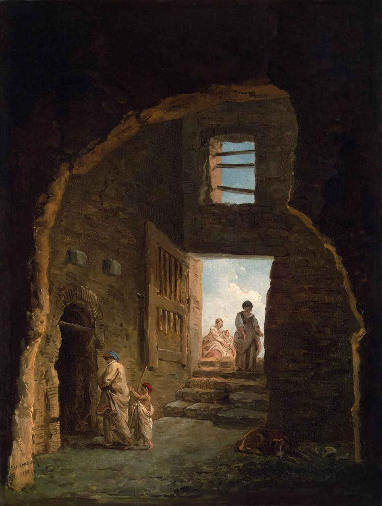

# Old Ostium

<!-- location-residents:start -->

## NPCs Currently Based Here

| NPC | Role | Faction / affiliation | Recorded current location | Status |
| --- | --- | --- | --- | --- |
| [[Characters/NPCs/Arla Gerrin\|Arla Gerrin]] | Apothecary | Not established | [[Locations/Old Ostium Hospital District\|Old Ostium Hospital District]] | alive |
| [[Characters/NPCs/Brock Drungur\|Brock Drungur]] | Senior waterworks engineer | [[Factions/Old Ostium Engineers\|Old Ostium Engineers]] | [[Locations/Old Ostium Waterworks\|Old Ostium Waterworks]] | alive |
| [[Characters/NPCs/Calev Marr\|Calev Marr]] | Protectorate quartermaster | [[Factions/The Protectorate\|The Protectorate]] | [[Locations/Old Ostium Town Hall\|Old Ostium Town Hall]] | alive |
| [[Characters/NPCs/Indra Karaf\|Indra Karaf]] | Commander of the Protectorate | [[Factions/The Protectorate\|The Protectorate]] | [[Locations/Old Ostium Town Hall\|Old Ostium Town Hall]] | alive |
| [[Characters/NPCs/Mara Voss\|Mara Voss]] | Hospital District speaker and relief administrator | [[Factions/Old Ostium Hospital District Community\|Old Ostium Hospital District Community]] | [[Locations/Old Ostium Hospital District\|Old Ostium Hospital District]] | alive |
| [[Characters/NPCs/Senn Vale\|Senn Vale]] | Pump captain; waterworks maintenance worker | [[Factions/Old Ostium Engineers\|Old Ostium Engineers]] | [[Locations/Old Ostium Pump 4\|Old Ostium Pump 4]] | alive |
| [[Characters/NPCs/Taran Lusat\|Taran Lusat]] | Civil engineer and relief benefactor | [[Factions/Old Ostium Hospital District Community\|Old Ostium Hospital District Community]] | [[Locations/Old Ostium Hospital District\|Old Ostium Hospital District]] | alive |
| [[Characters/NPCs/Ulroc Grimscar\|Ulroc Grimscar]] | Raider chief and crime lord | [[Factions/The Shattered Axe\|The Shattered Axe]] | [[Locations/Old Ostium Slums\|Old Ostium Slums]] | alive |
| [[Characters/NPCs/Vesha Noll\|Vesha Noll]] | Shattered Axe intelligence and smuggling chief; warden and scavenger | [[Factions/The Shattered Axe\|The Shattered Axe]] | [[Locations/Old Ostium Slums\|Old Ostium Slums]] | alive |

*From NPC current-location records, including contained districts and work sites. A work location is not a confirmed home. Deceased characters, unknown locations, and planned visitors are excluded; table-specific movements must be recorded before changing this list.*

<!-- location-residents:end -->

<!-- campaign-artwork:start -->

> [!gallery] Visual inspiration
> These images combine classical atmosphere with fantasy texture and scale. They are inspiration, not a map or new campaign facts.
>
> > [!artwork] Classical reference
> >
> > 
> >
> > *Modern Rome — Campo Vaccino — J. M. W. Turner. [Source](https://commons.wikimedia.org/wiki/File:JMW_Turner_-_Modern_Rome_-_Campo_Vacino.jpg) · [Public domain](https://creativecommons.org/publicdomain/mark/1.0/).*
>
> > [!artwork] Classical reference
> >
> > 
> >
> > *Inhabited Ruins — Hubert Robert. [Source](https://commons.wikimedia.org/wiki/File:Hubert_Robert_-_Inhabited_Ruins_-_WGA19584.jpg) · [Public domain](https://creativecommons.org/publicdomain/mark/1.0/).*
>
> > [!artwork] Fantasy reference
> >
> > 
> >
> > *Ishtar — layered streets — David Revoy / Blender Foundation (Sintel). [Source](https://www.davidrevoy.com/article45/sintel-art-direction) · [CC-BY-4.0](https://creativecommons.org/licenses/by/4.0/).*

<!-- campaign-artwork:end -->

## Operational Summary

**Why the party comes here:** Primary exploration zone and open-world urban dungeon\
**What is changing:** The city is moving from slow decline toward systems failure.\
**Current controlling pressure:** Rot exposure, infrastructure scarcity, local faction control.\
**Hidden danger:** The Rot is not merely a plague in the city; the city is contaminating an infected divine wound.\
**Useful NPCs:** [[Characters/NPCs/Taran Lusat|Taran Lusat]], [[Characters/NPCs/Brock Drungur|Brock Drungur]], [[Characters/NPCs/Indra Karaf|Indra Karaf]], [[Characters/NPCs/Ulroc Grimscar|Ulroc Grimscar]]\

## Secrets & Hidden History

- Old Ostium's failure causes fluid loss from the deeper circulatory system and allows sewage/contamination into the wound.
- The Rot's cognitive effects reflect its connection to the being below, whose influence historically amplified higher creative faculties without being the universal source of reason or magic.

## Faction Pressures

- Settlements tolerate Protectorate levies because alternatives are worse.
- Shattered Axe raids intensify shortages.
- Engineers are one of the few cross-faction groups everyone has reasons not to destroy.

## Hidden Areas / Access

- Service shafts and lower waterworks routes progressively connect to structures not built by the city.
- Some deep flooded routes can bypass faction checkpoints at the cost of higher Rot exposure.

## Clues & Revelations

- Repeated anatomical metaphors in engineering: chambers, pressure, pulse, flow.
- Old plans call certain structures 'legacy works' without explaining their origin.

## D&D 5e (2024) Mechanics

Use the environmental fiction above. For uncertain investigation, travel, negotiation, or repair, see [[Rules/System Guide|System Guide]]; choose checks and consequences for the actual approach. Existing Daggerheart Difficulty, damage, and tiers below are not D&D DCs or encounter ratings. Saving throws, conditions, and spell interactions require a separately defined effect, not an automatic disease rule.

## Daggerheart Environment

> Existing campaign homebrew / narrative guidance, retained independently. Check against the adopted SRD before use; no direct D&D conversion.

**Tier:** 1 initially; scale by district\
**Type:** Exploration\
**Description:** A ruined city whose civic decay, Rot, and surviving communities overlap block by block.\
**Impulses:** Isolate, flood, disorient, expose buried dependency\
**Difficulty:** 11 in early Act I districts; scale with party tier\
**Potential Adversaries:** Shattered Axe raiders, Rot-afflicted people, beasts, collapsing infrastructure\

### Features

- **Rot Pressure — Reaction:** On a Fear result during prolonged exposure, introduce an unsettling cognitive or perceptual effect, mark a narrative exposure consequence, or separate what a character perceives from what others perceive. Do not use a fixed infection track until the GM establishes one.
- **The Street Is Gone — Action:** A familiar route becomes flooded, collapsed, blocked, or controlled, forcing a choice between delay, danger, payment, or a new route.
- **Someone Still Lives Here — Passive:** Ruins should regularly reveal residents, workers, scavengers, or communities so Old Ostium never becomes an empty monster dungeon.

### Feature Questions

- Who is surviving here and what do they need?
- What evidence shows that the city is still connected to New Ostium?
- What does the Rot make someone perceive that might contain a fragment of truth?

## Encounter / Scene Ideas

- Escort through a shifting district.
- Patrol encounter with Protectorate or Shattered Axe.
- Rot phenomenon that can be interpreted as madness or signal.
- Infrastructure failure that creates a moral choice rather than just damage.

## Future Changes

- As acts progress, lower districts should become stranger and more organic in implication.

## PC Knowledge — Recorded Overview

Old Ostium is the failing former capital of Ostium. It remains inhabited despite its decay, flooding, the danger of the Rot, and other hazards.

It remains a place of survival, labour, and danger, with a complex relationship to the safer and wealthier [[Locations/New Ostium|New Ostium]].
