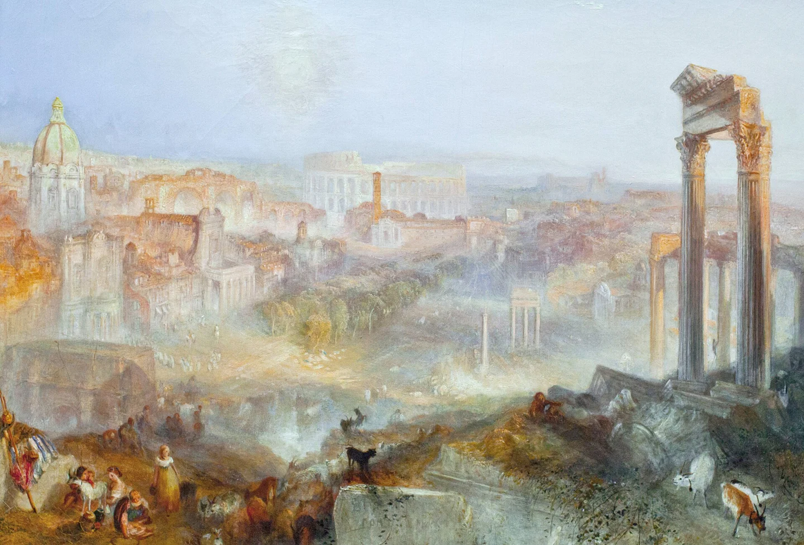
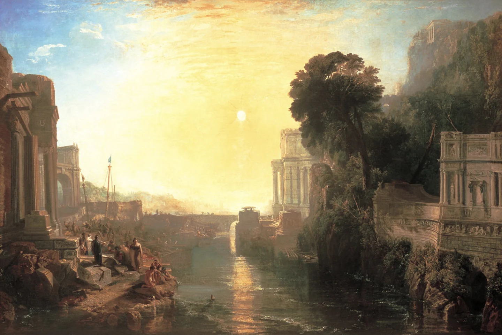

# Ostium

<!-- campaign-artwork:start -->

*Visual reference: Modern Rome — Campo Vaccino — J. M. W. Turner. [Public domain](https://creativecommons.org/publicdomain/mark/1.0/); [source](https://commons.wikimedia.org/wiki/File:JMW_Turner_-_Modern_Rome_-_Campo_Vacino.jpg). [[Attachments/Artwork Credits|Credits and interpretation]].*

<!-- campaign-artwork:end -->

## Operational Summary

**Why the party comes here:** Campaign hub and frame for the entire story\
**What is changing:** The material interdependence between Old and New Ostium is becoming impossible to ignore.\
**Current controlling pressure:** Scarcity, Rot, faction rivalry, and failing infrastructure.\
**Hidden danger:** The deepest systems under Ostium are not merely civic engineering.\
**Useful NPCs:** [[Characters/NPCs/Helena Orst|Helena Orst]], [[Characters/NPCs/Brock Drungur|Brock Drungur]]\

## Secrets & Hidden History

- The city's extraordinary historic prosperity was unknowingly amplified by the life force of the being beneath it.
- The municipal waterworks ultimately interface with ancient Titan-built structures and the interred god's circulatory system.
- The city's decline is not simply a civic collapse; it has become a physical wound and infection in something far older.

## Faction Pressures

- [[Factions/New Ostium Government|New Ostium Government]] wants stability and bounded responsibility.
- [[Factions/Old Ostium Engineers|Old Ostium Engineers]] preserve interdependence in practice.
- [[Factions/The Protectorate|The Protectorate]] and [[Factions/The Shattered Axe|The Shattered Axe]] fill the power vacuum in Old Ostium.

## Hidden Areas / Access

- Deeper layers descend from ordinary municipal systems toward [[Locations/Titan Works|Titan Works]] and eventually [[Locations/The Heart|The Heart]].

<!-- campaign-artwork:start -->

*Visual reference: Dido Building Carthage — J. M. W. Turner. [Public domain](https://creativecommons.org/publicdomain/mark/1.0/); [source](https://commons.wikimedia.org/wiki/File:Dido_building_Carthage_-_JMW_Turner.jpg). [[Attachments/Artwork Credits|Credits and interpretation]].*

<!-- campaign-artwork:end -->

## Clues & Revelations

- Maps or construction records stop making sense below certain depths.
- The same systems that keep Ostium alive can look disturbingly anatomical once the party reaches older layers.

## D&D 5e (2024) Mechanics

Use the environmental fiction above. For uncertain investigation, travel, negotiation, or repair, see [[Rules/System Guide|System Guide]]; choose checks and consequences for the actual approach. Existing Daggerheart Difficulty, damage, and tiers below are not D&D DCs or encounter ratings. Saving throws, conditions, and spell interactions require a separately defined effect, not an automatic disease rule.

## Daggerheart Environment

> Existing campaign homebrew / narrative guidance, retained independently. Check against the adopted SRD before use; no direct D&D conversion.

**Tier:** Variable\
**Type:** Campaign environment / mixed\
**Description:** A divided city built over a hidden divine wound.\
**Impulses:** Divide, depend, descend, reveal buried connections\
**Difficulty:** Use scene tier\
**Potential Adversaries:** Faction agents, Rot-afflicted inhabitants, beasts, civic hazards\

### Features

- **Two Cities, One System — Passive:** Whenever a major infrastructure choice clearly benefits one side, identify the cost or dependency it creates for the other.
- **The Door Opens Downward — Reaction:** When the party solves a surface problem with Fear or a major complication, reveal a clue that the problem connects to an older/deeper layer rather than merely escalating the same obstacle.

### Feature Questions

- What looks separate politically but remains physically connected?
- Which civic problem is actually a symptom of the deeper wound?

## Encounter / Scene Ideas

- Cross-wall negotiations.
- Competing claims over a shared resource.
- A familiar municipal space opening onto something impossibly old.

## Future Changes

- Act I makes the interdependence concrete through Pump 7.
- Act II shifts attention beneath the municipal works.
- Act III reaches the Heart and the infection itself.

## PC Knowledge — Recorded Overview

Ostium was once a great city, but it is now divided between the failing former capital of [[Locations/Old Ostium|Old Ostium]] and the functioning successor city of [[Locations/New Ostium|New Ostium]].

The two cities remain linked by practical necessity even while their relationship is tense and often difficult.
