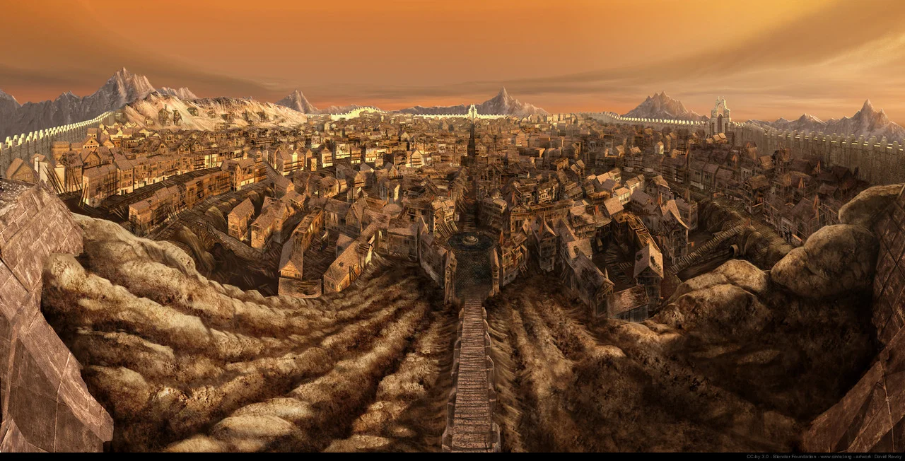
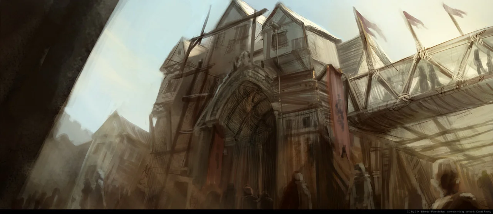

# Ostium

<!-- page-summary:start -->

A divided city whose old and new halves share failing infrastructure, unequal resources, and a wounded divine being buried beneath them.

<!-- page-summary:end -->

## Operational Summary

**Why the party comes here:** Campaign hub and frame for the entire story\
**What is changing:** The material interdependence between Old and New Ostium is becoming impossible to ignore.\
**Current controlling pressure:** Scarcity, Rot, faction rivalry, and failing infrastructure.\
**Hidden danger:** The deepest systems under Ostium are not merely civic engineering.\
**Useful NPCs:** [[Characters/NPCs/Helena Orst|Helena Orst]], [[Characters/NPCs/Brock Drungur|Brock Drungur]]\

<!-- page-connections:start -->

## Connected Pages

| Connection | Follow links |
| --- | --- |
| People | [[Characters/NPCs/Brock Drungur\|Brock Drungur]] · [[Characters/NPCs/Helena Orst\|Helena Orst]] |
| Locations | [[Locations/New Ostium\|New Ostium]] · [[Locations/Old Ostium\|Old Ostium]] · [[Locations/The Heart\|The Heart]] · [[Locations/Titan Works\|Titan Works]] |
| Factions | [[Factions/New Ostium Government\|New Ostium Government]] · [[Factions/Old Ostium Engineers\|Old Ostium Engineers]] · [[Factions/The Protectorate\|The Protectorate]] · [[Factions/The Shattered Axe\|The Shattered Axe]] |
| Contained locations | [[Locations/New Ostium\|New Ostium]] · [[Locations/Old Ostium\|Old Ostium]] |

### Adventures & Encounters

| Adventure / state | Situation |
| --- | --- |
| [[Storylines/Adventures/The Road to Ostium\|The Road to Ostium]] — prepared | A prepared caravan journey and city investigation opening several routes to Frigid Woe antidote through danger, medical referrals, and negotiation. |

> [!example]- Session references
> A link records a mention, not proof of an appearance or revelation. Read each report for actual outcomes.
>
> | Record | Table | State |
> | --- | --- | --- |
> | [[Session Logs/Oliver's Table/Session 2\|Session 2 — The Road to Ostium — Preparation]] | Oliver's Table | planned |
> | [[Session Logs/Session 0 Prep\|Session 0 Prep]] | Unassigned | Planned |

<!-- page-connections:end -->

<!-- location-residents:start -->

## NPCs Currently Based Here

| NPC | Role | Faction / affiliation | Recorded current location | Status |
| --- | --- | --- | --- | --- |
| [[Characters/NPCs/Arla Gerrin\|Arla Gerrin]] | Apothecary | Not established | [[Locations/Old Ostium Hospital District\|Old Ostium Hospital District]] | alive |
| [[Characters/NPCs/Brock Drungur\|Brock Drungur]] | Senior waterworks engineer | [[Factions/Old Ostium Engineers\|Old Ostium Engineers]] | [[Locations/Old Ostium Waterworks\|Old Ostium Waterworks]] | alive |
| [[Characters/NPCs/Calev Marr\|Calev Marr]] | Protectorate quartermaster | [[Factions/The Protectorate\|The Protectorate]] | [[Locations/Old Ostium Town Hall\|Old Ostium Town Hall]] | alive |
| [[Characters/NPCs/Dalia Quent\|Dalia Quent]] | Guildmaster; broker and fixer | [[Factions/New Ostium Merchants Guild\|New Ostium Merchants Guild]] | [[Locations/New Ostium Market District\|New Ostium Market District]] | alive |
| [[Characters/NPCs/Egbert Lusat\|Egbert Lusat]] | Wealthy merchant and former Old Ostium resident | Not established | [[Locations/New Ostium\|New Ostium]] | alive |
| [[Characters/NPCs/Helena Orst\|Helena Orst]] | First Councillor; civil administrator | [[Factions/New Ostium Government\|New Ostium Government]] | [[Locations/New Ostium Town Hall\|New Ostium Town Hall]] | alive |
| [[Characters/NPCs/Indra Karaf\|Indra Karaf]] | Commander of the Protectorate | [[Factions/The Protectorate\|The Protectorate]] | [[Locations/Old Ostium Town Hall\|Old Ostium Town Hall]] | alive |
| [[Characters/NPCs/Mara Voss\|Mara Voss]] | Hospital District speaker and relief administrator | [[Factions/Old Ostium Hospital District Community\|Old Ostium Hospital District Community]] | [[Locations/Old Ostium Hospital District\|Old Ostium Hospital District]] | alive |
| [[Characters/NPCs/Orla Meren\|Orla Meren]] | Public servant and clerk | Not established | [[Locations/New Ostium\|New Ostium]] | alive |
| [[Characters/NPCs/Senn Vale\|Senn Vale]] | Pump captain; waterworks maintenance worker | [[Factions/Old Ostium Engineers\|Old Ostium Engineers]] | [[Locations/Old Ostium Pump 4\|Old Ostium Pump 4]] | alive |
| [[Characters/NPCs/Shanda Karth\|Shanda Karth]] | Apothecary | Not established | [[Locations/New Ostium\|New Ostium]] | alive |
| [[Characters/NPCs/Taran Lusat\|Taran Lusat]] | Civil engineer and relief benefactor | [[Factions/Old Ostium Hospital District Community\|Old Ostium Hospital District Community]] | [[Locations/Old Ostium Hospital District\|Old Ostium Hospital District]] | alive |
| [[Characters/NPCs/Trine Baradur\|Trine Baradur]] | Guild acquisition factor; merchant and broker | [[Factions/New Ostium Merchants Guild\|New Ostium Merchants Guild]] | [[Locations/New Ostium Market District\|New Ostium Market District]] | alive |
| [[Characters/NPCs/Ulroc Grimscar\|Ulroc Grimscar]] | Raider chief and crime lord | [[Factions/The Shattered Axe\|The Shattered Axe]] | [[Locations/Old Ostium Slums\|Old Ostium Slums]] | alive |
| [[Characters/NPCs/Vesha Noll\|Vesha Noll]] | Shattered Axe intelligence and smuggling chief; warden and scavenger | [[Factions/The Shattered Axe\|The Shattered Axe]] | [[Locations/Old Ostium Slums\|Old Ostium Slums]] | alive |

*From NPC current-location records, including contained districts and work sites. A work location is not a confirmed home. Deceased characters, unknown locations, and planned visitors are excluded; table-specific movements must be recorded before changing this list.*

<!-- location-residents:end -->

<!-- campaign-artwork:start -->

> [!gallery]- Visual inspiration
> These images combine classical atmosphere with fantasy texture and scale. They are inspiration, not a map or new campaign facts.
>
> > [!artwork] Classical reference
> >
> > 
> >
> > *Modern Rome — Campo Vaccino — J. M. W. Turner. [Source](https://commons.wikimedia.org/wiki/File:JMW_Turner_-_Modern_Rome_-_Campo_Vacino.jpg) · [Public domain](https://creativecommons.org/publicdomain/mark/1.0/).*
>
> > [!artwork] Classical reference
> >
> > 
> >
> > *Dido Building Carthage — J. M. W. Turner. [Source](https://commons.wikimedia.org/wiki/File:Dido_building_Carthage_-_JMW_Turner.jpg) · [Public domain](https://creativecommons.org/publicdomain/mark/1.0/).*
>
> > [!artwork] Fantasy reference
> >
> > 
> >
> > *Ishtar — city panorama — David Revoy / Blender Foundation (Sintel). [Source](https://www.davidrevoy.com/article45/sintel-art-direction) · [CC-BY-4.0](https://creativecommons.org/licenses/by/4.0/).*
>
> > [!artwork] Fantasy reference
> >
> > 
> >
> > *Ishtar — layered streets — David Revoy / Blender Foundation (Sintel). [Source](https://www.davidrevoy.com/article45/sintel-art-direction) · [CC-BY-4.0](https://creativecommons.org/licenses/by/4.0/).*

<!-- campaign-artwork:end -->

## Secrets & Hidden History

- The city's extraordinary historic prosperity was unknowingly amplified by the life force of the being beneath it.
- The municipal waterworks ultimately interface with ancient Titan-built structures and the interred god's circulatory system.
- The city's decline is not simply a civic collapse; it has become a physical wound and infection in something far older.

## Faction Pressures

- [[Factions/New Ostium Government|New Ostium Government]] wants stability and bounded responsibility.
- [[Factions/Old Ostium Engineers|Old Ostium Engineers]] preserve interdependence in practice.
- [[Factions/The Protectorate|The Protectorate]] and [[Factions/The Shattered Axe|The Shattered Axe]] fill the power vacuum in Old Ostium.

## Hidden Areas / Access

- Deeper layers descend from ordinary municipal systems toward [[Locations/Titan Works|Titan Works]] and eventually [[Locations/The Heart|The Heart]].

## Clues & Revelations

- Maps or construction records stop making sense below certain depths.
- The same systems that keep Ostium alive can look disturbingly anatomical once the party reaches older layers.

## D&D 5e (2024) Mechanics

Use the environmental fiction above. For uncertain investigation, travel, negotiation, or repair, see [[Rules/System Guide|System Guide]]; choose checks and consequences for the actual approach. Existing Daggerheart Difficulty, damage, and tiers below are not D&D DCs or encounter ratings. Saving throws, conditions, and spell interactions require a separately defined effect, not an automatic disease rule.

## Daggerheart Environment

> Existing campaign homebrew / narrative guidance, retained independently. Check against the adopted SRD before use; no direct D&D conversion.

**Tier:** Variable\
**Type:** Campaign environment / mixed\
**Description:** A divided city built over a hidden divine wound.\
**Impulses:** Divide, depend, descend, reveal buried connections\
**Difficulty:** Use scene tier\
**Potential Adversaries:** Faction agents, Rot-afflicted inhabitants, beasts, civic hazards\

### Features

- **Two Cities, One System — Passive:** Whenever a major infrastructure choice clearly benefits one side, identify the cost or dependency it creates for the other.
- **The Door Opens Downward — Reaction:** When the party solves a surface problem with Fear or a major complication, reveal a clue that the problem connects to an older/deeper layer rather than merely escalating the same obstacle.

### Feature Questions

- What looks separate politically but remains physically connected?
- Which civic problem is actually a symptom of the deeper wound?

## Encounter / Scene Ideas

- Cross-wall negotiations.
- Competing claims over a shared resource.
- A familiar municipal space opening onto something impossibly old.

## Future Changes

- Act I makes the interdependence concrete through Pump 7.
- Act II shifts attention beneath the municipal works.
- Act III reaches the Heart and the infection itself.

## PC Knowledge — Recorded Overview

Ostium was once a great city, but it is now divided between the failing former capital of [[Locations/Old Ostium|Old Ostium]] and the functioning successor city of [[Locations/New Ostium|New Ostium]].

The two cities remain linked by practical necessity even while their relationship is tense and often difficult.
