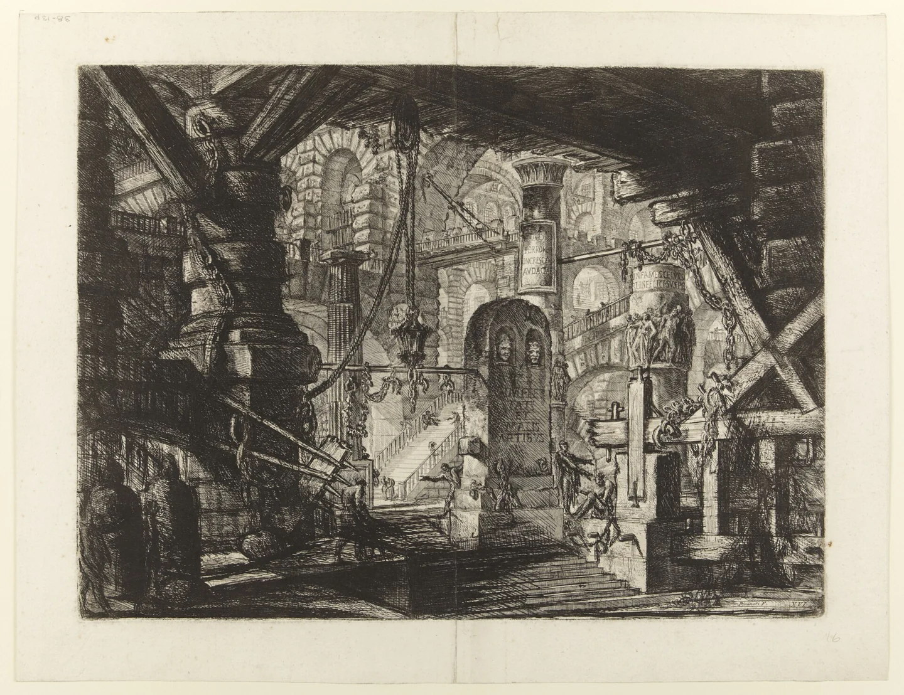
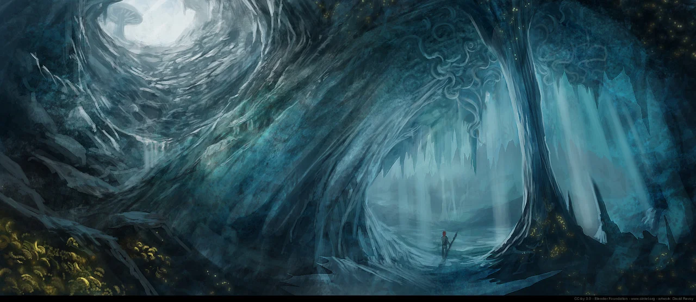

# Titan Works

<!-- page-summary:start -->

Ancient structures beneath the waterworks that bind, route, and stabilize the captive being whose vitality helped Ostium flourish.

<!-- page-summary:end -->

<!-- campaign-artwork:start -->

> [!gallery]- Visual inspiration
> These images combine classical atmosphere with fantasy texture and scale. They are inspiration, not a map or new campaign facts.
>
> > [!artwork] Classical reference
> >
> > 
> >
> > *Le Carceri d’Invenzione: The Pier with Chains, second edition — Giovanni Battista Piranesi. [Source](https://commons.wikimedia.org/wiki/File:Giovanni_Battista_Piranesi_-_Le_Carceri_d%27Invenzione_-_Second_Edition_-_1761_-_16_-_The_Pier_with_Chains.jpg) · [Public domain](https://creativecommons.org/publicdomain/mark/1.0/).*
>
> > [!artwork] Fantasy reference
> >
> > 
> >
> > *Ishtar — abandoned temple — David Revoy / Blender Foundation (Sintel). [Source](https://www.davidrevoy.com/article45/sintel-art-direction) · [CC-BY-4.0](https://creativecommons.org/licenses/by/4.0/).*
>
> > [!artwork] Fantasy reference
> >
> > 
> >
> > *Sintel — dragon cave concept — David Revoy / Blender Foundation (Sintel). [Source](https://www.davidrevoy.com/article45/sintel-art-direction) · [CC-BY-4.0](https://creativecommons.org/licenses/by/4.0/).*

<!-- campaign-artwork:end -->

## Operational Summary

**Why the party comes here:** Act II deep infrastructure exploration and first sustained contact with the pre-Ostium system\
**What is changing:** Municipal collapse and infection are stressing structures that were built to bind, route, and stabilize something alive.\
**Current controlling pressure:** Ancient mechanisms, Rot manifestations, and the danger of misreading their purpose.\
**Hidden danger:** The Works are simultaneously prison architecture, siphoning/distribution infrastructure, and wound management at a scale where all three can be true.\

<!-- page-connections:start -->

## Connected Pages

Location links are document references; geographic containment is shown in the Within and Contained locations rows.

| Connection | Follow links |
| --- | --- |
| Within | [[Locations/Old Ostium Waterworks\|Old Ostium Waterworks]] |
| Referenced locations | [[Locations/The Heart\|The Heart]] |
| Contained locations | [[Locations/The Heart\|The Heart]] |

### Adventures & Encounters

| Adventure / state | Situation |
| --- | --- |
| [[Storylines/Adventures/Pump 7\|Pump 7]] — prepared | A prepared infrastructure crisis offering alternatives to a choice that merely shifts catastrophe between Old and New Ostium. |

<!-- page-connections:end -->

<!-- location-residents:start -->

## NPCs Currently Based Here

| NPC | Role | Faction / affiliation | Recorded current location | Status |
| --- | --- | --- | --- | --- |
| None recorded | — | — | — | — |

*From NPC current-location records, including contained districts and work sites. A work location is not a confirmed home. Deceased characters, unknown locations, and planned visitors are excluded; table-specific movements must be recorded before changing this list.*

<!-- location-residents:end -->

## Secrets & Hidden History

- The Titans captured an ancient/outer/old god and gravely wounded it.
- They built immense structures around the being. These can function as chains/manacles, siphons or needles routing its vitality through the land, and bandage-like supports stabilizing the wounds they inflicted.
- Later Ostium engineers built civic systems into and over these works without understanding their full nature.

## Faction Pressures

- Modern factions do not control this place in any stable way.
- Engineers may have partial maps or inherited terminology but no complete doctrine.

## Hidden Areas / Access

- Great braces, conduits, seal structures, pressure chambers, and repair-like assemblies lead toward [[Locations/The Heart|The Heart]].

## Clues & Revelations

- The same feature can look like a shackle from one angle and a medical brace from another.
- Flow routes outward from the captive being as well as back toward it.
- Old Ostium's waterworks diagrams map only the interfaces humans added.

## D&D 5e (2024) Mechanics

Use the environmental fiction above. For uncertain investigation, travel, negotiation, or repair, see [[Rules/System Guide|System Guide]]; choose checks and consequences for the actual approach. Existing Daggerheart Difficulty, damage, and tiers below are not D&D DCs or encounter ratings. Saving throws, conditions, and spell interactions require a separately defined effect, not an automatic disease rule.

## Daggerheart Environment

> Existing campaign homebrew / narrative guidance, retained independently. Check against the adopted SRD before use; no direct D&D conversion.

**Tier:** 2-3, scaled to party\
**Type:** Exploration / Traversal\
**Description:** Titan-scale bindings and life-support works surrounding a wounded interred god.\
**Impulses:** Bind, siphon, stabilize, dwarf, expose purpose\
**Difficulty:** Use current-tier benchmark\
**Potential Adversaries:** Rot/infection entities, ancient defensive responses, environmental hazards\

### Features

- **Prison or Bandage? — Passive:** Every major structure should support at least two plausible interpretations until enough evidence accumulates.
- **Scale Without Humans — Action:** A mechanism moves or changes pressure on a timescale and scale that makes human engineering feel incidental.
- **Borrowed Vitality — Reaction:** When the party successfully activates or repairs an ancient system with Fear, let it work while revealing that the energy has been drawn from somewhere living.

### Feature Questions

- Was this built to punish, exploit, save, or all three?
- What part of the structure is actually touching living tissue?
- What would fail if a binding were simply destroyed?

## Encounter / Scene Ideas

- Traverse a Titan-scale conduit.
- Repair a stabilizer whose function the party only partly understands.
- Discover evidence that the system feeds the wider land/city with borrowed vitality.

## Future Changes

- The party should move from 'there is ancient infrastructure' to 'there is a living captive beneath us' before or as they reach the Heart.

## PC Knowledge

_No encounter or revelation recorded yet; this is a continuity note, not a publishing restriction._
