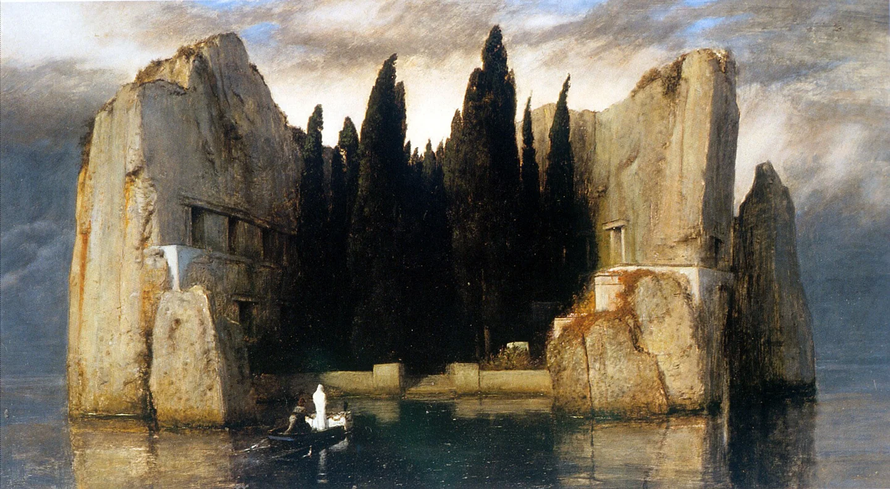
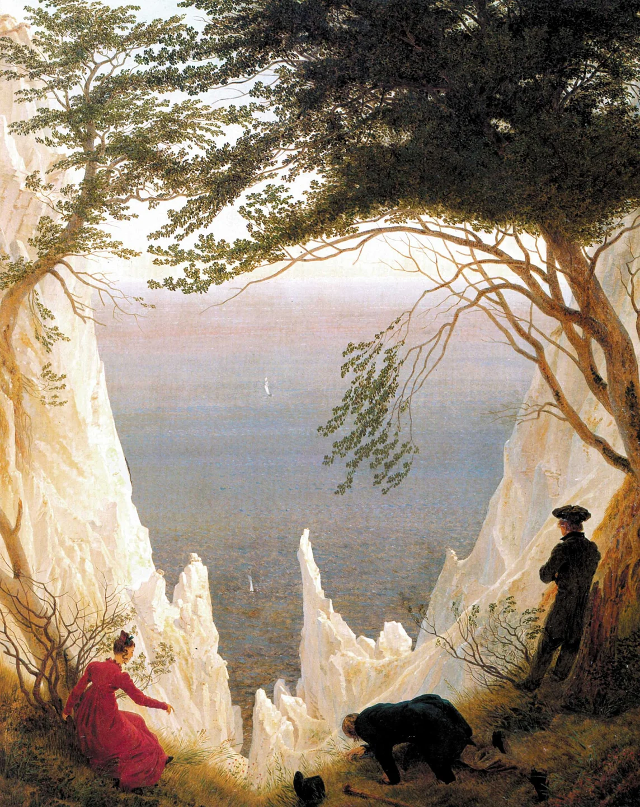
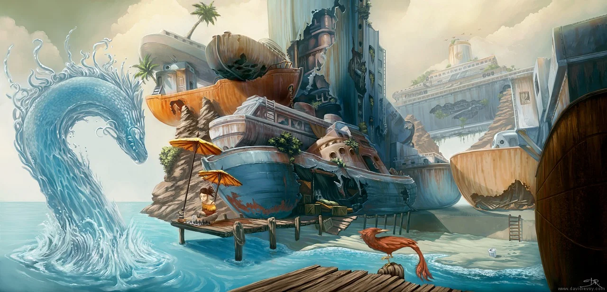

# Torney Isles

<!-- page-summary:start -->

Islands near Mistbreak on the northern coast, far from Ostium, once inhabited by the Auren and important to the Frigid Woe antidote search.

<!-- page-summary:end -->

<!-- page-connections:start -->

## Connected Pages

Location links are document references; geographic containment is shown in the Within and Contained locations rows.

| Connection | Follow links |
| --- | --- |
| People | [[Characters/NPCs/Veritas\|Veritas]] |
| Referenced locations | [[Locations/Mistbreak\|Mistbreak]] |
| Campaign & lore | [[Creatures and Afflictions/Frigid Woe\|Frigid Woe]] · [[World Lore/Auren Culture\|Auren Culture]] |

> [!example]- Session references
> A link records a mention, not proof of an appearance or revelation. Read each report for actual outcomes.
>
> | Record | Table | State |
> | --- | --- | --- |
> | [[Session Logs/Steven's Table/Session 4\|Session 4 — To the Torney Isles]] | Steven's Table | completed |
> | [[Session Logs/Steven's Table/Session 5\|Session 5 — The Antidote Retrieved]] | Steven's Table | completed |

<!-- page-connections:end -->

<!-- location-residents:start -->

## NPCs Currently Based Here

| NPC | Role | Faction / affiliation | Recorded current location | Status |
| --- | --- | --- | --- | --- |
| None recorded | — | — | — | — |

*From NPC current-location records, including contained districts and work sites. A work location is not a confirmed home. Deceased characters, unknown locations, and planned visitors are excluded; table-specific movements must be recorded before changing this list.*

<!-- location-residents:end -->

<!-- campaign-artwork:start -->

> [!gallery]- Visual inspiration
> These images combine classical atmosphere with fantasy texture and scale. They are inspiration, not a map or new campaign facts.
>
> > [!artwork] Classical reference
> >
> > 
> >
> > *Island of the Dead, third version — Arnold Böcklin. [Source](https://commons.wikimedia.org/wiki/File:Arnold_Boecklin_-_Island_of_the_Dead,_Third_Version.JPG) · [Public domain](https://creativecommons.org/publicdomain/mark/1.0/).*
>
> > [!artwork] Classical reference
> >
> > 
> >
> > *Chalk Cliffs on Rügen — Caspar David Friedrich. [Source](https://commons.wikimedia.org/wiki/File:Caspar_David_Friedrich%27s_Chalk_Cliffs_on_R%C3%BCgen.jpg) · [Public domain](https://creativecommons.org/publicdomain/mark/1.0/).*
>
> > [!artwork] Fantasy reference
> >
> > 
> >
> > *Boat City — David Revoy. [Source](https://www.davidrevoy.com/article144/boat-city) · [CC-BY-4.0](https://creativecommons.org/licenses/by/4.0/).*

<!-- campaign-artwork:end -->

- Islands off the northern coast, near the independent town of [[Locations/Mistbreak|Mistbreak]], far north of Ostium. This northern setting is outside Ostium’s city districts and jurisdiction; local political details remain TBD.
- Formerly inhabited by the ancient [[World Lore/Auren Culture|Auren Culture]], a civilization that battled the gods.

## Secrets & Hidden History

- The Auren developed or employed [[Creatures and Afflictions/Frigid Woe|Frigid Woe]] as a weapon against the gods' warriors.
- It was designed to cause suffering or wounds that divine healing could not cure.
- This history may reveal limitations of divine power; wider theological conclusions remain unresolved.

## Suggested Exploration — Tentative

- Abandoned Auren structures, arcane/alchemical traces, or surviving fragments of writing and artifacts.
- An ancient laboratory, armory, or magical research facility as a possible origin site.
- [[Characters/NPCs/Veritas|Veritas]] may have researched the islands before his death; **not established canon**.

## Clues & Revelations

- Exact records, artifacts, accessibility, and surviving witnesses: TBD.
- No established connection between the Auren, the Rot, or the buried god.

## D&D 5e (2024) Mechanics

Use the environmental fiction above. For uncertain investigation, travel, negotiation, or repair, see [[Rules/System Guide|System Guide]]; choose checks and consequences for the actual approach. Existing Daggerheart Difficulty, damage, and tiers below are not D&D DCs or encounter ratings. Saving throws, conditions, and spell interactions require a separately defined effect, not an automatic disease rule.

## Daggerheart Environment

> Existing campaign homebrew / narrative guidance, retained independently. Check against the adopted SRD before use; no direct D&D conversion.

- Exploration / Traversal if visited; prepare local obstacles once the party chooses this path.

## PC Knowledge

_No encounter or revelation recorded yet; this is a continuity note, not a publishing restriction._
